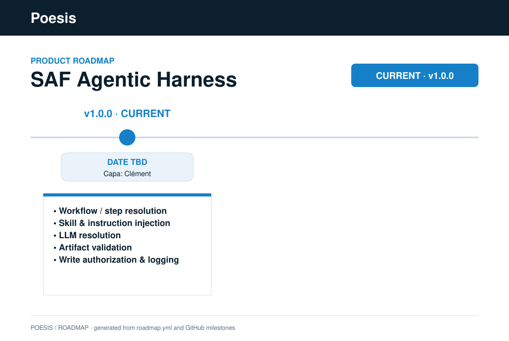

# Agentic Harness

[](https://github.com/poesis-cloud/saf-agentic-harness/actions/workflows/ci.yaml)
[](https://github.com/poesis-cloud/saf-agentic-harness/releases/latest)
[](.github/workflows/ci.yaml)
[](LICENSE)

The harness is the deterministic execution core of an agentic framework: it resolves steps,
models, and agents' session context (instructions and skills — injected at session open),
checks steps' conditions, authorization, and artifacts, and logs all of it —
deterministically, from persisted state and validated configuration only. The harness core
is fully host-agnostic; host-specific bindings live in separate adapter specifications.

The canonical harness-core specification — terminology, invariants, the twelve-function
contract, design, and implementation — lives in **[`def/core/spec.md`](def/core/spec.md)**.
Read that first; this file is
only an orientation pointer. Each host binding has its own specification under
`def/adapter/<host>/spec.md`. Today there is one,
[`github-copilot`](def/adapter/github-copilot/spec.md): the GitHub Copilot agent runtime that
the Copilot CLI, the Copilot app and VS Code (Session Target: Copilot) share.

## Install

Users install the harness as the Copilot plugin **`poesis-saf-agentic-harness`** (Agent Plugins
1.0), beside their framework's plugin, from the marketplace `poesis-cloud/saf-marketplace`:

```bash
copilot plugin marketplace add poesis-cloud/saf-marketplace
copilot plugin install poesis-saf-agentic-harness@poesis-saf
```

The Copilot app and VS Code install from the same marketplace; VS Code needs **Session Target:
Copilot**. The first session provisions the harness requirements from the plugin's hash-locked
`requirements.lock`. A folder is governed when its Git top-level holds a committed
`.saf/workspace.yaml` naming the framework. Full steps, settings and the developer install are
in [`adapters/github-copilot/README.md`](adapters/github-copilot/README.md).

## SAF context

This repository is the **engine** product of the Systemic Agentic Framework (SAF). It knows
nothing about any particular methodology: the embedding framework and the data plane are
supplied to it as environment-anchored paths (`FRAMEWORK_DIR`, `FRAMEWORK_WORKSPACE_DIR`).

- [`saf-agentic-organization`](https://github.com/poesis-cloud/saf-agentic-organization) —
  the SAFe-shaped framework application (agents, skills, workflows, instructions, artifacts,
  templates) that embeds this harness.
- [`saf-agentic-workspace`](https://github.com/poesis-cloud/saf-agentic-workspace) — the shared data
  plane the harness reads, checks, and commits into.

## Layout

- `def/` — `harness.sd.puml`, the sequence diagram spanning one workflow instance across
  framework user, orchestrator agent, step subagents, host, and harness. It sits above
  `core/` and `adapter/` because it depicts host-mediated steps (hooks, dispatch) alongside
  the host-agnostic ones, so it is not core-only.
- `def/core/` — the harness-core specification (`spec.md`) and its class diagram
  (`harness-src-classes.puml`) — `src/` only, host-blind.
- `def/adapter/<host>/` — one specification + class diagram per host binding
  (`github-copilot/`).
- `adapters/` — host-specific bindings (`github-copilot/`, with its plugin renderer).
- `contracts/` — JSON Schema contracts for configuration, artifacts, and the journal.
- `src/` — the Python implementation; `harness.py` at the root is its entry point
  (`python3 harness.py <function> [flags]`).
- `tests/` — the unit (`tests/unit/`) and functional (`tests/functional/`) planes; the adapter
  and its plugin are tested in both.

## Requirements

- Python 3.10 or newer (CI runs 3.10–3.13).
- Runtime: `pip install -r requirements.txt` (cel-python, jsonschema, PyYAML, packaging). Tests
  additionally need `pip install -r requirements-dev.txt`. The plugin provisions these itself.
- **Git ≥ 2.38** on `PATH`: step transactions rebase in memory with
  `git merge-tree --write-tree` ([Workspace Git plane](def/core/spec.md#workspace-git-plane)).
- **A Git identity in the governed workspace** (`git config user.name` and
  `git config user.email` in the workspace repository, or globally): the harness commits
  every validated write onto its step ref and replays step commits on promotion, so Git must
  be able to name the committer. The harness's `refs/harness/*` refs (step refs, artifact
  locks) are local-only: Git's default refspecs never push or fetch them.
- **A compatible framework:** the framework declares the harness versions it supports in
  `conf/harness.conf.yaml` (`require: ">=1.0.0a2,<1.1"`, a PEP 440 range); the harness refuses
  any other version at load ("requires harness <range>; installed <version>"). The installed
  version is [`VERSION`](VERSION).
- Developer install only: the interpreter that runs the hooks must have `requirements.txt`
  installed. `make install-hooks` records that absolute interpreter (`HARNESS_PYTHON`,
  defaulting to the interpreter running the installer, i.e. `PYTHON`) into every rendered
  hook entry, and refuses to render if the interpreter cannot import the requirements.

## Validation

```bash
make verify       # the full pytest suite (unit + functional planes); CI runs this
make unit         # the unit plane only (tests/unit)
make functional   # the functional plane only (tests/functional)
make plugin       # render the harness plugin into build/plugin (needs uv for the lock)
```

`make test` is an alias for `make verify`;
`make install-hooks FRAMEWORK_DIR=<framework> BUNDLE_DIR=<bundle>` is the developer install of
the hooks into a framework bundle. See the [`Makefile`](Makefile) for what each target runs and the
[TDD plan](def/tdd-plan.md) for the test layout.

## Recovering an interrupted workflow instance

**Symptom.** `resolve-step` answers `state-error` with code `workflow-instance-busy`, and
the workflow instance stays stuck.

**Cause.** The host interrupted a run (a crash, a force-quit, a killed terminal) while an
orchestrator session held an unfinished step resolution, and that session's end was never
observed. Ending a session is best-effort ([C8](def/core/spec.md#c8---session-ending)), so the
harness still counts that session as the instance's live driver and refuses every other
orchestrator session (function 3, invariant 10).

**Find the holder.** The error message names the holding orchestrator session and prints the
exact command that ends it, with the effective framework layout set in its environment. In a
POSIX shell, for example:

```text
… run: FRAMEWORK_DIR=/path/to/framework FRAMEWORK_WORKSPACE_DIR=/path/to/framework/workspace … /path/to/.venv/bin/python /path/to/harness.py end-session --session-id=<holder id>
```

On Windows it is rendered for PowerShell instead:

```text
… run: $env:FRAMEWORK_DIR='C:\path\to\framework'; … & 'C:\path\to\.venv\Scripts\python.exe' 'C:\path\to\harness.py' 'end-session' '--session-id=<holder id>'
```

**Recover.** Only if that session is really gone, run the printed command from your own
terminal, as printed. Then retry: the next orchestrator session continues the workflow
instance and re-resolves its unfinished step.

**Why this is safe.** `end-session` only appends the session's ending entry to that session's
log. Every later call from the ended session is refused (`session-ended`, C8 — fail closed),
so even if it was in fact still alive, it can no longer resolve, gate, or conclude a step: the
new orchestrator session is the instance's only driver.

<!-- roadmap:start -->
## Roadmap



<!-- roadmap:end -->
