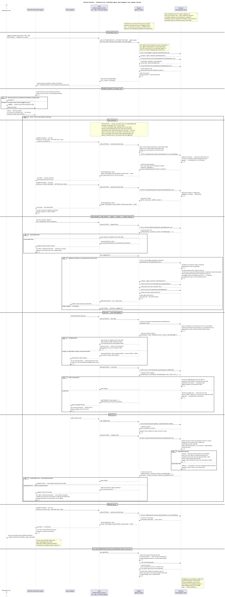

# Agentic Harness

The harness is the deterministic execution core of an agentic framework. It owns:

- resolution of step, workflow, and model,
- checking of step's conditions, authorization, and artifacts,
- resolution of agent's instructions and skills — the context injected into sessions
  at session and step start,
- logging of all that.

Agents stay limited to the irreducible work: generating content, judging within a step, and actuating host tools.

The harness does not orchestrate: the **orchestrator agent** orchestrates (converses with the
user, starts workflows on assent, dispatches subagent's steps). The harness **resolves, checks, and records** — deterministically, from persisted state and validated configuration only.

The harness is methodology-agnostic and host-agnostic: it knows nothing of SAFe, Scrum, or any
other methodology, and nothing of GitHub Copilot, VS Code, or any other host. It consumes generic
workflow definitions, artifact schemas, an ACL, and a model catalog supplied by the framework
that embeds it. Methodology-specific concepts live in the framework's skills, artifact schemas,
and workflow configs; host-specific concepts live entirely outside this specification — this
document is fully agnostic to how it is invoked and never needs to describe that mechanism.

This document is the canonical harness specification: **the functions section is the functional
contract** (it changes only by explicit design decision, never by refactoring), and the design
and implementation parts prescribe its realization.

## Summary

- [Terminology](#terminology) — the shared nouns: framework, workspace, artifact, log,
  session, orchestrator, workflow, workflow instance, step, step instance, step ref,
  artifact lock, promotion — and the definition / execution / session distinction.
- [The harness functions](#the-harness-functions) — the functional contract: twelve functions,
  numbered and ordered as they sequence in the diagram, each specified by its interface (with
  JSON I/O contract), pre/postconditions, and invariants.
  - Session (0, 11): [`start-session`](#0-start-session) · [`end-session`](#11-end-session)
  - Workflow context (1–2): [`resolve-workflow-instructions`](#1-resolve-workflow-instructions) ·
    [`resolve-workflow-skills`](#2-resolve-workflow-skills)
  - Resolution (3–4): [`resolve-step`](#3-resolve-step) ·
    [`resolve-step-model`](#4-resolve-step-model)
  - Step (5–10): [`check-step-preconditions`](#5-check-step-preconditions) ·
    [`resolve-step-instructions`](#6-resolve-step-instructions) ·
    [`resolve-step-skills`](#7-resolve-step-skills) ·
    [`check-step-authorization`](#8-check-step-authorization) ·
    [`check-step-artifact`](#9-check-step-artifact) ·
    [`check-step-postconditions`](#10-check-step-postconditions)
  - [Internal validation — not functions](#internal-validation--not-functions) — how
    configuration and workspace validity are enforced without an exposed function.
  - [General invariants](#general-invariants) — C0–C8: workspace state definition, assertion
  scope, agnosticism, schema binding, workspace validity, framework-agent scope, session
  ending.
- [Design](#design) — trigger planes, boundary normalization, source layout, class design,
  configuration plane, workspace Git plane, logging.
- [Development](#development) — Python conventions, SOLID, TDD, unit and functional
  testing, installation, and the validation surface.

## Terminology

- **Framework** — the agentic framework application embedding the harness (this repo's SAFe methodology). Its
  layout is declared in environment variables loaded from a `.env` file at the framework root
  (see the [configuration plane](#configuration-plane)).
- **Workspace** — the writable data plane the harness checks, constituted exclusively of
  **artifacts** and **logs** — one workspace, two authors, no overlap: agents author artifacts,
  the harness authors logs. The workspace is a Git repository, and **workspace state is its
  committed state** (`HEAD`) — the committed content of its **workspace branch**, the branch
  the workspace repository works on and syncs, which stays checked out: the harness never
  switches the working tree to any other ref. The working tree is the write staging area — an
  agent write lands there, is validated (function 9), and only a validated write is
  committed, onto the in-flight step instance's **step ref** and without moving `HEAD`; an
  invalid write is discarded from staging, so no commit ever holds invalid bytes. A committed
  write becomes workspace state only through its step instance's **promotion**; until then its
  bytes simply stay in the working tree, outside workspace state. In the condition language
  (function 5, invariant 2), `workspace` names the artifact plane only; `workflows` and
  `steps` expose the log plane.
- **Artifact** — the framework's content: every business, governance, or orchestration
  deliverable persisted under the workspace state paths. Schema-bound (C5),
  valid-by-construction once persisted (C6), and the sole basis for every check the harness
  performs (C1–C2). Artifacts — status transitions, human decisions, and authored deliverables
  included — are produced by dispatched agents (or the user) and then checked by the harness,
  which never authors artifact content: its only deliberate Git actions are creating the step
  ref when the worker session registers (function 0), claiming and re-pointing artifact locks
  (function 8), committing a validated staged write onto the step ref and reverting an
  invalid one (function 9), and rebasing the step ref, promoting it by compare-and-swap, and
  syncing the index entries of the promoted paths when the step ends (function 10) — none of
  which authors new content. Artifacts attach
  to **steps**, never to workflows: each step instance delivers exactly one artifact
  instance — its step's `artifact` field names it by schema slug (the artifact kind) or URI
  (a specific artifact instance) — and a workflow's deliverables in workspace state are simply the
  union of its steps' artifacts, each from the step's passing step instance (in this
  framework: epics, features, stories, …).
- **Log** — the harness's record: the append-only JSONL file of one session
  (`<workspace>/logs/<sessionId>.log.jsonl`), created by function 0 (`start-session`)'s entry —
  its first line. Every completed function invocation appends exactly one entry to the log of
  the session it ran in, and the log-entry contract schema-binds every entry. A workflow instance
  owns no file: its history is its *instance view* — the ordered union of the entries carrying
  its id across the session logs (see [Logging](#logging)). Logs are persisted workspace state
  (C0) — a condition may read log evidence and assert it as state (C5) — but they are not
  artifacts: agents never write logs, and no step produces one.
- **Session** — the harness's unit of attribution, execution identity, and log ownership: a
  host-observed span of one framework **agent**'s work, whose identity — its `sessionId` —
  comes from the host, observed or minted by the mechanism surrounding its opening and never
  self-reported by the model, so that every session's identity is independently verifiable
  at the moment it opens; and which owns its own log. It is opened at the session-started
  boundary and registered by function 0 (`start-session`) under that `sessionId` for the
  life of its log, and, best-effort, closed by function 11 (`end-session`) with a final
  entry when the surrounding mechanism can observe that end (C8). Its agent is fixed for its
  entire lifetime: the harness registers agent sessions, nothing else. There are two kinds,
  paired:
  - an **orchestrator session**, performed by the orchestrator agent, drives **at most one**
    workflow instance (a session that ends before the user's assent drives none);
  - a **worker session**, performed by a dispatched subagent, executes **exactly one** step
    instance, and IS that step instance (1 step instance = 1 agent = 1 session = 1 artifact
    instance).

  How a host's signals map to sessions — what opens and ends an orchestrator session, what
  opens a worker session — is each adapter's to state, never the core's. The "at most one
  workflow instance per orchestrator session" rule is what lets the harness deduce the
  workflow instance from the session alone, without any agent-provided id (function 3,
  invariants 8–9). The converse does not hold: a half-finished workflow instance is
  continued — never replaced — by a later orchestrator session (function 3's latest-open
  deduction and the single-driver invariant carry the handoff), so a workflow instance's view
  spans sessions, and no session spans workflow instances: no session's log ever carries
  entries of two workflow instances.
- **parentSessionId** — links a session to the session whose action opened it, forming a
  parent chain of arbitrary depth: an orchestrator session opens a worker session at dispatch, or
  a session opens a nested session. A session without a `parentSessionId` is a root — the
  first session of its lineage.
- **Orchestrator** — the orchestrator agent a workflow declares to drive its instances. Its
  session receives its workflow instructions — selection and return-handling (function 1) —
  and its procedure skills (function 2); it converses, obtains assent, calls resolution, and
  dispatches steps. An orchestrator is an **agent**; an agent is an **actor** only when acting at a step —
  the orchestrator normally never is: steps are acted by dispatched subagents.
- **Workflow** — a configuration entity (`conf/workflows/*.workflow.conf.yaml`): an atomic,
  artifact-delivering unit of the methodology, made of steps. "Atomic" means indivisible — a
  workflow never nests another, a sub-orchestration being a step — not transactional: the
  step instance, not the workflow instance, is the unit of acceptance (promotion). Each
  workflow declares its
  **orchestrator** — the orchestrator agent that drives its instances; the orchestrator's
  workflow instructions are injected at its session open (function 1). Optional `description`
  is prose for orchestrator selection (which user concern this workflow answers) and for
  naming main delivery artifacts versus challenge/mediation packets.
- **Workflow instance** — one run of one workflow, the way an object is an instance of a
  class: the workflow configuration is the definition; the instance is one dated execution of
  it, journaled across the session logs that serve it — its *instance view* — with its own
  step cursor. An instance carries no input of its
  own — it is identified by its minted id and recognized by its content: the artifacts its
  steps have journaled delivered. A workflow delivers MANY artifacts — in workspace state,
  one per step: its passing step instance's, the only one promoted — so no single artifact is
  attached to the workflow instance; artifacts attach to steps. It has its own minted id
  because it can outlive its sessions: one workflow instance ↔ one or more orchestrator
  sessions, in sequence. A half-finished workflow instance is **continued** by the next
  orchestrator session (function 3, invariant 8: latest open wins), never replaced; a new
  workflow instance of the same workflow opens only once the previous one has no next step and
  the user reiterates the workflow (function 3, invariant 7). One orchestrator session drives
  at most one workflow instance (function 3, invariant 9) — the rule that lets the harness
  deduce the workflow instance without agent-provided ids — so the orchestrator drives
  workflow instances sequentially, at most one per orchestrator session.
- **Step** — a configured unit of work, executed by one worker session per step instance.
  **1 step instance = 1 agent = 1 session = 1 artifact instance**: the session lifecycle IS
  the step instance's lifecycle, and each step instance delivers exactly one artifact instance of the
  artifact kind its step's `artifact` declares. A step may have several step instances in one
  workflow instance (retries), but only its passing step instance is promoted — so in
  workspace state each step delivers exactly one artifact instance, the passing one's. Step
  transactions (step refs, artifact locks, and promotion, below) are what make this hold.
- **Step instance** — one execution of a step within a workflow instance; a retry is a new
  step instance (a re-resolution, which admits a new worker session). It is bound 1:1 to its
  worker session (function 0, invariant 5), so its identity IS its worker session id: no second
  id is minted. The step instance is the harness's unit of verification (one session, one
  artifact, postconditions evaluated once) and therefore its unit of acceptance: its output
  enters workspace state only by promotion, once function 10 passes it.
- **Step ref** (step-instance ref) — the Git ref
  `refs/harness/steps/<workflowInstanceId>/<stepSlug>/<workerSessionId>` carrying one step
  instance's validated commits, keyed by the step instance itself — every leaf is a session
  id, so no two step refs ever conflict in Git's ref namespace. Function 0 creates it when it
  registers the worker session correlated to its resolution — the step instance exists only
  from then on — and never checks it out: function 9 commits onto it without moving `HEAD`
  or the working tree. A step instance of the same step in the same workflow instance as an
  earlier, unpromoted one is a retry and **continues** it: it inherits its artifact locks
  (function 8), and its step ref is created from the previous step instance's ref tip when
  the workspace branch has not moved since that step instance's base — so the retry continues
  the failed work — otherwise from the workspace branch tip. Nothing is
  renamed, reused, or deleted: every step instance's ref is kept, promoted or not, as the
  audit trail of that step instance (pruning is out of scope). Every `refs/harness/*` ref is
  **local-only**: never pushed or fetched — the harness relies on Git's default refspecs,
  which carry only branches and tags, never `refs/harness/*` — never checked out by humans,
  and never part of workspace state or of the canonical branch. The **step state** is the
  latest workspace state plus the step instance's commits, rebased onto it — what function 10
  evaluates.
- **Artifact lock** — the Git ref `refs/harness/locks/<artifactPath>` (the artifact path,
  encoded where Git's ref-name rules require), whose value names the step ref holding it — a
  blob object whose content is that step ref's name, so that creating it create-only and
  re-pointing it are ordinary compare-and-swap ref updates.
  Function 8 claims it atomically, create-only, before admitting a step instance's first
  write to that artifact instance, so writes are exclusive per artifact instance until
  promotion. A lock whose holding step instance was promoted counts as released; a retry
  re-points the locks it inherits to its own step ref. Local-only, like every
  `refs/harness/*` ref.
- **Promotion** — fast-forwarding the workspace branch, in one atomic compare-and-swap ref
  update, to a step ref whose step instance passed function 10 — the only way artifacts enter
  workspace state.

### Definitions and executions

**Workflow** and **Step** are configuration — definitions. **Workflow instance** and **Step
instance** are executions of them. **Sessions** are the host-observed spans of one agent's
work that carry executions — an **orchestrator session** drives at most one workflow
instance, a **worker session** executes exactly one step instance (how host signals map to
sessions is each adapter's to state); they are the unit of attribution and of logging
(every entry and every commit names its `sessionId`). Side by side, the cardinalities:

- a **workflow instance** spans several sessions: one or more orchestrator sessions, one
  after another — the next continues a half-finished workflow instance, never replaces it —
  plus one worker session per step instance; so it needs its own minted id;
- a **step instance** has exactly one session, and a retry is a new step instance — so its
  identity is that session's id, and nothing is minted.

| Definition (configuration) | Execution | Carried by | Cardinality |
| --- | --- | --- | --- |
| Workflow — `workflowSlug` | Workflow instance — `workflowInstanceId`, minted by function 3 | Its orchestrator sessions, one after another, plus one worker session per step instance | 1 workflow instance ↔ 1..N orchestrator sessions, in sequence (the next one continues it — function 3, invariant 8); 1 orchestrator session → at most 1 workflow instance (function 3, invariant 9) |
| Step — `stepSlug`, unique within its workflow | Step instance — its worker session's `sessionId`, nothing minted | Its one worker session | 1 step instance ↔ 1 worker session (function 0, invariant 5); 1 step → 0..N step instances per workflow instance (retries) |

The identity chain runs: `workflowInstanceId` → `stepSlug` → step instance (= the worker
session's `sessionId`) → its commits (that `sessionId` in each commit message, function 9)
→ its step ref `refs/harness/steps/<workflowInstanceId>/<stepSlug>/<workerSessionId>`.

---

## The harness functions

This is the functional contract: everything the harness exposes is exactly one of these twelve
functions, every log entry names the function that produced it, and every harness command is
an entry point into one of them. (Configuration and workspace validity are enforced too — but
internally, not as functions: see
[Internal validation](#internal-validation--not-functions).) A **harness command** is the
Python executable function entry
point; its input is the function's JSON `in` object:

```json
{
  "in": {
    "sessionId": "01j9xq0f2m",
    "parentSessionId": null,
    "workflowSlug": "verification"
  },
  "out": {
    "context": {
      "function": "resolve-step",
      "sessionId": "01j9xq0f2m",
      "parentSessionId": null,
      "workflowInstanceId": "verification-01J9XQ"
    },
    "outcome": { "status": "step-resolution" },
    "step": { "...": "..." }
  }
}
```

Every session-bound function's `in` carries the session attribution fields directly:
`sessionId` and nullable `parentSessionId`. That pair IS the shared **inquiry** envelope
([contracts/inquiry.schema.json](../../contracts/inquiry.schema.json)) every
function's input contract roots, exactly as every output contract roots the **report**
envelope — the pairing is ontological: every harness function is asked something about a
session (an inquiry) and answers with its account (a report).
Function-specific fields live beside them in the same object (for example `workflowSlug` for
function 3, `artifactPath` for function 8, or the set-valued `artifactPaths` for function 9);
seven of the twelve add nothing at all and
are the bare envelope. Whatever surrounds each invocation — a hook mechanism — supplies
the session fields; a raw agent-authored value is not trusted. Requiring `sessionId` on every
inquiry — including function 0's — is deliberate: the id is observed or minted by the
surrounding mechanism *before* invocation (function 0, invariant 2), so the id always exists
before the session record it opens. Function 0 is the bootstrap
exception only in that its `in` also carries the framework agent name as a required `agent`
slug,
because no opening exists yet and the session record is the only place to attach that
identity — the harness opens agent sessions: harnessing agents is what this function, and
the harness itself, is for.
Every function is session-bound: there is no session-less invocation.

Every `out` object is a concrete **Report** object: the exact object returned by the service,
rendered by the command, and persisted byte-identically as the
log entry's `report`. Reports share the `context` object (`function`, `sessionId`, nullable
`parentSessionId`, nullable `workflowInstanceId` — the exact invocation context the log entry
persists) and the `outcome` object (`status`, plus the `error` detail — required on error
statuses, absent otherwise), and add one function-owned specific property where needed. Each
output contract additionally pins `context.function` to its own `const` — the discriminator
the log-entry envelope's `oneOf` selects on, and what keeps two reports sharing the
`conditionChecks` payload (functions 5 and 10) distinguishable both in the journal and in the
type model. Any
session metadata beyond correlation, such as framework-agent identity when applicable, is
recorded by function 0's registration and recovered through `sessionId` when needed. The
normative schemas live at `contracts/api/<function>.input.schema.json` and
`contracts/api/<function>.output.schema.json`; each function section links to
them. Shared contracts live beside them:
[contracts/conf/framework/access-control-list.conf.schema.json](../../contracts/conf/framework/access-control-list.conf.schema.json) (action vocabulary),
[contracts/context.schema.json](../../contracts/context.schema.json),
[contracts/inquiry.schema.json](../../contracts/inquiry.schema.json),
[contracts/report.schema.json](../../contracts/report.schema.json), and
[contracts/log-entry.schema.json](../../contracts/log-entry.schema.json).

| # | Function | What it answers | When |
| --- | --- | --- | --- |
| 0 | [`start-session`](#0-start-session) | Which framework-agent session just opened, under which parent session — the registration every later entry's session ids trace back to? | session-started / step-started — every framework-agent session, always first |
| 1 | [`resolve-workflow-instructions`](#1-resolve-workflow-instructions) | Which workflow-context guidance does the orchestrator's session load? | session-started |
| 2 | [`resolve-workflow-skills`](#2-resolve-workflow-skills) | Which skills does the orchestrator's session load? | session-started |
| 3 | [`resolve-step`](#3-resolve-step) | What is the next eligible step of this workflow instance, with its full step resolution — or is there no next step to resolve? | mediated agent invocation — on assent, and after each step's outcome journals |
| 4 | [`resolve-step-model`](#4-resolve-step-model) | Which model profile serves this step's dispatch? | mediated agent invocation — between resolution and dispatch |
| 5 | [`check-step-preconditions`](#5-check-step-preconditions) | May this step start? | step-starting |
| 6 | [`resolve-step-instructions`](#6-resolve-step-instructions) | Which behavioral guidance does this step's worker session load? | step-started |
| 7 | [`resolve-step-skills`](#7-resolve-step-skills) | Which skills does this step's worker session load? | step-started |
| 8 | [`check-step-authorization`](#8-check-step-authorization) | Is this write a granted privilege of the acting agent? | write-starting |
| 9 | [`check-step-artifact`](#9-check-step-artifact) | Is the step's written artifact schema-valid? | write-ended |
| 10 | [`check-step-postconditions`](#10-check-step-postconditions) | Did this step deliver? | step-ended |
| 11 | [`end-session`](#11-end-session) | Which session just ended, closing its log with a final entry? | session-ended / step-ended — best-effort, whenever the surrounding mechanism can observe it |

The `When` values are the harness's canonical **boundaries** — abstract lifecycle trigger
points — or the non-hook invocation surface: host event names never appear in the
functional contract (C4); how host events normalize to boundaries is entirely outside this
specification's concern, per [Boundary Normalization](#boundary-normalization).

Function 0 is **session-scoped**: triggered at every session start — orchestrator and worker
sessions alike — strictly before any other function of that session; it opens the
session's identity and creates its log, and for a worker session it creates the step
instance's step ref. Functions 1–2 **resolve the
orchestrator's workflow context** at its session start — selection and return-handling
instructions, procedure skills — which get injected at session open. Functions 3–4 are
**resolution-scoped**: pure functions over
the instance view of the logs plus validated configuration; they read no artifacts. Functions
5–10 are **step-scoped**, in step lifecycle order — 1 step instance = 1 agent = 1 session = 1 artifact instance:
5 gates the dispatch, 6–7 resolve the step's declared
context at its session start (injected there too), 8–9 guard
every write as it lands, claiming its artifact lock and committing it onto the step ref, 10
evaluates delivery against the
step state the step left and, on pass, promotes it into workspace state. Function 11 is
**session-scoped at the opposite end**: best-effort, triggered whenever the surrounding
mechanism can observe a session ending — orchestrator and worker sessions alike — appending the
session's closing log entry (C8); a session whose end is never observed simply never gets one,
which is not an error state.

The sequence diagram [`harness.sd.puml`](../harness.sd.puml) shows all
twelve functions in play across one workflow instance — framework user, orchestrator agent,
step subagents, host, adapter, and harness core. It lives one level up (`def/`), not under
`def/core/`, because it depicts one concrete host binding's hooks (as a distinct Adapter
participant, separate from the host-agnostic Harness core) realizing the boundaries — see
[`../adapter/github-copilot/spec.md`](../adapter/github-copilot/spec.md).



### Outcomes, failure modes, and refusals

Five normative rules make every branch of every function testable from this specification
alone. Function-specific violation outcomes are integrated **inline** in each function's
Preconditions and Invariants (rule 5) — there is no separate failure catalog to drift.

**1. The error-status assignment rule.** Every function may return the four shared error
statuses; which condition produces which status is fixed by kind, never per-function taste:

| Status | Assigned to | Journaled |
| --- | --- | --- |
| `inquiry-error` | Everything wrong with the inquiry itself, distinguished by `error.code`: it fails its input contract or domain validation (code `invalid-inquiry` — non-slug `sessionId`, missing `agent`; `unknown-workflow`), or it is illegitimate at its surface (code `session-unregistered` — the mediated backstop; `not-facilitator`) | Yes when the session is attributable and open; contract-validation failures are pre-attribution and unjournalable (rule 4) |
| `state-error` | Persisted state contradicts an otherwise legitimate inquiry: the target session's log carries an ending entry (C8 — code `session-ended`), a step is already in flight (`step-in-flight`), another orchestrator session that has not ended holds an unfinished step resolution in the deduced workflow instance (`workflow-instance-busy`), the orchestrator session already drives a workflow instance of another workflow (`session-instance-bound`), a step resolution already registered its worker session (`worker-session-bound`), a step correlation is missing or of the wrong kind (`step-correlation-missing`, `session-kind-mismatch`), a re-registration names a different agent (`session-conflict`), a condition evaluation fails at runtime (`condition-evaluation-failed`), a path resolves to no artifact schema at the commit gate (`artifact-schema-unresolved`), a step ref cannot be rebased onto a moved workspace branch, or the workspace branch moved under the step instance before its promotion's compare-and-swap (`step-rebase-conflict`), the session was started by another harness version (`harness-version-changed` — [Harness compatibility](#harness-compatibility)) | Yes, except the C8 refusal (rule 3), `worker-session-bound` (rule 4) and `harness-version-changed` (rule 4) |
| `configuration-error` | Configuration invalid at use time — residual only: the fail-fast load ([Internal validation](#internal-validation--not-functions)) owns configuration validity, so reaching this status at runtime indicates config mutated after load | Yes |
| `system-error` | The environment fails: Git index lock, disk full, an unreadable log (code `log-unreadable` — a log file that cannot be opened, retryable, or whose bytes are not JSONL log entries, not retryable; the invoking session's own log or any log a cross-log scan reads), log creation or append failing (`log-creation-failed`, `log-append-failed` — the report is still returned; the entry is lost — best-effort; an error report whose own entry is lost keeps its primary error) | Yes, when the log is writable |

Three of these apply uniformly to **every** function and are not repeated per function:
contract validation of the inquiry (`inquiry-error`/`invalid-inquiry` — surfacing at the
command exit plane, rule 4), the C8
refusal (rule 3 — functions 0–10; function 11 is exempt, C8), and `system-error`.
`error.code` values are lowercase slugs (`[a-z0-9-]+`);
the codes named in this specification
(`invalid-inquiry`, `session-ended`, `session-unregistered`, `session-conflict`,
`session-kind-mismatch`, `not-facilitator`,
`unknown-workflow`, `step-in-flight`, `workflow-instance-busy`, `session-instance-bound`,
`worker-session-bound`, `step-correlation-missing`,
`condition-evaluation-failed`, `artifact-schema-unresolved`,
`step-rebase-conflict`, `harness-version-changed`, `log-unreadable`,
`log-creation-failed`, `log-append-failed`) are normative; implementations
may add codes but never repurpose these. Statuses, codes, and structured fields are the
normative test surface; `error.message` and every `failureMessage` are **advisory prose** —
tests assert their presence and key facts, never exact wording.

**2. The `not-applicable` outcome.** Functions 0, 4, 5, and 10 answer `not-applicable` when
persisted state names **no target** for the call: function 0 for a worker session with no
correlated unresolved step resolution (a foreign or non-framework dispatch) and for a root
session whose `agent` names no framework agent; functions 4, 5, and 10 when the invoking
session has no in-flight step — which also absorbs a duplicate step-ended delivery: after the
first function-10 outcome the step is no longer in flight, so re-delivery finds no target.
`not-applicable` is a success status, **never journaled** (there is no session log it belongs
to — the one explicit exception to 1 invocation = 1 entry), and carries no function-specific
payload. Hook planes render it as pass-through (C7).

**3. The C8 refusal shape.** A session-bound call against a session whose log carries an
ending entry returns `state-error` with code `session-ended` — and is **not journaled**: no
entry ever follows the ending entry (function 11, invariant 1). Apart from `worker-session-bound`,
which has no log of its own to journal to (rule 4), this is the only `state-error` that does
not journal, besides `harness-version-changed` (rule 4).

**4. The failure-journaling rule.** Error outcomes are ordinary outcomes and journal to the
attributed session's log — with these exceptions, all forced by the absence of an open
target log: the C8 refusal (rule 3) and `not-applicable` (rule 2) are **returned but never
journaled**; `session-unregistered` returns its report (the context is constructible — the
id is a valid slug) but has no log to journal to; so does function 0's `worker-session-bound`
refusal — the refused worker session is never registered, so no log of its own exists;
`harness-version-changed` is returned but never journaled — one harness version never writes
into a log another version started; and a
**contract-validation failure** (`invalid-inquiry`) produces **no report at all** — a
contract-valid report cannot be built when the inquiry's own `sessionId` is missing or
malformed, so the failure surfaces at the
**command exit plane** (stderr + nonzero exit), exactly like a crashed invocation (see
[Logging](#logging)). A completed invocation whose log append
fails still returns its report and surfaces `system-error` at the trigger plane. No exception
crosses the command boundary: a failure no service classified (a defect, not an outcome) is
caught at the command dispatch backstop and surfaces at the command exit plane as
`harness: system-error: …` on stderr with **exit 4**, no report — beside exit 1 (contract
validation), exit 2 (usage: no or unknown function) and exit 3 (configuration invalid at
load).

**5. The precondition classification rule.** Every precondition in this specification is one
of: **(E) enforced** — the function checks it and **names its violation outcome inline**, in
place, as part of the precondition itself; **(C) by construction** — guaranteed upstream
(fail-fast configuration load, boundary
normalization, physical file ordering), so the function carries no runtime branch for it and
tests exercise the upstream guarantee instead; **(O) caller obligation** — outside the
harness's assertion boundary (C2), documented but not asserted. TDD derives one red test per
(E) violation, per invariant, per example — plus, for every function, the three uniform
failure tests of rule 1.

### 0. start-session

The session seed: the first function of every session, triggered strictly before any other
function at that session's level. It starts the session's identity — the
`sessionId` and, for a dispatched (subagent) session, its `parentSessionId` — and creates the
session's log file with this start as its first entry: the entry every later entry's
session ids trace back to. The harness stays agnostic about how the session id was sourced;
the surrounding mechanism is responsible for observing or minting it before invocation. The
caller always attaches the session's framework-agent identity as a required `agent` slug — the
harness starts agent sessions: it resolves, checks, and records for the framework's agents.

No agent ever reports its own session identity: the id is always observed or minted by the
surrounding mechanism, never accepted as a raw
agent-authored argument.

**Interface**

- **In** — the session ids: `sessionId` (this session) and `parentSessionId` (the session that
  opened this one — nullable: a dispatching agent session, or `null` for a root session).
  `agent` is **required**: the framework-agent identity — the harness
  starts agent sessions, so every invocation names one.
- **Out** — `SessionStartReport`: the `session` object, which records the `harnessVersion`
  that started the session ([Harness compatibility](#harness-compatibility)).
- **Caller usage** — never called by an agent's own action; called by whatever surrounds the
  session's start (a hook mechanism). Later
  mediated agent invocations of the same
  session are attributed to it per the
  session-attribution rule (see [Invocation surfaces](#invocation-surfaces-one-command-system)
  and [Logging](#logging)).

Example:

```json
{
  "in": { "agent": "qa-engineer", "sessionId": "01j9xqr7t3", "parentSessionId": "01j9xq0f2m" },
  "out": {
    "context": {
      "function": "start-session",
      "sessionId": "01j9xqr7t3",
      "parentSessionId": "01j9xq0f2m",
      "workflowInstanceId": null
    },
    "outcome": { "status": "started" },
    "session": {
      "agent": "qa-engineer",
      "sessionId": "01j9xqr7t3",
      "parentSessionId": "01j9xq0f2m",
      "harnessVersion": "1.0.0"
    }
  }
}
```

Contract schemas — [contracts/api/start-session.input.schema.json](../../contracts/api/start-session.input.schema.json) and [contracts/api/start-session.output.schema.json](../../contracts/api/start-session.output.schema.json).

**Preconditions**

- (E) The surrounding mechanism has observed or minted a `sessionId` and, when applicable, a
  `parentSessionId`, normalized to a safe slug — the id becomes a log
  filename (see [Logging](#logging)) — and `agent` is present. Enforced at the contract
  boundary — violation: `inquiry-error` (`invalid-inquiry`), unjournalable (rule 4).
- (E) `agent` resolves to a framework agent identity (C7) — enforced by this function
  itself, differently per session kind, violation in both cases: `not-applicable` (rule 2 —
  the session passes through untouched and unstarted: the harness starts agent sessions,
  nothing else). For a **root** session (no parent), the function checks `agent` against the
  access control list's declared actors — the one membership lookup in the session plane,
  deliberately owned by the core rather than trusted to the caller's scoping. For a **worker**
  session (parent present), the correlation IS the check: function 3 only ever resolves
  configured, ACL-validated workflow actors, so a non-framework `agent` — or any foreign
  dispatch — simply finds no correlation to complete.
- (E) For a **worker** session, its correlated resolution has registered no worker session yet
  — 1 step instance = 1 session (invariant 5) — violation: `state-error` (`worker-session-bound`),
  returned but not journaled: the refused session is never registered, so it has no log
  (rule 4).
- Trigger — the session-started boundary for hook-opened sessions, before
  functions 1–2 (orchestrator session) or 6–7 (worker session) run at the
  same boundary, where applicable.

**Postconditions**

- The session log `<workspace>/logs/<sessionId>.log.jsonl` exists; the start entry
  is its first line.
- The start is the session-scope seed: every subsequent entry of this session carries
  the started `sessionId` (and `parentSessionId` where present) in its envelope.
- For a **worker** session, its step instance exists and its step ref
  `refs/harness/steps/<workflowInstanceId>/<stepSlug>/<workerSessionId>` is created
  (invariant 6). Creating a ref writes no artifact content and touches neither `HEAD` nor the
  working tree.

**Invariants**

1. Starting precedes everything: no function logs at a session's level before this one —
   physically enforced, since function 0 creates the very file the others append to.
2. Session ids are observed or minted by the surrounding mechanism — host event payload and
  normalization — never minted
  by the harness, never self-reported by an agent.
3. The parent chain is unbounded: each start records one parent, so any nesting depth
   of subagent dispatches reconstructs by walking starts parent-by-parent — the
   envelope never caps the hierarchy at two levels. Any dispatched subagent may record a
   parent, at any nesting depth.
4. Starting is idempotent per session: re-delivery of the same session-start signal (host
   resume, duplicate hook) appends no second
   registration for an already-registered **open** `sessionId` — the duplicate call returns
   the same
   `started` report as the first, rebuilt from the existing registration entry, with no
   second entry. Replay serves open sessions only: a start against an **ended** id is the C8
   refusal (`state-error`, `session-ended`) — a dead identity never revives. A
   re-registration naming a **different** `agent` for an already-registered `sessionId` is
   `state-error` (`session-conflict`), journaled: identity never silently mutates.
5. 1 step instance = 1 session. A step resolution admits exactly one worker session — the
   registration naming the resolution's orchestrator session as `parentSessionId` and the
   resolved step's actor as `agent`, at or after the resolution's `timestamp` (the cross-log
   ordering key, see [Logging](#logging)). A start for a different `sessionId` that
   correlates to a resolution which already registered its worker session is `state-error`
   (`worker-session-bound`). Recovery is function 10's alone: it concludes the step at
   dispatch return, and the orchestrator's re-resolution (function 3) writes a new
   resolution, which admits a new worker session. This single registration is the step's
   session that function 10 reads delivery from (function 10, invariant 5).
6. A worker session's registration creates its **step instance**'s step ref, without any
   checkout: from the ref tip of the step's previous, unpromoted step instance in the same
   workflow instance — a retry, which continues it — when the workspace branch has not moved
   since that step instance's base, so the retry continues the failed work; otherwise from
   the workspace branch tip. Nothing is renamed, reused, or deleted: every step instance's
   ref remains (function 10). A replayed registration (invariant 4) creates no second ref. A
   failed creation — a Git failure — is the uniform `system-error` (rule 1). The bound: such a
   step instance has no step ref, so function 8 denies every write it attempts (function 8,
   invariant 7), and function 10 finds no delivery and withholds — it can never deliver into
   workspace state.

### 1. resolve-workflow-instructions

Which workflow-context guidance does the orchestrator's session load? Deterministic
resolution, at the session-started boundary, of the orchestrator's workflow instructions —
injected into the session at open: one named instruction per orchestrator
duty, so every selection and every harness return meets an instructed reaction, never an
improvised one:

- `workflow-selection-handling` — how to select a workflow. This instruction **references the
  facilitated workflows themselves** (the catalog knowledge is framework-authored instruction
  content, with each workflow's advisory position and guidance — not function output): match
  the user's intent to one facilitated workflow, propose it (or the continuation of an
  unfinished one), ask when ambiguous, await assent.
- `step-resolution-handling` — how to use function 3's step resolution: resolve the step's
  model profile (function 4) and relay the resolution verbatim into the host dispatch.
- `no-next-step-handling` — how to close: return end-to-end workflow results and the
  workflow-level options — including the advisory successor workflows it names.
- `reports-handling` — how to react to any negative return (denied dispatch, failed outcome):
  produce the missing state, re-resolve — never override, never surface step details to the
  user.

**Interface**

- **In** — `sessionId` + nullable `parentSessionId`. The orchestrator is resolved from
  the registered session; the instruction set is keyed by that orchestrator.
- **Out** — `WorkflowInstructionsReport`: the instruction refs.
- **Caller usage** — the refs get rendered into the host's session context at open; the
  orchestrator starts its conversation already knowing its workflows and how to handle every
  harness return.

Example:

```json
{
  "in": { "sessionId": "01j9xq0f2m", "parentSessionId": null },
  "out": {
    "context": {
      "function": "resolve-workflow-instructions",
      "sessionId": "01j9xq0f2m",
      "parentSessionId": null,
      "workflowInstanceId": null
    },
    "outcome": { "status": "resolved" },
    "instructions": [
      "instructions/workflow-selection-handling.instructions.md",
      "instructions/step-resolution-handling.instructions.md",
      "instructions/no-next-step-handling.instructions.md",
      "instructions/reports-handling.instructions.md"
    ]
  }
}
```

Contract schemas — [contracts/api/resolve-workflow-instructions.input.schema.json](../../contracts/api/resolve-workflow-instructions.input.schema.json) and [contracts/api/resolve-workflow-instructions.output.schema.json](../../contracts/api/resolve-workflow-instructions.output.schema.json).

**Preconditions** (functions 1 and 2 share these)

- (E) A session opened with no unresolved `resolve-step` entry correlating to it (typically: its
  registration carries no `parentSessionId`) — an orchestrator session
  (a worker session loads functions 6–7 instead) — violation: `state-error`
  (`session-kind-mismatch`), journaled.
- (E) The session is registered (a start entry exists) — violation: `inquiry-error`
  (`session-unregistered`), unjournalable (rule 4).
- (C) The session's agent is a framework orchestrator (C7) — guaranteed by function 0's
  registration gate; an orchestrator facilitating zero workflows is rejected at configuration
  load ([Internal validation](#internal-validation--not-functions)).
- Trigger — the session-started boundary (hook plane).

**Postconditions**

- The session context contains the orchestrator's instruction refs — nothing more, nothing
  chosen by the agent.
- The invocation appends its own entry to the session's log (what was resolved, for which
  orchestrator).

**Invariants**

1. The instruction set derives from configuration only: one framework-authored instruction
   per orchestrator duty, keyed by orchestrator; the selection instruction names the workflows
   whose `orchestrator` is the session's agent, with their advisory positions and guidance —
   static, no log reads.
2. The instructions are framework-authored refs, one per duty and per harness return kind the
   orchestrator handles; every function-3 return the orchestrator receives — and the workflow
   selection itself — is covered by an injected instruction.
3. Resolution is deterministic and orchestrator-scoped: `sessionId` resolves to the
  orchestrator's registered session, and the configuration decides the refs — never the agent.

### 2. resolve-workflow-skills

Which skills does the orchestrator's session load? The same session-kind correlation and
determinism as function 1, for skills: the orchestrator's procedure skills — its selection skill
and one procedure skill per workflow it facilitates.

**Interface**

- **In** — `sessionId` + nullable `parentSessionId`. The orchestrator is resolved from
  the registered session.
- **Out** — `WorkflowSkillsReport`: the skill ids to load.
- **Caller usage** — the skills get loaded into the session at open; the orchestrator's toolbox
  is its orchestrator role's toolbox, by construction.

Example:

```json
{
  "in": { "sessionId": "01j9xq0f2m", "parentSessionId": null },
  "out": {
    "context": {
      "function": "resolve-workflow-skills",
      "sessionId": "01j9xq0f2m",
      "parentSessionId": null,
      "workflowInstanceId": null
    },
    "outcome": { "status": "resolved" },
    "skills": ["workflow-selection", "pair-programming-procedure", "verification-procedure"]
  }
}
```

Contract schemas — [contracts/api/resolve-workflow-skills.input.schema.json](../../contracts/api/resolve-workflow-skills.input.schema.json) and [contracts/api/resolve-workflow-skills.output.schema.json](../../contracts/api/resolve-workflow-skills.output.schema.json).

**Preconditions**

- A session opened with no unresolved `resolve-step` entry correlating to it — an
  orchestrator session. Function 1's preconditions and violation outcomes apply identically.
- Trigger — the session-started boundary (hook plane).

**Postconditions**

- The session loads exactly the orchestrator's declared skill set.
- The invocation appends its own entry to the session's log, alongside function 1's.

**Invariants**

1. The skill set derives from configuration only: the selection skill plus each facilitated
   workflow's procedure skill.
2. Resolution is deterministic: the configuration decides, never the agent.

### 3. resolve-step

The resolution core and the orchestrator's main loop. The orchestrator agent drives a workflow
instance by calling this function repeatedly — once after starting the instance on user assent,
then once after each step's outcome journals — and relaying each result verbatim into the host.
The harness alone governs workflow/step sequencing: no agent selects steps, and there is no
`previous` direction — a failed or reopened step is simply not journaled executed, so plain
forward resolution returns it again. Retry is re-resolution, not selection.

**Interface**

- **In** — `sessionId` + nullable `parentSessionId` + the workflow slug
  (`workflowSlug`) — the only agent-supplied function-specific parameter in the whole
  contract. The instance is deduced, never named:
  the harness continues the **latest
  open instance** of the workflow (an instance not all of whose steps are journaled passing),
  or — none open — **opens a new one**, minting the workflow-instance id; the opening is this
  invocation's own log entry, no dedicated file exists. Instance ids are minted and correlated
  by the harness alone and are never accepted as input: the report's `context` carries the
  `workflowInstanceId` read-only (the contract is the source of truth) — no agent ever passes
  or mints one. (Starting over
  a half-finished instance is an explicit non-goal for now: an open instance is always
  resumed.)
- **Out** — `StepResolutionReport`: `outcome` ± `step`, nothing more:
  - a **step resolution** (`step-resolution`): the configured step object itself, verbatim
    from the workflow configuration — `slug`, `actor`, `skills`, `instructions`, `artifact`
    (schema slug / URI), flat `conditions`, `capabilities`, and optional `description`;
  - `no-next-step`: every authored step currently has a passing journaled execution — a
    reversible observation, no step attached. Advisory succession is `no-next-step-handling`
    instruction content (function 1), not function output.
- **Caller usage** — the orchestrator handles each return per its injected instructions
  (function 1). On a step resolution — per `step-resolution-handling` — it resolves the
  step's model profile (function 4), relays the resolution verbatim into the host dispatch
  (actor, model, skills, instructions exactly as given), awaits the step's outcome journals,
  and calls again — after a failed outcome (per `reports-handling`) exactly the same way: the
  cursor returns the failed step.
  On `no-next-step` — per `no-next-step-handling` — it returns the instance's END-TO-END
  workflow results (the delivered artifacts) to the user and presents the workflow-level
  options — reiterate the workflow or take an advisory successor: the user decides.

Example:

```json
{
  "in": {
    "sessionId": "01j9xq0f2m",
    "parentSessionId": null,
    "workflowSlug": "verification"
  },
  "out": {
    "context": {
      "function": "resolve-step",
      "sessionId": "01j9xq0f2m",
      "parentSessionId": null,
      "workflowInstanceId": "verification-01J9XQ"
    },
    "outcome": { "status": "step-resolution" },
    "step": {
      "slug": "review", "actor": "qa-engineer", "skills": ["code-review"],
      "instructions": ["instructions/review.instructions.md"],
      "artifact": "review-report",
      "conditions": [
        { "kind": "precondition", "slug": "after-build", "step": "build" },
        {
          "kind": "precondition", "slug": "build-passed",
          "setSelector": {
            "setQuery": "workspace.filter(a, steps.exists(s, s.workflow == workflow.id && s.slug == 'build' && s.outcome == 'pass' && s.artifact.path == a.path))"
          },
          "setPredicate": "selected.size() == 1 && selected.all(a, a.data.status == 'passed')"
        },
        {
          "kind": "postcondition", "slug": "report-approved",
          "setSelector": {
            "setQuery": "workspace.filter(a, a.path == step.artifact.path && a.data.status == 'approved')"
          },
          "setPredicate": "selected.size() == 1"
        }
      ],
      "capabilities": {
        "deep-reasoning": 9, "coding": 2, "tool-use": 6,
        "long-context": 6, "multimodal": 0, "writing-quality": 7,
        "instruction-following": 8, "fast-iteration": 4, "schema-adherence": 8
      }
    }
  }
}
```

Contract schemas — [contracts/api/resolve-step.input.schema.json](../../contracts/api/resolve-step.input.schema.json) and [contracts/api/resolve-step.output.schema.json](../../contracts/api/resolve-step.output.schema.json).

**Preconditions**

- (C) The configuration is validated (fail-fast at load): the step DAG of every catalog
  workflow is acyclic, every step routes.
- (E) `workflowSlug` names a workflow in the catalog — the one agent-supplied parameter, so
  its domain validation is runtime, not load-time — violation: `inquiry-error`
  (`unknown-workflow`), journaled.
- (E) The session's agent is the named workflow's facilitator — violation: `inquiry-error`
  (`not-facilitator`), journaled.
- (E) The session drives no instance yet, or drives an instance of the named workflow
  (invariant 9) — violation: `state-error` (`session-instance-bound`), journaled with no
  `workflowInstanceId` in its `context` (the refusal resolves no instance and is no entry of
  the bound one).
- (E) No OTHER orchestrator session that has not ended (C8: its log carries no ending entry)
  holds an unfinished step resolution — a `step-resolution` entry with no later function-10
  outcome — in the deduced workflow instance (invariant 10) — violation: `state-error`
  (`workflow-instance-busy`), journaled, like `session-instance-bound`, with no
  `workflowInstanceId` in its `context`: the refused session drives nothing.
- (O) The user assented to the workflow (per the selection instruction) — not persisted
  state, so never asserted by the harness (C2): a caller obligation carried by the
  orchestrator's injected instructions. Instance continuation or
  opening is deduced (In, above) — no id is ever given.
- (E) The attributed `sessionId` resolves to a currently open, registered session — the
  mediated-invocation backstop (see [Invocation surfaces](#invocation-surfaces-one-command-system))
  — violation: `inquiry-error` (`session-unregistered`), unjournalable (rule 4).
- Trigger — mediated agent invocation, each time the orchestrator asks "what's
  next?" on a driven workflow: after starting it on user assent, and after each step's
  outcome journals — including after a failed outcome, where the same call re-resolves the
  failed step. The invocation is session-attributed (see [Logging](#logging)).

**Postconditions**

- Exactly one log entry records the invocation: the resolved action (`step-resolution` with
  the step / `no-next-step`), carrying the instance id in its envelope.
- When no instance was open, the new instance exists: its id is minted and the opening is
  this very entry — surfaced read-only in the report's `context`, never accepted as input.
- No artifact is written, no step is started — nothing beyond the log entry changes.

**Invariants**

1. The step cursor derives from the instance view of the logs only: a step counts as **executed** when
   its LATEST journaled `check-step-postconditions` outcome for this instance reports its
   postconditions holding (latest wins — a replayed or reopened step drops back out).
2. Eligibility follows the authored step order: the first remaining step whose `kind:
   precondition` `stepCondition` predecessors are all journaled executed. In a validated
   configuration (acyclic step DAG, resolvable `stepCondition` references — enforced at load)
   an instance with a remaining step always has exactly one next eligible step: there is no
   runtime "blocked" state.
3. The step resolution is fully resolved by the harness — the agent relays it verbatim into the
   host dispatch (e.g. `runSubagent`), never chooses for itself. The model profile is NOT part
   of the resolution: it is function 4's, resolved by its own call between resolution and
   dispatch — the two functions are fully independent.
4. Resolution never writes artifacts and never starts the step: it returns the resolution; the
   agent dispatches it.
5. The harness never declares a workflow complete, done, or finished — those are judgments it
   cannot make. `no-next-step` only observes that every authored step currently has a passing
   journaled execution: a reversible observation, not a verdict. Any completion judgment
   belongs to the user at the return boundary.
6. Sequencing is governed by the harness alone: no agent — orchestrator or subagent — selects
   steps. There is no `step` parameter and no `previous` direction: a failed or reopened step
   is not journaled executed, so forward resolution (invariants 1–2) returns it again — retry
   is re-resolution, not selection.
7. The workflow is the user-facing unit of execution: the orchestrator returns end-to-end
   workflow results to the user, never intermediate step results. The USER reiterates
   workflows; step retries — on negative harness reports — happen inside the workflow through
   re-resolution (invariant 6), invisible to the user. The human checkpoint is the workflow
   return boundary: every instance ends by delivering artifacts back to the user — there are
   no in-band gates and no step-level user surface.
8. **Instance correlation is deduced, latest-open-wins**: `resolve-step(workflowSlug)`
   continues the latest open instance of that workflow, else opens one. Older open instances
   simply stop being the latest — abandonment is not a state, and no register closes
   anything. Should two open instances share an identical latest-entry `timestamp`, the
   lexicographically lowest `workflowInstanceId` wins — a deterministic tie-break, never an
   error. Agents never pass or mint instance ids — the id surfaces read-only in the
   report's `context`.
9. **One workflow instance and one in-flight step per orchestrator session**: an orchestrator
   session drives at most one workflow instance over its whole lifetime (see the Session
   definition: this is what lets the harness deduce the workflow instance without
   agent-provided ids), and between
   a step's resolution
   and its journaled outcome it resolves no other step — a resolve-step call arriving while a
   step is in flight is refused (`state-error`, `step-in-flight`, journaled), never silently
   re-resolved. The session's instance is the one its own log already carries: a
   resolve-step call naming a DIFFERENT workflow — in flight or not, even after
   `no-next-step` — is refused (`state-error`, `session-instance-bound`, journaled without a
   `workflowInstanceId`); naming the same workflow continues that workflow instance. Running
   concurrent workflow instances — whether of the same workflow or different workflows — is
   a deliberate non-goal for now, but it is safe: step instances on different artifact
   instances may coexist on one clone (see [Isolation level](#isolation-level)). The log
   still carries `workflowInstanceId`, so a later concurrent model can be added without
   changing the identity of past entries.
10. **Single driver per workflow instance**: the single-driver invariant (see
   [Logging](#logging)) is enforced here — a resolve-step call is refused
   (`workflow-instance-busy`) while another orchestrator session that has not ended holds an
   unfinished step resolution in the deduced workflow instance, so a later orchestrator
   session continues a workflow instance only once the previous driver has ended or
   concluded its step. Residual race: two calls at the same instant can both pass the check,
   which reads the logs and takes no lock — accepted, since the orchestrator sessions driving
   one workflow instance are sequential by construction. Residual: an orchestrator session
   whose end is never observed (C8, best-effort ending) keeps an unfinished step resolution
   live, so the workflow instance stays busy until that session's ending entry is recorded
   (function 11).

### 4. resolve-step-model

The model resolution function: which model profile serves this step's dispatch. A
**standalone, mediated agent invocation between resolution and dispatch** — never embedded in
function 3: the two functions are fully independent, and whoever needs both composes them
outside the harness (the orchestrator per its instructions, or whatever mediates the invocation
surface, on one hook).
Resolved from two static configuration layers, deterministically, with no artifact reads and
no per-instance estimation; the harness deduces WHICH step from its own logs — the agent
asks, never describes.

**Interface**

- **In** — `sessionId` + nullable `parentSessionId`. The harness deduces the
  session's **in-flight step** from the session id and logs — the latest step resolution
  journaled in the invoking session, not yet
  concluded by a function-10 outcome (unambiguous by function 3, invariant 9) — and reads
  its weighted `capabilities` from the workflow configuration: an agent never supplies
  weights (self-reporting).
- **Out** — `ModelProfileReport`: the canonical model **profile**
  `{slug, score, costRank, reason}` — a catalog profile, not a host model id: a host-specific
  binding maps it to the host-specific id at dispatch. It always returns a profile
  (invariant 4).
- **Caller usage** — the orchestrator calls it between function 3's resolution and the
  dispatch (per its `step-resolution-handling` instruction) and relays the profile into the
  dispatch.

Example:

```json
{
  "in": {
    "sessionId": "01j9xq0f2m",
    "parentSessionId": null
  },
  "out": {
    "context": {
      "function": "resolve-step-model",
      "sessionId": "01j9xq0f2m",
      "parentSessionId": null,
      "workflowInstanceId": "verification-01J9XQ"
    },
    "outcome": { "status": "resolved" },
    "profile": { "slug": "claude-sonnet-4", "score": 144, "costRank": 2, "reason": "highest weighted capability score" }
  }
}
```

Contract schemas — [contracts/api/resolve-step-model.input.schema.json](../../contracts/api/resolve-step-model.input.schema.json) and [contracts/api/resolve-step-model.output.schema.json](../../contracts/api/resolve-step-model.output.schema.json).

**Preconditions**

- (C) The model catalog and the step's capability map are loaded and validated (fail-fast at load).
- (E) An in-flight step exists in the invoking session: function 3 resolved it and its outcome has
  not journaled yet — violation: `not-applicable` (rule 2).
- (E) The attributed `sessionId` resolves to a currently open, registered session — the
  mediated-invocation backstop (see [Invocation surfaces](#invocation-surfaces-one-command-system))
  — violation: `inquiry-error` (`session-unregistered`), unjournalable (rule 4).
- Trigger — mediated agent invocation, between resolution and dispatch. The
  invocation is session-attributed (see [Logging](#logging)).

**Postconditions**

- One log entry records the resolution (1 invocation = 1 entry), carrying the deduced step in
  its envelope. A profile is always returned: unroutable configurations died at load
  (invariant 4) — no `Auto` and no unknown id ever reaches a dispatch.

**Invariants**

1. **Step → `capabilities` (weighted, static)**: each workflow step declares a weighted map of
   capability tag → weight (0–10), all nine tags explicit, authored once per step in its
   workflow configuration. The step is the dispatch — its kind of work fixes both WHICH tags
   matter and HOW MUCH (the methodology's splitting discipline homogenizes per-unit complexity,
   so two instances of the same step carry the same weights). Every step must carry at least one
   positive weight — the config plane rejects an all-zero map at load.
2. **Model catalog → `capabilities` + `costRank` (static)**: `conf/model-profiles.conf.yaml`
   scores every model 0–10 per tag and ranks its relative cost. The catalog owns the canonical
   tag vocabulary.
3. **The score** is a pure weighted capability sum:

   $\text{Score}(m) = \sum_{\text{tag}} \text{capability\_score}_m[\text{tag}] \times \text{step.capabilities}[\text{tag}]$

   Highest score wins; ties break toward lower `costRank`; if both are equal, the
   lexicographically lowest model `slug` wins. Cost sensitivity emerges
   structurally: low, sparse weights compress candidate scores into a narrow band where the
   cheap-model tie-break dominates; high weights on discriminating tags let capability dominate
   cost.

   *Worked example* — a step weighting `deep-reasoning: 9`, two models scoring 9 vs 7 on it:
   $A = 81$, $B = 63$ — A wins on capability. At weight 3 the spread narrows ($27$ vs $21$) and,
   across a larger candidate set, the `costRank` tie-break routes cheaper.

4. An empty catalog or an all-zero effective weight is **unroutable** — rejected at
   configuration load (invariant 1 plus catalog validation), so it cannot occur at runtime and
   is never papered over with a silent `Auto`.
5. **Deterministic and idempotent per step**: the profile is a pure function of static
   configuration and the deduced step, so any number of calls for the same step yields the
   identical profile — there is no "once" to protect and no re-resolution risk. The relayed
   profile is what reaches the dispatch, per the orchestrator's `step-resolution-handling`
   instruction: the harness resolves; the instructed agent relays.

### 5. check-step-preconditions

May this step start? The gate the orchestrator consults between resolution and dispatch.
Evaluated strictly against persisted workspace state
(C1) and the instance view of the logs — never against anything an agent merely remembers.

**Interface**

- **In** — `sessionId` + nullable `parentSessionId`. The step key is resolved by the
  harness from the session ids and logs — hook-plane correlation at the boundaries,
  in-flight-step deduction for the agent probe — never supplied by an agent.
- **Out** — `CheckStepPreconditionsReport`: the aggregate `outcome` (`pass` / `fail`) +
  `conditionChecks`: one check per
  declared precondition — the condition object itself, verbatim from the workflow
  configuration, its `outcome`, and its `failureMessage` when failing.
- **Caller usage** — the orchestrator dispatches only on a passing outcome; on `fail` — per its
  `reports-handling` instruction (function 1) — it reports exactly which persisted state is
  missing so the user or a predecessor step produces it — it never overrides a failing
  precondition.

Example:

```json
{
  "in": {
    "sessionId": "01j9xq0f2m",
    "parentSessionId": null
  },
  "out": {
    "context": {
      "function": "check-step-preconditions",
      "sessionId": "01j9xq0f2m",
      "parentSessionId": null,
      "workflowInstanceId": "verification-01J9XQ"
    },
    "outcome": { "status": "fail" },
    "conditionChecks": [
      { "condition": { "kind": "precondition", "slug": "after-build", "step": "build" }, "outcome": "pass" },
      {
        "condition": {
          "kind": "precondition", "slug": "build-passed",
          "setSelector": {
            "setQuery": "workspace.filter(a, steps.exists(s, s.workflow == workflow.id && s.slug == 'build' && s.outcome == 'pass' && s.artifact.path == a.path))"
          },
          "setPredicate": "selected.size() == 1 && selected.all(a, a.data.status == 'passed')"
        },
        "outcome": "fail", "failureMessage": "the 'build-report' delivered by step 'build' does not have status 'passed'"
      }
    ]
  }
}
```

Contract schemas — [contracts/api/check-step-preconditions.input.schema.json](../../contracts/api/check-step-preconditions.input.schema.json) and [contracts/api/check-step-preconditions.output.schema.json](../../contracts/api/check-step-preconditions.output.schema.json).

**Preconditions**

- (E) A resolved step is in hand — an in-flight step in the invoking session — carrying its
  declared precondition list from the workflow
  configuration — violation: `not-applicable` (rule 2).
- (C) Persisted workspace state and the logs are readable (an unreadable environment is the
  uniform `system-error`, rule 1).
- Trigger — the step-starting boundary (THE enforcement point: a failing precondition denies
  the dispatch), in the dispatching (orchestrator) session: the worker
  session does not exist yet at this boundary. There is no agent-facing probe: the mediated
  surface serves functions 3–4 only — the orchestrator learns of a failing precondition from
  the denied dispatch, equivalent feedback one hook later.

**Postconditions**

- One log entry records the invocation: the per-condition checks plus the aggregate outcome —
  appended to the dispatching (orchestrator) session's log, the session the step-starting
  boundary belongs to.
- No artifact is touched — the invocation's own log entry is the only write: checking never
  mutates artifacts. The step ref is created later, by function 0, once the worker session —
  and with it the step instance — exists.

**Enforcement scope.** "THE enforcement point" holds while the boundary fires — a host whose
hook plane fails open (timeout, spawn failure) can let a dispatch bypass this function. The
bypass is bounded: an ungated step's writes still land only on its own step ref, under its
own artifact locks (functions 0, 8–9) — or, when function 0 could not create that ref, are
all denied (function 8, invariant 7) — and its missing-precondition work fails function 10's
evaluation, so it is withheld: the step never journals executed and never enters workspace
state, and re-resolution recovers. Residual cleanup is C6's detect-and-remediate plane, exactly as function 8's enforcement scope.

**Invariants**

1. `stepCondition`: for `kind: precondition`, the referenced `step` (the predecessor) must be
  journaled executed in the correlated workflow instance. The instance view always exists once
  a step is in flight, so there is no unevaluable case: a predecessor not journaled executed
  fails the condition — never a silent pass. A `kind: postcondition` `stepCondition` (naming a
  successor) is advisory — a documentation cross-reference mirroring that successor's own
  `kind: precondition` declaration — never itself re-checked as a hard gate: the DAG edge it
  declares is enforced once, from the successor's side.
2. `stateCondition` — the **condition language**. `setSelector.setQuery` is a CEL
   expression whose result is bound to `selected`; `setPredicate` is a CEL boolean then
   evaluated over it. Both read the evaluated state through these variables:

   ```text
   workspace    the artifact instances in the state being evaluated (artifacts only, no logs)
     a.kind     schema slug, from the workspace layout
     a.path     workspace path
     a.data     authored content, validated by the kind's schema
   workflows    workflow instances, from the logs (the instance view)
     w.slug     its workflow definition
     w.id       the workflow instance id
   steps        step instances of every workflow instance, from the logs, oldest first
     s.slug     its step definition
     s.id       its worker session id (1 step instance = 1 worker session)
     s.workflow its workflow instance id (joins workflows by w.id)
     s.actor    the actor agent
     s.outcome  'pass' | 'fail' | 'in-flight'
     s.artifact { kind, path } | null  the artifact instance it delivered (its function-10 artifactDelivery; joins workspace by path)
   workflow     the current workflow instance (an element of workflows)
   step         the current step instance: in its own postconditions, an element of steps; in a precondition, the step instance about to start (below)
   selected     in setPredicate: the result of setQuery
   ```

   **Step instance fields.** `s.outcome` is `'pass'` when the step instance's function-10
   outcome passed; `'fail'` when function 10 concluded it otherwise, by a `fail` or an error
   outcome (the step instance concludes not executed); and `'in-flight'` while no function-10
   outcome concludes it (a crashed or abandoned step instance stays `'in-flight'`).
   `s.artifact` is `{kind, path}` from that outcome's `artifactDelivery` when it names an
   `artifactPath`, else `null`; an error outcome carries none. For the current step,
   `step.artifact` is always `{kind: <declared kind>, path}`, with `path` `null` when no
   single artifact instance was delivered; `step.artifact.kind` thus always gives the step's
   declared kind.

   **`step` in preconditions.** In a precondition, `step` is the step instance about to
   start. It is not yet an element of `steps`: `step.slug`, `step.workflow` and `step.actor`
   are set, `step.id` is `null`, `step.outcome` is `'in-flight'`, and `step.artifact` is
   `{kind: <declared kind>, path: null}`. A path join with `step` in a precondition is a
   configuration load error.

   Everything else is plain CEL: `filter`, `exists`, `exists_one`, `all`, `map`, `size`,
   `has`, `in`, `==`, `&&`, `||`. There is no per-kind artifact map and no step-artifact
   constant: a kind is selected by a guard on `a.kind` (below), and `step.artifact.kind`
   gives the step's declared kind.

   **Naming.** C0's "workspace state" means artifacts plus logs. In the condition language,
   `workspace` names the artifact plane only, while `workflows` and `steps` expose the log
   plane — in line with C5: artifacts are the framework's content, logs are the harness's
   record, and log evidence is read from the logs and asserted as state.

   **Evaluated state.** `workspace` holds the artifact instances of the state the condition
   is checked against (C1): the workspace branch for a precondition, the step state being
   promoted for a postcondition (function 10, invariant 1).

   **Scope.** The current `workflow` and its step instances are always complete. `workflows`
   and `steps` cover only this machine's logs, which are local-only (C0), so a condition
   about another workflow instance should rely on artifact content, which syncs. In a step's
   own postconditions, `steps` includes the current step instance, `step`, with `outcome:
   'in-flight'` and its `artifact` set to the delivery being evaluated.

   **Typing, checked at configuration load.** A read of `a.data.<p>` is valid only where the
   kind of `a` is fixed by a guard in the same macro — the macro binding `a`, the read
   sitting anywhere inside it, nested macros included. The guard is either:

   - `a.kind == '<literal>'`; or
   - a path join of `a.path` with the `artifact.path` of a step instance whose `s.slug` is a
     literal step of a known workflow — the current one (`step` itself, or `s.workflow ==
     workflow.id`), or one fixed by a literal workflow slug through `w.slug == '<literal>'`
     joined by `s.workflow == w.id`. The kind is that step's declared `artifact`.

   A macro ranging over the result of a `filter` whose guard fixed the kind — `selected`
   included — reads elements of that kind. The loader checks `<p>` against that kind's
   schema. Each of these is a **configuration load error** (see
   [Internal validation](#internal-validation--not-functions)), never a false pass:

   - an unguarded `a.data` read;
   - an unknown kind;
   - an unknown step or workflow slug;
   - in a precondition, a reference to a current-workflow step that has not necessarily run
     yet — one that is not a declared predecessor of the step (its `kind: precondition`
     `stepCondition`s, directly or through theirs);
   - in a precondition, a path join with `step`.

   **Runtime.** An empty `selected` is a normal value: the predicate decides whether it
   passes or fails. A CEL expression failing **at runtime** (an evaluation error, not a
   false predicate) is `state-error` (`condition-evaluation-failed`), journaled, the error
   detail naming the condition slug; a false predicate is never an error — it is a normal
   `fail` check inside a normal report.

   **Examples** (workflow configuration YAML):

   ```yaml
   # feature-derivation / derive-business (artifact: feature), postcondition:
   # the feature's parent Epic is approved
   - kind: postcondition
     slug: parent-epic-approved
     setSelector:
       setQuery: >-
         workspace.filter(e, e.kind == 'epic' && workspace.exists(f,
         f.path == step.artifact.path && f.data.parentEpic == e.data.id))
     setPredicate: >-
       selected.size() == 1 && selected.all(e,
       e.data.status in ['portfolio-backlog','implementing'])

   # owner-rewrite, postcondition: it rewrites the artifact instance this workflow
   # instance's discovery-and-draft step delivered
   - kind: postcondition
     slug: rewrites-drafted-artifact
     setSelector:
       setQuery: >-
         steps.filter(s, s.workflow == workflow.id && s.slug == 'discovery-and-draft'
         && s.outcome == 'pass' && s.artifact.path == step.artifact.path)
     setPredicate: selected.size() == 1

   # verification / review, precondition: the build report this workflow instance's
   # build step delivered (build is a declared predecessor) has status 'passed'
   - kind: precondition
     slug: build-passed
     setSelector:
       setQuery: >-
         workspace.filter(a, steps.exists(s, s.workflow == workflow.id
         && s.slug == 'build' && s.outcome == 'pass' && s.artifact.path == a.path))
     setPredicate: selected.size() == 1 && selected.all(a, a.data.status == 'passed')
   ```

3. Condition slugs are the audit handle: unique within a step, and every check logs the full
   condition object with its outcome under that slug.
4. A step declaring zero preconditions passes vacuously: `outcome: pass` with an empty
   `conditionChecks` array — an explicit, journaled entry, never a skipped invocation.

### 6. resolve-step-instructions

Which behavioral guidance does this step's worker session load? Deterministic resolution of the
step's authored context at the step-started boundary — injected into the session at open:
1 step instance = 1 agent = 1 session = 1 artifact instance — the
step's authored constraints
reach the agent with no discretion of its own.

**Interface**

- **In** — `sessionId` + nullable `parentSessionId`. The step whose session opened is
  resolved from those ids by the hook plane (the unresolved-`step-resolution`-entry correlation
  is normalization's job, not the resolver's).
- **Out** — `StepInstructionsReport`: the step's declared instruction refs.
- **Caller usage** — the refs get rendered into the host's session context at open; the agent
  starts its turn already carrying its constraints.

Example:

```json
{
  "in": {
    "sessionId": "01j9xqr7t3",
    "parentSessionId": "01j9xq0f2m"
  },
  "out": {
    "context": {
      "function": "resolve-step-instructions",
      "sessionId": "01j9xqr7t3",
      "parentSessionId": "01j9xq0f2m",
      "workflowInstanceId": "verification-01J9XQ"
    },
    "outcome": { "status": "resolved" },
    "instructions": ["instructions/review.instructions.md"]
  }
}
```

Contract schemas — [contracts/api/resolve-step-instructions.input.schema.json](../../contracts/api/resolve-step-instructions.input.schema.json) and [contracts/api/resolve-step-instructions.output.schema.json](../../contracts/api/resolve-step-instructions.output.schema.json).

**Preconditions** (functions 6 and 7 share these)

- (C) A session opened and the logs are readable (the correlation source).
- (E) An unresolved `resolve-step` entry correlating to this session exists in the logs — matched
  exactly via the registration's `parentSessionId` to the parent session's latest
  `step-resolution` entry whose actor is the session's agent and whose step has no later
  function-10 outcome. A session with no such
  correlation is the orchestrator's and loads functions 1–2 instead — violation (the
  correlation concluded, or the invocation is out of order): `state-error`
  (`step-correlation-missing`), journaled. An uncorrelatable dispatch never reaches this
  function on the normal path: function 0 already answered `not-applicable` for it and the
  hook plane stopped there (rule 2).
- (E) The session is registered — violation: `inquiry-error` (`session-unregistered`),
  unjournalable (rule 4).
- (C) The session's agent resolves to a framework agent identity (C7) — guaranteed by
  function 0's registration gate.
- Trigger — the step-started boundary (hook plane).

**Postconditions**

- The session context contains exactly its step's declared refs — nothing more, nothing chosen
  by the agent.
- The invocation appends its own entry to the worker session's log (what was resolved, for
  which step).

**Invariants**

1. Instruction refs are declared per step in the workflow configuration
   (`instructions:` — contract/repo-relative refs).
2. At session open, the hook plane correlates the new session to its step by exact match
   (the parent session's latest unresolved `step-resolution` entry whose actor matches the
   session's agent), and calls this function with THAT step
   resolved from the session ids; the resolution itself is a pure configuration lookup. No
   separate dispatch-open marker is required.
3. Resolution is deterministic and step-scoped: the workflow configuration decides, never the
   agent.

### 7. resolve-step-skills

Which skills does this step's worker session load? The same correlation and determinism as function
6, for skills — a session's capabilities are step-scoped by construction.

**Interface**

- **In** — `sessionId` + nullable `parentSessionId`. The step is resolved from those
  ids by the hook plane, as in function 6.
- **Out** — `StepSkillsReport`: the skill ids to load.
- **Caller usage** — the skills get loaded into the session at open; the agent's toolbox is its
  step's toolbox, by construction.

Example:

```json
{
  "in": {
    "sessionId": "01j9xqr7t3",
    "parentSessionId": "01j9xq0f2m"
  },
  "out": {
    "context": {
      "function": "resolve-step-skills",
      "sessionId": "01j9xqr7t3",
      "parentSessionId": "01j9xq0f2m",
      "workflowInstanceId": "verification-01J9XQ"
    },
    "outcome": { "status": "resolved" },
    "skills": ["code-review"]
  }
}
```

Contract schemas — [contracts/api/resolve-step-skills.input.schema.json](../../contracts/api/resolve-step-skills.input.schema.json) and [contracts/api/resolve-step-skills.output.schema.json](../../contracts/api/resolve-step-skills.output.schema.json).

**Preconditions**

- A session opened with an unresolved `resolve-step` entry correlating to it — a worker
  session. Function 6's preconditions and violation outcomes apply identically.
- Trigger — the step-started boundary (hook plane).

**Postconditions**

- The session loads exactly its step's declared skills.
- The invocation appends its own entry to the worker session's log, alongside function 6's.

**Invariants**

1. Skill ids are declared per step (`skills:` in the workflow configuration) — per step, not per
   workflow: a session loads exactly its step's skills.
2. Correlation identical to function 6 (unresolved-`step-resolution`-entry lookup).
3. Resolution is deterministic: the step declaration decides.

### 8. check-step-authorization

Is this write a granted privilege of the acting agent? Plain whole-resource RBAC over
structured privileges from `conf/access-control-list.conf.yaml`, guarding every agent write
live at the boundary. The same boundary also claims the written artifact instance's
**artifact lock** for the acting step instance — refusing a write to an artifact instance
another step instance holds — refuses a write to an unclaimed path whose staging baseline is
not clean against `HEAD` (the commit gate's precondition, C6), and refuses any write made
outside an in-flight step instance.

**ACL design principles**

- **Roles are framework-defined.** The framework owns the role catalog: each role is a named
  set of privileges, where each privilege is exactly one artifact schema slug plus one action
  verb (`create`, `update`, `delete`). Roles are not declared by agents. Reads are
  deliberately not modeled: agent sourcing is unrestricted by design (C3), so the privilege
  vocabulary carries no read verb — there is nothing for it to guard at the write boundary.
  **`delete` is a forward declaration**: the verb exists in the vocabulary and roles may
  grant it, but delete enforcement downstream of authorization (what the commit gate
  validates for an absence) is an explicit v1 non-goal — this function denies every `delete`
  unconditionally until it is modeled (failure modes, below).
- **Actors are role-to-agent mappings.** An actor assigns one or more framework-defined roles
  to a single framework agent. Agents are the `.agent.md` files in the framework's
  `agents/` directory, identified by the `name` value in their YAML frontmatter.
- **Authorization is whole-resource.** The resource under test is the artifact kind (schema
  slug); path-level or property-level granularity is intentionally not modeled.
- **No implicit grants.** A write is denied unless at least one role held by the acting agent
  explicitly grants the requested action on the artifact kind.

**Interface**

- **In** — `sessionId` + nullable `parentSessionId` + the **artifact path**
  (`artifactPath`) + the write `action` (`create`, `update`, `delete`), derived from
  the host write tool. The actor is derived from the registered session, never
  supplied by the agent; the resource — the artifact's schema slug — is derived from the path
  (invariant 2).
- **Out** — `AuthorizationReport`: allow, or deny with an `authorization.failureMessage`
  naming the missing privilege.
- **Caller usage** — the live verdict is enforced at the write boundary (a denied tool call never
  executes); the orchestrator then routes the change through a privileged author and re-runs.

Example:

```json
{
  "in": {
    "sessionId": "01j9xqr7t3",
    "parentSessionId": "01j9xq0f2m",
    "artifactPath": "portfolio/epics/epic-payments.md",
    "action": "update"
  },
  "out": {
    "context": {
      "function": "check-step-authorization",
      "sessionId": "01j9xqr7t3",
      "parentSessionId": "01j9xq0f2m",
      "workflowInstanceId": "verification-01J9XQ"
    },
    "outcome": { "status": "denied" },
    "authorization": {
      "actor": "qa-engineer",
      "artifactPath": "portfolio/epics/epic-payments.md",
      "action": "update",
      "resource": "epic",
      "failureMessage": "missing privilege: update epic"
    }
  }
}
```

Contract schemas — [contracts/api/check-step-authorization.input.schema.json](../../contracts/api/check-step-authorization.input.schema.json) and [contracts/api/check-step-authorization.output.schema.json](../../contracts/api/check-step-authorization.output.schema.json).

**Preconditions**

- (C) The ACL, workspace layout, and the framework's artifact schemas are loaded (path → resource
  resolution needs them).
- (C) The host write tool has been mapped to an `action` in the contract vocabulary — the input
  contract's `action` enum is the enforcement point (a value outside it fails contract
  validation, rule 4), and the mapping itself is the embedding mechanism's.
- Trigger — the write-starting boundary, once per pending write.

**Postconditions**

- One log entry per authorization decision (allow / deny with the missing privilege).
- On an allow, the acting step instance holds the artifact lock of the written path
  (invariant 8). On a deny, the write never lands — the workspace never sees unauthorized
  bytes — and no lock is claimed or re-pointed.

**Enforcement scope.** "Never executes" holds while the boundary fires — a host whose hook
plane fails open (timeout, spawn failure) can let a write bypass this function entirely. The
bypass is bounded, per C6's graded guarantee: unmediated bytes land only in the working tree,
never in a commit (no function 9 ran, so nothing committed them) and never in workspace state
(only promotion advances it, function 10), and the dirtied path then fails this function's
own staging-baseline check (invariant 5) for every later mediated write to it while it is
unclaimed — the escape cannot compound through the harness. A worker session without its own
step ref (function 0 could not create it, or a fail-open host never ran function 0) has every
write denied (invariant 7): every artifact write happens inside a governed step instance.
Residual cleanup is C6's detect-and-remediate plane.

**Invariants**

1. The actor is the AGENT (normalized agent identity) derived from the registered host
  session, never the skill and never a function input.
2. The resource is the artifact's schema identity, resolved from the write path — via the
   workspace layout's singleton map for well-known single-instance files, else via the
   artifact schemas' own path patterns. The layout must resolve a path to exactly one
   artifact kind; a layout in which two kinds claim one path is rejected at configuration
   load ([Internal validation](#internal-validation--not-functions)).
3. Authorization is whole-resource: any `#property` suffix on an artifact path is ignored.
4. A write nobody granted is denied at the boundary — denial is the enforcement. Every deny
   is an ordinary `denied` outcome, journaled, its `failureMessage` naming the cause: the
   missing privilege, the unsupported `delete` (ACL principles, above), the unresolvable
   resource, the logs path (invariant 6), the unclean baseline (invariant 5), no step in
   flight (invariant 7), or the artifact lock another step instance holds (invariant 8).
5. Paths outside the artifact layout are denied. A write to an **unclaimed** path — one with
   no artifact lock, or whose lock counts as released (invariant 8) — is denied unless its
   staging baseline is clean against `HEAD`: dirty tracked targets and pre-existing untracked
   targets do not execute. A path whose lock another step instance holds is denied by
   invariant 8, before this check applies. For a path the step instance holds, the
   lock replaces this check: the working tree legitimately carries that step instance's
   unpromoted bytes there (function 9, invariant 2). Either way the staged write is always
   the only staged content at its path (C6).
6. A write targeting the workspace logs path is denied always, for every actor: logs are
   harness-authored, single-writer (C0) — no agent privilege can grant authorship of the
   journal, and no role can declare one (the ACL vocabulary has no resource for it).
7. A write is admitted only from a worker session of an in-flight step instance whose own
   step ref exists. Any other write — from an orchestrator (root) session, from a worker
   session whose ref function 0 could not create, or after its step instance's function-10
   outcome — is denied, an ordinary `denied` outcome whose `failureMessage` names "no step in
   flight": every artifact write happens inside a governed step instance, onto its own ref.
8. **Artifact lock claim.** Once every other check admits the write, the function claims the
   written path's artifact lock `refs/harness/locks/<artifactPath>` atomically: a create-only
   ref update (expected old value: none) to a blob naming the acting step ref. The write is
   admitted when the claim succeeds (the path was unclaimed), when the lock is already held
   by this step instance, or when it is held by an unpromoted step instance that this one
   continues — an earlier step instance of the same step in the same workflow instance (a
   retry, function 0, invariant 6) — in which case the lock is re-pointed to this step ref by
   a compare-and-swap from the previous holder. A lock belongs to a promoted step instance,
   and counts as released, when its holding step ref's tip is a commit of that step instance
   (its worker session's `sessionId` in the commit message) reachable from the workspace
   branch — a test that cannot hold before the step instance's promotion, since its own
   commits reach the workspace branch only by promotion; a released lock is replaced the same
   way, by compare-and-swap. A lock held by any other step instance denies the
   write, an ordinary `denied` outcome whose `failureMessage` names the holder's workflow
   instance and step. A claimed lock persists until its step instance is promoted, even if
   function 9 later reverts the write. Writes are therefore exclusive per artifact instance
   until promotion (see [Isolation level](#isolation-level)).

### 9. check-step-artifact

Is the step's written artifact schema-valid? The write-boundary enforcement of C6 — the
**commit gate**: a write lands in the working tree (the staging area, not yet committed), this
function validates the staged bytes, and only a validated write is committed — onto the
acting step instance's own step ref, without moving `HEAD` or the working tree, never into
workspace state: workspace state advances only when function 10 promotes the step instance.

**Interface**

- **In** — `sessionId` + nullable `parentSessionId` + **`artifactPaths`**: every artifact path
  the just-landed write staged — the whole set of one tool call, a single-path write being a
  set of one. The set is the atomic unit: it validates and commits, or is discarded, as one.
  The set bounds one **tool call**, never the step's deliverable: 1 step instance = 1 artifact instance binds
  *delivery* (function 10 evaluates the step's declared `artifact`), while the write plane
  guards every write the session's privileges admit — a host tool may stage several paths in
  one call, and the harness handles what the host can do, not what the methodology
  recommends.
  **Out** — `ArtifactCheckReport`: the `outcome` — `valid` (every path validated; the whole
  set committed as ONE commit onto the step ref) or `reverted` (any path judged invalid; the whole staged set
  discarded — call-level atomicity) — plus, when valid, the commit's record: `commitId` (the
  commit's Git object id, or `null` when nothing was committed — invariant 4) and
  `committedPaths` (the artifact paths that commit changed; empty when `commitId` is `null`);
  and, when reverted, `artifactChecks`: one record per **failing** path (its `artifactPath`,
  the failure message, and the revert action); valid siblings are discarded with the set,
  implied by set membership.
- **Caller usage** — the agent receives the failure message(s) and rewrites the artifacts
  correctly; a write never silently corrupts the workspace, and no partial set ever commits.

Example:

```json
{
  "in": {
    "sessionId": "01j9xqr7t3",
    "parentSessionId": "01j9xq0f2m",
    "artifactPaths": ["portfolio/payments/features/feature-refunds.md"]
  },
  "out": {
    "context": {
      "function": "check-step-artifact",
      "sessionId": "01j9xqr7t3",
      "parentSessionId": "01j9xq0f2m",
      "workflowInstanceId": "verification-01J9XQ"
    },
    "outcome": { "status": "reverted" },
    "artifactChecks": [
      {
        "artifactPath": "portfolio/payments/features/feature-refunds.md",
        "failureMessage": "frontmatter.status: 'shipped' is not one of the enum values",
        "revert": { "action": "restored", "from": "HEAD" }
      }
    ]
  }
}
```

Contract schemas — [contracts/api/check-step-artifact.input.schema.json](../../contracts/api/check-step-artifact.input.schema.json) and [contracts/api/check-step-artifact.output.schema.json](../../contracts/api/check-step-artifact.output.schema.json).

**Preconditions**

- (E) The framework's artifact schemas are loaded and every written path resolves to one of
  them — function 8 should have denied an unresolvable path, so reaching this function with
  one is abnormal — violation: `state-error` (`artifact-schema-unresolved`), journaled, and
  the whole staged set is discarded defensively.
- (C) Function 8 has already admitted every target path: each is held by the acting step
  instance's artifact lock (function 8, invariant 8), and each path it newly claimed was
  absent or tracked-and-clean against `HEAD` (invariant 5), so the staged set is the only
  staged content at its paths — and the acting step instance is in flight with its own step
  ref (invariant 7), so the commit has a step ref to land on.
- Trigger — the write-ended boundary, after every write.

**Postconditions**

- C6 holds by construction: the step ref advanced only by the validated set's single commit,
  or the whole staged set was discarded — no commit ever contained the invalid bytes, and
  never a partial set. Workspace state never advances here: only promotion (function 10)
  advances it.
- One log entry per write validation (`valid` / `reverted`), covering the whole set. When
  reverted, the same entry's
  report carries the failing paths' revert records, so there is no second revert entry.

**Invariants**

1. Every artifact write is validated against its matched artifact schema (path patterns;
   schemas extend the harness base contract via `$ref`).
2. Any invalid path reverts the **whole set** — call-level atomicity: every staged path of the
   call is discarded — restored from the step ref tip when the step ref already changed it
   (since the step ref's merge base with the workspace branch: this step instance's commits
   or those of the step instance it continues), otherwise from `HEAD` when it is tracked
   there, otherwise deleted (a new path) — and the failure messages name each failing path so the agent retries. The
   discard never touches a commit: the invalid bytes existed only in staging. Unclean
   baselines were denied before the write (function 8, invariant 5), so `invalid but left in
   place` is not a function-9 outcome. A validly written path, by contrast, stays modified in
   the working tree — between writes and until promotion — holding the step instance's
   committed but unpromoted bytes; that is expected, and its artifact lock (function 8,
   invariant 8) keeps it exclusive.
3. A fully valid set is **committed** in the same act — 1 validated set = 1 commit, onto the
   acting step instance's own step ref, attributed to the acting session (its `sessionId` in
   the commit message — the step instance's identity) so Git history and the session log
   correlate. The commit is built from the validated working-tree bytes over the step ref tip
   without moving `HEAD`, the working tree, or the workspace's index (implementation hint: a
   temporary index plus `git commit-tree`, then a compare-and-swap update of the step ref).
   The commit and the revert are function 9's deliberate Git actions (the harness's only
   others are function 0's step-ref creation, function 8's lock claims and re-pointing, and
   function 10's rebase, compare-and-swap promotion, and index sync), both recorded inside the validation entry's report: the discard as the revert
   records, the commit as `commitId` + `committedPaths` — so the session log alone states what
   each session committed, and the commit message's `sessionId` correlates the Git history
   back to it (also across a function-10 rebase, which rewrites commit ids but keeps the
   message). `committedPaths` lists only the paths the commit changed. The commit carries
   exactly the validated set: any other content already staged in the workspace's index
   stays staged and never enters it.
4. A staged path byte-identical to the step instance's step ref tip validates vacuously and
   stages nothing: a set of only such paths reports `valid` with `commitId: null` and empty `committedPaths`, and
   creates no commit — `valid` asserts validity, not that a commit occurred.
5. A Git failure mid-commit or mid-discard is the uniform `system-error` (rule 1): the staged
   state is whatever the failure left — C6's detect-and-remediate plane owns residual cleanup.

### 10. check-step-postconditions

Did this step deliver? The same condition machinery as function 5, applied to the step's
declared postconditions over the **step state** — and the producer of the step outcome that
drives the whole workflow instance: function 3's cursor reads nothing else. It is also the acceptance
point: a passing step instance is **promoted** — its step ref fast-forwarded into workspace
state — and a failing one is withheld, so workspace state only ever holds the output of step
instances that passed here.

**Interface**

- **In** — `sessionId` + nullable `parentSessionId`. The step key is resolved by the
  hook plane from the returning dispatch and session ids — never supplied by an agent.
  This correlation **normatively relies on function 3, invariant 9** (one in-flight step per
  orchestrator session): the invoking session's single in-flight step IS the step being
  evaluated, so a host event payload need not echo the worker session's own id — hosts whose
  dispatch-return events carry no step identity are fully supported. The step's worker session is
  the single worker session function 0 registered under the in-flight resolution (function 0,
  invariant 5). Delivery (invariant 5) is read from two sources: the diff between that
  session's step-instance ref and its base — the workspace branch tip, after any rebase —
  and that session's log — the `committedPaths` of its function-9 `valid` entries (function
  9, invariant 3); each path's kind is resolved through the workspace layout.
- **Out** — `CheckStepPostconditionsReport`: the aggregate `outcome` (`pass` / `fail`) +
  `conditionChecks`, exactly as function 5 (distinct type — one output contract each), plus
  its own `artifactDelivery` (invariant 5), journaled in the same entry: the step's
  `artifact` kind, the delivered artifact instance's `artifactPath` (or `null`), the delivery
  `outcome` (`pass` / `fail`), and on failure a `failureMessage` naming the step, the kind,
  and why — the step state changes zero artifact instances of the kind, or more than one, or
  the worker session's own commits do not change the one it changes. A failed delivery fails
  the aggregate. The report also carries its own `promotion` (invariant 6), journaled in the
  same entry: `{outcome: promoted | withheld, workspaceCommit}` — whether the step ref was
  promoted, and
  the workspace branch tip the invocation leaves (the evaluated step state's commit when
  promoted, the unchanged tip when withheld). The output contract gains `promotion` in the
  implementation change that follows this specification change.
- **Caller usage** — on a passing outcome the orchestrator calls function 3 for the next step;
  on a failing one — per its `reports-handling` instruction (function 1) — it handles the
  failure messages and calls function 3 again — the failed step is not
  journaled executed, so the cursor resolves it again, the messages feeding the new pass, and
  its output stays on the failed step instance's ref, out of workspace state, for the
  retry's new step instance to build on (function 0, invariant 6). The
  failure stays inside the workflow: the user sees end-to-end workflow results only (function
  3, invariant 7).

Example:

```json
{
  "in": {
    "sessionId": "01j9xq0f2m",
    "parentSessionId": null
  },
  "out": {
    "context": {
      "function": "check-step-postconditions",
      "sessionId": "01j9xq0f2m",
      "parentSessionId": null,
      "workflowInstanceId": "verification-01J9XQ"
    },
    "outcome": { "status": "pass" },
    "conditionChecks": [
      {
        "condition": {
          "kind": "postcondition", "slug": "report-approved",
          "setSelector": {
            "setQuery": "workspace.filter(a, a.path == step.artifact.path && a.data.status == 'approved')"
          },
          "setPredicate": "selected.size() == 1"
        },
        "outcome": "pass"
      }
    ],
    "artifactDelivery": {
      "artifact": "review-report",
      "artifactPath": "reviews/payments/payments.review-report.md",
      "outcome": "pass"
    },
    "promotion": {
      "outcome": "promoted",
      "workspaceCommit": "c3a9f0e1d2b4a5968776655443322110ffeeddcc"
    }
  }
}
```

Contract schemas — [contracts/api/check-step-postconditions.input.schema.json](../../contracts/api/check-step-postconditions.input.schema.json) and [contracts/api/check-step-postconditions.output.schema.json](../../contracts/api/check-step-postconditions.output.schema.json).

**Preconditions**

- (E) The step was dispatched from a correlated unresolved `step-resolution` entry and its execution
  is being evaluated — an in-flight step exists — violation: `not-applicable` (rule 2). This
  also absorbs a duplicate step-ended delivery: after the first outcome journals, the step is
  no longer in flight, so re-delivery finds no target — enforcing invariant 2 structurally.
- Trigger — the step-ended boundary (THE evaluation point: the step's worker session has ended, the
  state it left is final). The invocation runs in the dispatching (orchestrator) session — the
  same session that owns the step's precondition check: at step-ended the worker session has
  already closed. The step-ended boundary is the return of the step's own dispatch: a host
  binding that can attribute a dispatch return to a refused worker session does not treat it
  as the step-ended boundary.

**Postconditions**

- One log entry per step evaluation, carrying the step's outcome — the exact input of
  function 3's cursor — and its `promotion`, appended to the dispatching (orchestrator)
  session's log.
- No artifact content is authored; on pass, workspace state advances exactly to the evaluated
  step state. On fail or any error outcome, workspace state is untouched.
- The step ref is kept whatever the outcome — the audit trail of each step instance, and on
  failure the base a retry's new step instance may build on (function 0, invariant 6);
  pruning step refs is out of scope.
- The working tree is never switched or rewritten. On pass it already holds the promoted
  bytes — every promoted path was held exclusively by this step instance's artifact lock, so
  its working-tree bytes are the ones the step ref carries, and the rebase admits no path
  changed on both sides (step 1), so those are exactly the promoted bytes — and only the index
  entries of the promoted paths are synced to the new `HEAD`. On fail it keeps the step
  instance's unpromoted bytes, which a retry inherits together with the locks.
- On pass, the step instance's artifact locks count as released (function 8, invariant 8);
  on fail or any error outcome they are untouched.

**Order of operations.** On the in-flight step instance — the worker session function 0
registered under the in-flight resolution, and that session's own step ref — the function:

1. If the workspace branch moved since the step ref's base — a foreign commit, or, where step
   instances on different artifact instances coexist, another step instance's promotion —
   rebases the step instance's commits onto the branch tip in memory, without a working tree
   (`git merge-tree`), and moves the step ref to the rebased commits, so history stays
   linear. A conflict — including any path changed both by the step ref and by the commits it
   is rebased over, so that every promoted path's bytes are exactly the step instance's — is
   `state-error` (`step-rebase-conflict`), journaled: the rebase is
   abandoned, leaving the step ref as it was, the step instance concludes not executed, and
   the workspace branch is untouched.
2. Evaluates delivery (invariant 5) and the declared postconditions on the step state.
3. On `pass`, promotes: ONE atomic fast-forward of the workspace branch ref to the step ref
   tip, conditional on the branch still holding its expected old value — the tip the step
   ref was based on after step 1 (a compare-and-swap ref update, e.g. `git update-ref
   <branch> <new> <old>`). **This ref update is the acceptance point.** If the
   compare-and-swap fails because the workspace branch moved between the rebase and the
   update, the step instance fails with `state-error` (`step-rebase-conflict` — the workspace
   branch moved under the step instance), journaled: the workspace branch and the locks are
   untouched, the step ref is kept, and since the base has moved, the retry's new step
   instance starts from the new workspace branch tip (function 0, invariant 6).
4. After the acceptance point, syncs the index entries of the promoted paths to the new
   `HEAD`, and deletes the step instance's artifact locks — best-effort and harmless, since a
   promoted step instance's locks already count as released.
5. On `fail`, withholds: no promotion, no index sync, no lock act — the workspace branch and
   the locks are untouched, so a retry inherits both (the step ref alone may have moved, by
   step 1's rebase).

A step instance whose ref function 0 could not create (function 0, invariant 6) has no step
ref: function 8 denied all its writes, so its step state is workspace state, its delivery
fails, and it is withheld with nothing to keep. The workspace branch itself takes no lock:
promotion is optimistic, and its compare-and-swap is the only serialization point between
promotions (artifact locks serialize writes, not promotions) — a branch that moved under the
step instance is caught there (step 3), never by locking it. Any other Git failure during the
rebase or at the promotion update is the uniform `system-error` (rule 1) with the workspace
branch unmoved: the ref update is atomic, so acceptance either happened or did not. A failure
of step 4's index sync or lock deletion does not change the outcome — the report stays
`promoted` — and its residue is C6's detect-and-remediate plane. The one other residual is the
journal: if the append fails after promotion, rule 4 applies (`log-append-failed`, the entry
is lost). Function 3's cursor then re-resolves an already-promoted step, and the new step
instance must deliver again — bounded and visible, and an environment failure, not an
outcome.

**Invariants**

1. `state` assertions evaluate over the step state — the persisted, committed artifacts of
   the latest workspace state plus the step instance's validated commits rebased onto it —
   never agent memory, and never the working tree (C2). They use the condition language of
   function 5, invariant 2, with `workspace` holding the step state's artifact instances, and
   `steps` including the current step instance — `outcome: 'in-flight'`, its `artifact` (and
   `step.artifact`) the delivery being evaluated (invariant 5). A CEL
   expression failing at runtime is `state-error` (`condition-evaluation-failed`), journaled,
   exactly as function 5, invariant 2; like any error outcome, it withholds.
2. Postconditions are evaluated ONCE per step pass, at the step-ended boundary — the step's
   session has ended, the state it left is final; the step's own worker session end adds no second
   evaluation of the same state.
3. The step's outcome logs from this function: its postconditions hold, or they do not.
   This journaled outcome is exactly what function 3's cursor reads — a step whose latest
   outcome passes counts as executed.
4. A step's outcome passes only if its artifact was delivered (invariant 5) and every
   declared postcondition passes. Declared postconditions may be zero; delivery is never
   optional.
5. Delivery is checked over the whole step state being promoted, and holds when both:
   (a) the diff between the step-instance ref and its base — the workspace branch tip,
   after any rebase — changes **exactly one** artifact instance of the step's declared
   artifact kind, creating it or updating it (the workflow schema's "produces or updates");
   and (b) the worker session's own commits, through function 9, include a change to that same
   artifact instance. (a) keeps a retry built on a previous step instance's ref (function 0,
   invariant 6) from promoting more than one artifact instance of the kind; (b) keeps "no
   valid step instance without its artifact": a retry that agrees with the earlier work
   still records its decision in the artifact. A step instance that decides "no change" or
   "none" records that decision in the artifact itself, which is a real change, so it still
   delivers. A write identical to the step ref tip creates no commit (function 9, invariant
   4) and does not deliver. Writes to other kinds remain governed by authorization
   (function 8) only.
6. Atomic acceptance: workspace state advances once per passing step instance, to exactly the state
   that was evaluated; a failed, abandoned, or crashed step instance never advances it.
   Workspace state therefore only ever holds the output of step instances that passed this
   function (C6).
7. Crash recovery: a worker session ending without a function-10 outcome leaves its step
   ref, its artifact locks, and its bytes in the working tree in place — there is nothing to
   switch back, since the working tree never left the workspace branch. The step is then
   re-resolved (function 3), and the new step instance continues the orphaned one: it
   inherits its locks (function 8, invariant 8), and its step ref is based on the orphaned
   ref when the workspace branch has not moved since that ref's base (function 0, invariant
   6). Recovery is tied to no particular orchestrator session: a workflow instance resumed by
   a new orchestrator session after the previous one ended mid-step continues the same way —
   the orphaned step instance's resolution belongs to the old session, and the new session
   re-resolves the step once the old one has ended (function 3, invariant 10). Within one
   orchestrator session, concluding an unfinished step instance relies on the step-ended
   boundary firing on dispatch return — including for a failed or crashed sub-agent — so
   that this function journals its outcome. Where it does not fire (a host whose hook plane
   fails open), the step instance stays in flight in that session (function 3, invariant 9,
   `step-in-flight`), and recovery goes through a new orchestrator session, as above; no
   other recovery mechanism is specified.

### 11. end-session

The session's counterpart to function 0: closes a session's log with a final entry when the
surrounding mechanism can observe that session ending. **Best-effort, not mandatory** — a
session whose end the surrounding mechanism cannot observe (a crash, a force-quit host) simply
never receives this entry; that is not an error state, merely one without this function's
extra protection (C8). Where it does run, it gives the harness core itself an authoritative,
host-agnostic answer to "is this session still open" — computed from the session's own log,
the same persisted state every other function already reads — rather than leaving that fact
to any one host adapter's private bookkeeping.

**Interface**

- **In** — `sessionId`: the session being ended. Nothing else — no `parentSessionId`, no
  `agent`: both are already on record from this session's own start entry, and this
  function's only job is to close the log that entry started.
- **Out** — `SessionEndReport`.
- **Caller usage** — never called by an agent's own action; called by whatever surrounds the
  session's ending, whenever it can observe that ending (a hook mechanism). Idempotent: ending
  an already-ended or never-started session is a no-op, not an error — a duplicate ending
  signal (host re-delivery) changes nothing.

Example:

```json
{
  "in": { "sessionId": "01j9xqr7t3" },
  "out": {
    "context": {
      "function": "end-session",
      "sessionId": "01j9xqr7t3",
      "parentSessionId": "01j9xq0f2m",
      "workflowInstanceId": null
    },
    "outcome": { "status": "ended" }
  }
}
```

Contract schemas — [contracts/api/end-session.input.schema.json](../../contracts/api/end-session.input.schema.json) and [contracts/api/end-session.output.schema.json](../../contracts/api/end-session.output.schema.json).

**Preconditions**

- The surrounding mechanism has observed that the session ended — never inferred by the
  harness itself, which has no notion of a session's execution independent of its log.
- Trigger — the session-ended boundary, whenever the surrounding mechanism can observe it;
  best-effort, not guaranteed to fire for every session (above).

**Postconditions**

- The session's log carries an ending entry as its last line, when the session was open.
- Ending is idempotent: an already-ended or never-started `sessionId` produces the same
  `ended` outcome and no additional entry.
- **C8 takes effect from this entry on**: every session-bound function's precondition
  includes checking that its target session's log carries no ending entry; a call against an
  ended session is refused, regardless of what any adapter's own bookkeeping believes is
  "current" (see [General invariants](#general-invariants)).

**Invariants**

1. Ending is the mirror of starting (function 0, invariant 1): where starting precedes
   everything, ending follows everything — no further entry is ever appended to an ended
   session's log (enforced by C8 at every other function, not by this one).
2. Idempotent per session: re-delivery of the same session-end signal, or an ending call
   against a session already ended or never started, appends no second ending entry and is
   never an error — the call returns the same `ended` outcome (idempotent no-op).
3. Best-effort by design: this function's absence from a session's log is not a fault
   condition anywhere else in this contract — no other function's precondition requires an
   ending entry to exist, only that one does not exist for OTHER, later invocations to be
   refused.
4. Ending asserts nothing about the session's workflow instance: a workflow instance's
   openness is computed structurally from its own steps' journaled outcomes (function 3,
   invariant 1), entirely independent of whether the session that resolved it has since
   ended.

### Internal validation — not functions

Configuration validity and workspace validity are harness concerns — but not harness
functions: nothing exposes them as commands, no boundary triggers them, and no log entry
carries a dedicated check report. They are enforced where they structurally belong:

**Configuration validity — fail-fast at every instantiation.** The configuration plane is the
enforcement point (see [Configuration plane](#configuration-plane)): `ConfigLoader` parses and
contract-validates every source as ONE act — an unvalidated parse never escapes — and applies
the semantic rules JSON Schema cannot express (non-empty steps, unique step slugs, resolvable
`stepCondition` references, unique condition slugs per step, acyclic step DAGs, at least one
positive capability weight per step, an acyclic advisory workflow graph, every orchestrator
agent facilitating at least one workflow, no two artifact kinds claiming the same layout
path), the
cross-configuration coherence rules (workflow actors exist in the ACL, capability tags belong
to the model catalog's vocabulary, step `artifact` slugs resolve to artifact schemas,
instruction/skill refs resolve to files in the framework layout), the layout environment
(every required variable present and pointing to an existing directory), and the harness
compatibility declaration (the installed harness version satisfies `require` — see
[Harness compatibility](#harness-compatibility)).
`Application` builds every configuration dataclass at
instantiation, so **every invocation of any function fails fast — with the full reports, as
domain exceptions at the trigger plane — before any function runs** on an invalid
configuration. There is no separate check to invoke and therefore nothing that can diverge
from what the functions actually trust. The embedding application's CI gates its framework
repository by exercising exactly this: any harness invocation (e.g. its test suite) is the
configuration check.

**Workspace validity — enforced at the write boundary, detected by construction.** C6's
enforcement is functions 8–9 (the commit gate) and function 10 (promotion); its detection
face is the readers: `discover()` raises rather than yield a schema-invalid artifact, so any
consumer of committed state fails loudly on foreign corruption. The whole-workspace
sweep — every artifact against its matched schema, the cross-artifact rules a single write cannot see (scope/frontmatter
coherence, parent linkage resolution, blocking open items), the workspace structure against
the workspace layout — is an **internal store capability** (`scan_raw_paths` +
`validate_artifact` over the raw universe of the workspace branch's committed state), not a
function: it journals nothing, never mutates, and reports findings to whoever runs it. Step
refs are reported as step instances — in flight, promoted, failed, or abandoned — never
validated as workspace state; held artifact locks — stale ones included — each with its
holder's workflow instance and step, and working-tree paths that differ from `HEAD` without
a lock, are reported too. The embedding application uses it for C6's canonical-branch guarantee — the required CI status check on the workspace
repository (see C6, guarantee scope) — and may ship it as an advisory pre-commit hook;
remediation always goes through agents.

### Harness compatibility

The framework and the harness are released independently, so the framework declares which
harness versions it supports, and the harness checks the declaration.

- **The declaration.** `conf/harness.conf.yaml` holds one property, `require`: a PEP 440
  version specifier set, e.g. `require: ">=1.0.0a1,<1.1"`. The file is required and validates
  against `conf/framework/harness.conf.schema.json`.
- **The check is configuration validity.** The fail-fast load ([Internal
  validation](#internal-validation--not-functions)) compares the installed harness version,
  read as a PEP 440 version (`1.0.0-alpha.1` reads as `1.0.0a1`), against `require`. A
  version outside the range is a configuration error like any other — exit 3, before any
  function runs — with the message "requires harness `<range>`; installed `<version>`".
- **The version stamp.** Function 0 records the installed harness version in the started
  session's `session` object (`harnessVersion`). Every later call of functions 0–10 for that
  session by another harness version — the stamp differs, or the session's start entry has
  none — is refused with `state-error`, code `harness-version-changed` ("the session was
  started by harness `<a>`; installed `<b>`: start a new session"), and is not journaled
  (rule 4). Function 11 is exempt, so a session another version started can always be
  ended. Reading another version's logs (function 3's driver check, function 10's
  correlation) is unaffected: logs are read through their contract, never through a
  version.

### General invariants

#### C0 - Workspace state definition

Workspace state is the union of:

- Persisted **artifacts** — the committed (`HEAD`) content of the workspace repository under
  the workspace state paths — `HEAD` being the workspace branch, which stays checked out: an
  agent write is committed onto its step instance's step ref by function 9's commit gate,
  and becomes state only when function 10 promotes that step instance (C6).
- Persisted **logs** — the harness's session logs under the workspace logs path:
  harness-authored, append-only, single-writer, and **local-only** — never committed or
  synced (see [Logging](#logging)). They have no invalid-write window, so they are
  exempt from the commit gate and read directly from the working tree; the logs path is
  excluded from Git, so no commit ever picks them up.

Both are first-class state for deterministic checks and replay.

#### C1 - Workspace-state scope

All preconditions and postconditions are evaluated strictly against persisted, committed
state, never against uncommitted bytes — the working tree, which may hold unpromoted bytes,
is never their source. Preconditions (function 5) are evaluated against workspace state.
Postconditions (function 10) are evaluated against the step state at promotion: the latest
workspace state plus the step instance's validated commits rebased onto it — persisted,
committed, and schema-valid (C6), like workspace state itself.

#### C2 - Harness assertion boundary

Condition checks executed by the harness only assert persisted state — workspace state, or
for postconditions the step state (C1). The harness does not assert private agent memory or
transient, non-persisted host context.

#### C3 - Agent sourcing freedom

The actor agent may source from workspace data, external systems, tools, or web context. Harness
pass or fail is based only on persisted state (C1).

#### C4 - Methodology and host agnosticism

The harness is generic: it is not hard-coded to any methodology, host environment, or artifact
taxonomy. Methodology-specific semantics come from the embedding framework's workflow configs,
artifact schemas, skills, and templates. Host-specific event mapping is entirely someone else's
concern, outside the harness's own boundary. The
harness only interprets the generic primitives it is given: workflow graphs, conditions,
artifact schemas, ACL grants, and the model catalog.

#### C5 - Schema-bound persistence

Every artifact is schema-bound to one of the framework's artifact schemas; every log entry is
bound to the log-entry contract. The selector model has one selector type: selecting persisted
state, either artifact instances (`workspace`) or the workflow and step instances the logs
record (`workflows`, `steps`; function 5, invariant 2). Where a
condition depends on log evidence, that evidence is read from the logs (part of workspace
state) and asserted as state. Artifacts are the framework's content; logs are the harness's
record — one workspace, two authors, no overlap.

#### C6 - Workspace validity

Workspace state — the committed (`HEAD`) content of the workspace repository's workspace
branch — contains exclusively schema-valid artifacts, at all times: the write boundary is a **Git
commit gate**, and the step boundary is a **promotion gate**. Two guarantees hold:

- **(a) Every commit is valid**: every commit, on a step ref or on the workspace branch,
  passed function 9 (graded by plane — see guarantee scope, below).
- **(b) Workspace state holds only accepted output**: it holds only the output of step
  instances that passed function 10 — a failed, abandoned, or crashed step instance's commits
  stay on its own step ref, outside workspace state (function 10, invariant 6).

Both are graded by plane like the whole invariant: a foreign commit is neither validated nor
accepted, and a function-10 rebase replays validated changes over it (guarantee scope,
below).

They are realized as follows:

- The working tree is the staging area: an authorized agent write lands there (write-starting,
  function 8), is validated there (write-ended, function 9), and is then either **committed**
  onto the acting step instance's own step ref, without moving `HEAD` — one validated write =
  one commit — or **discarded** from staging (restore the path from the step ref tip or
  `HEAD` / delete the new path) and denied with the schema reports so the agent retries. A
  committed write's bytes stay in the working tree, outside workspace state, until
  promotion. The step instance's commits are then
  **promoted** into workspace state when it passes (step-ended, function 10) — state
  advances atomically, once per passing step instance — or withheld when it fails. No commit
  ever contains invalid bytes, and workspace state never contains an unaccepted step
  instance's output —
  the transactional guarantee.
- Staging-baseline invariant: at write-starting the target path is held by the acting step
  instance's artifact lock (function 8, invariant 8) — and, when newly claimed, absent or
  tracked-and-clean against `HEAD`; dirty tracked targets, pre-existing untracked targets,
  and paths outside the artifact layout are denied (function 8, invariant 5) — and the acting
  step instance is in flight with its own step ref (function 8, invariant 7). The staged
  write is therefore always the only staged content at its path, and the discard is always
  trivial.
- Relied on by every reader: the artifact repository reads committed state — workspace
  state, or for function 10 the step state — and is valid-by-construction (`discover()`
  raises rather than yield a schema-invalid artifact). Validators that must enumerate
  invalids read the raw universe (`scan_raw`) of the workspace branch's committed state
  instead.
- Enables safe asynchronous / remote workspace sync: what syncs is the workspace branch — a
  synced replica is trustably valid and holds only accepted output. Step refs are local-only
  and never sync. Sync and handoff claims are scoped to **artifacts**: logs are
  local-only and never sync (see [Logging](#logging)).
- The commit gate governs artifacts — the agent-authored plane. Logs are harness-authored,
  append-only, single-writer (C0): they have no invalid-write window and are exempt.
- **Guarantee scope by plane** — the harness's write boundary only sees harness-mediated
  writes; a foreign commit (a human's editor commit, a script, an unvalidated merge) can still
  land invalid bytes on a local workspace branch — and is, besides promotions, the only thing
  that moves that branch; a step ref rebased over it (function 10) carries it too. A foreign
  commit made in the same working tree may also pick up unpromoted bytes there (function 9,
  invariant 2) — unaccepted output entering the branch unvalidated by function 10, on the
  same detect-and-remediate footing.
  The invariant therefore holds at three strengths:
  **local staging** is guarded live (functions 8–9, the commit gate, and function 10, the
  promotion gate); a **local clone's
  workspace branch** is detect-and-remediate (the internal workspace sweep detects, readers
  fail loudly —
  `discover()` raises — and remediation goes through agents); the **canonical branch** is
  guaranteed — it is protected (no direct pushes) and every change merges only through a
  required, unskippable CI status check running the internal workspace sweep clean (see
  [Internal validation](#internal-validation--not-functions)), so nothing
  invalid ever becomes shared state. The sweep checks the workspace branch; step refs are
  local-only and never canonical. A framework-shipped advisory pre-commit hook (running
  the same sweep) narrows the local window; it is ergonomics, never the guarantee.

#### C7 - Framework-agent scope

The harness governs the framework's agents, not the host. A hook event is processed only when
its agent resolves to a framework agent (a normalized identity the ACL declares); events from
any other host agent or session pass through untouched and unlogged.

#### C8 - Session ending

A session whose log carries an ending entry (function 11) accepts no further invocation:
every session-bound function's precondition — **functions 0–10; function 11 is explicitly
exempt** (its idempotent no-op IS the specified answer to an ended session, function 11
invariant 2) — includes checking that its target session's log
carries no such entry, and refuses the call if it does — the refusal is `state-error` with
code `session-ended`, never journaled (no entry may follow the ending entry; see
[Outcomes, failure modes, and refusals](#outcomes-failure-modes-and-refusals), rule 3).
The refusal takes precedence over function 0's idempotent replay: a dead identity never
revives — replay serves OPEN sessions only.
This holds regardless of what any
adapter's own bookkeeping believes is "current" — the check reads the target session's own
log, the harness's own persisted state (C0), never an adapter-side record. Ending is
best-effort (function 11, invariant 3): a session that never receives an ending entry is
simply never refused on that basis — this invariant only ever narrows what is accepted, never
requires ending to have happened.

---

## Design

### Invocation surfaces, one command system

Every harness function is exposed as a harness command: the Python executable function entry
point. It accepts one input object (session attribution fields + function-specific fields) and
returns the function's Report as `out`. Every invocation is session-bound — there is no
session-less surface, and every session is an `agent`-origin session: the harness opens,
and journals for, agents — nothing else. The command system is entered through two invocation
surfaces:

- **Hook invocation** — a host event triggers a harness command. Whatever normalizes the host
  event builds the session attribution fields from the event payload and its own private
  bookkeeping — never the harness's stores or config; this surface triggers functions 0–2 and
  5–10 at their natural boundaries.
- **Mediated agent invocation** — an agent asks through a trusted surface into a harness
  command, within an already-opened session. This surface is available only where that
  surface can attach host-observed session attribution outside model-authored arguments. It
  may serve functions 3–4. A host that cannot prove such attribution MUST NOT expose this
  surface for session-bound functions.

**Session attribution.** Every journaling invocation carries the `sessionId` of the session it
runs in, and the id always comes from the surrounding mechanism — never self-reported by an
agent: hook-triggered functions read it from their own event payload; mediated agent
invocations are attributed by whatever mediates them, but only where that mechanism has a
verifiable host-observed attribution channel. There is no invocation without a session, and no
journaling or step-scoped function refuses a correctly-attributed session.

**Mediated attribution rule.** A trusted mediated-invocation surface is valid only when it can
populate `sessionId` and `parentSessionId` from a host-observed source that the model
did not author. Acceptable mechanisms include a per-session process environment, a
host-native command/tool surface that passes session identity outside the tool arguments
visible to the agent, or a host hook that intercepts the agent's request at the tool boundary
and invokes the command ITSELF — attributed from its own event payload and bookkeeping,
exactly as a hook invocation is — returning the report to the agent as the tool's response,
so the agent's own call never executes. Editing a model-authored command — rewriting or
stamping an attribution argument onto it — is never sufficient and never allowed: whatever
binds a host adapts host events to harness commands; it does not author the agent's
commands. If a host lacks such a mechanism, functions 3–4 are not exposed as mediated
commands for that host; whatever specifies that host's binding must state that limitation.

**Mediated-invocation backstop.** Independent of whatever attribution mechanism a host
binding uses, every mediated invocation's `sessionId` is validated
against the harness's own session registry before functions 3–4 proceed: an id that does not
resolve to a currently open, registered session (C7/C8) is rejected outright, never silently
trusted and never defaulted to some other session. This is a backstop, not a substitute for
the rule above: it bounds the damage of a weaker-than-required host mechanism (a
misattributed id fails closed at the harness itself, visibly, rather than silently corrupting
a foreign session's log) but does not by itself make that mechanism sufficient.

There is no hook logic inside the harness core: the **harness core** (`src/` + the function
commands) is hook- and host-blind by package graph — it exposes exactly one command per
function and nothing else, no hook command — so agents invoke the
same twelve pure commands directly. Whatever normalizes host events into boundaries and
session attribution, and however many hosts it serves, is entirely outside this
specification's concern: the harness core's only obligation is to expose its twelve commands
under their JSON contracts and trust nothing but what those contracts carry — this document
never needs to reference how, or by what, a given host is bound.

### Boundary Normalization

Host events are normalized to harness boundaries before any policy is applied, by whatever
mechanism embeds the harness for a given host. Concretely, that mechanism's one irreducible
job is session identification: using whatever host-specific signals it alone has access to,
decide which agent session a given host event or mediated call belongs to. The harness core
never performs this resolution and never sees the host-specific data behind it — only the
resolved `sessionId` / `parentSessionId` it carries (C4). This specification names the
boundaries only and requires nothing further of that mechanism beyond correct session
attribution (above). Dispatch tools carry the **step boundary** — the subagent session IS the
step, so step pre- and postconditions apply before and after it — while write tools carry the
**write boundary** (authorization and schema validity, never step conditions).

| Boundary | Structural evidence | Functions |
| --- | --- | --- |
| session-started | Session-open event with no correlated unresolved `step-resolution` entry | 0 (opening — always first) + 1, 2 |
| step-starting | Dispatch about to open a worker session | 5 (preconditions — THE enforcement point) |
| step-started | Session-open event correlated to an unresolved `step-resolution` entry | 0 (opening — always first; creates the step instance's step ref) + 6, 7 |
| write-starting | Write tool about to mutate an artifact path | 8 (authorization + step instance in flight + artifact lock claim + staging baseline — can deny; a target under the workspace logs path is denied always — function 8, invariant 6) |
| write-ended | Write tool has landed a staged write on an artifact path | 9 (schema validity — the commit gate, onto the step ref, `HEAD` unmoved) |
| step-ended | Dispatch returned after the worker session ended | 10 (postconditions — THE evaluation point; on pass, promotes the step ref by compare-and-swap) |
| session-ended | Session-end event, whenever the surrounding mechanism can observe it | 11 (closing — best-effort, C8) |

This keeps the harness env-agnostic: normalizing host-specific event names and tool payloads,
and deciding which tools are dispatches and which are writes, is entirely someone else's job.
The correlation classifier in the table ("with/without a correlated unresolved
`step-resolution` entry") is the **fallback**, for hosts whose event vocabulary cannot
distinguish the two session-open kinds: a host with structurally distinct events (a dedicated
subagent-start event, an agent-scoped prompt event) classifies by those events directly, and
the correlation is then needed only to resolve *which step* a worker session serves — validated
inside function 0 itself — never to classify the boundary. Likewise a host that hands the
worker session its actor directly needs no actor derivation.
The step-starting and step-ended boundaries occur in the dispatching (orchestrator) session —
their entries journal to its log; the worker session's own log carries its registration (0), its
context resolutions (6–7), and its write-boundary entries (8–9).
Observational host events that do not enter one of these boundaries are outside this
specification's concern, and they are not written to the harness journal.

**Context injection is per-boundary, and rendering is the embedding mechanism's duty
(normative).** Functions 1–2 and 6–7 return **refs**; whatever embeds the harness renders
them into the host's session context at the boundary: instruction refs are resolved and
**inlined** (small, normative content), skill ids are emitted as **load directives** — the
resolved path plus the instruction to read it before acting, never an inline dump (skills are
lazy-loaded by design; inlining would defeat that and bloat the context). A host MAY scope
injected context to the current request only — re-resolution at every session-started /
step-started boundary is therefore **mandatory**, not an optimization: the functions'
"session context contains…" postconditions read per-request on such hosts.

The boundary names are lifecycle participles precisely to dissolve the step/session clash the
1 step instance = 1 session invariant creates: **step-starting** (the dispatch about to open the step —
it can deny) and **step-started** (the worker session having opened — it can only inject) coincide
in time but differ in capability. No merged "step-start"
boundary could carry both capabilities — no host guarantees a session hook can veto its own
session.

**Framework-agent gate (C7)** — normalization resolves the event's agent and host session ids
first: only events
whose agent is a framework agent proceed to any function; everything else passes through
untouched and unlogged. The harness governs the framework's agents, never the host's other
inhabitants.

### Source layout

Five packages, one dependency direction — `commands → services → {stores, config}`, with
`utils` beneath everything:

```text
src/
  application.py      # the composition root: builds the object graph (config dataclasses fail-fast) and dispatches argv to one command
  errors.py           # the error model as code: HarnessError base + one exception per error status (InquiryError, StateError, ConfigurationError, SystemFailureError)
  commands/           # usage entry points (≈ web controllers): parse input into the function's own Inquiry subtype, invoke the service(s), render the result — no domain logic
  services/           # the logical domain services commands use: all harness logic lives here
    session_lifecycle/ # SessionLifecycle + its results: SessionStartReport (0), SessionEndReport (11)
    step_resolution/  # StepResolver + its result: StepResolutionReport
    model_resolution/ # StepModelResolver + its result: ModelProfileReport
    checking/         # the checkers + ConditionEvaluator + their result reports and ConditionCheck
    context_resolution/ # the four context resolvers + their instruction/skill report classes
  stores/             # data access, mirroring services: one family subpackage per store — used by services exclusively
    artifact_store/   # ArtifactStore + its persisted dataclasses: Artifact, Finding
    session_log_store/ # SessionLogStore + its persisted/derived dataclasses: Log, LogEntry, the Report base, WorkflowInstanceView
  config/             # ConfigLoader + the configuration dataclasses it constructs (parse + contract-validate + semantic rules)
  utils/              # domain-free mechanics: loaders (env/json/yaml/markdown) + higher-level SchemaValidator / JsonlStore
```

Four placement rules settle the boundary questions:

- **Harness contracts use JSON Schema 2020-12 and GSM-style composition.** The harness contract
  dialect is `https://json-schema.org/draft/2020-12/schema` — every contract, including the
  configuration and slug libraries — matching GSM/OIP's Archetype
  validation posture rather than draft-07 portability; shared definitions live under the
  2020-12 `$defs` keyword, never the pre-2019 `definitions`. Contract extension uses a root `$ref`
  when a schema specializes exactly one base contract — every function output roots
  `report.schema.json` and every function inquiry roots `inquiry.schema.json` — with
  sibling constraints (`properties`, `required`, `oneOf`,
  `unevaluatedProperties`) added directly. `allOf` is reserved for true facets, conditional
  composition, or multi-source intersection — not for ordinary single-base extension.
  A rooted schema uses `unevaluatedProperties: false`, never `additionalProperties: false`,
  which cannot see the base's properties through the `$ref`.
- **Contract identities follow the GSM `gsmarc://` `$id` convention.** Every schema declares an
  `$id` of the form `gsmarc://saf/<path>/<stem>/v1`, where `<path>` mirrors the file's
  repo location (`contracts/`, `artifacts/`, or an adapter's own `adapters/<adapter>/contracts/`)
  and `<stem>` is the filename without
  `.schema.json`. This aligns SAFE with GSM/OIP/SIE: scheme `gsmarc://`, product segment `saf`,
  logical path, filename stem as the identity segment, and `/v1` version suffix. Every
  cross-file `$ref` uses the target's URI — **never a filesystem-relative path**:
  because each schema declares a `gsmarc://` `$id`, that id (not the file's location) is the
  base URI a relative reference resolves against, so `../report.schema.json` would resolve to
  a `gsmarc://` URI that does not exist and the contract would not compile. Absolute ids are
  also scope-independent inside `oneOf` branches. A contract
  can therefore be moved or renamed only by updating its `$id` and every reference to it.
- **Canonical slug convention, centralized.** Every framework entity named by a slug uses the
  same URL-safe form: lowercase letters, digits, and hyphens (`[a-z0-9-]+`). Every `*Slug`
  definition lives in ONE shared library,
  [contracts/slugs.schema.json](../../contracts/slugs.schema.json) — no contract
  defines its own copy; every reference is a `$ref` to it, in-repo (from within the library
  itself) or cross-file via `gsmarc://saf/contracts/slugs/v1#/$defs/<slug>`. The
  slug is also the filename stem used to locate the entity's definition:
  - `workflowSlug` = stem of `conf/workflows/<slug>.workflow.conf.yaml`,
  - `stepSlug` = a step slug, unique within its workflow,
  - `conditionSlug` = a condition slug, unique within its step,
  - `agentSlug` = `name` frontmatter value and stem of `agents/<slug>.agent.md`,
  - `artifactSlug` = stem of `artifacts/<slug>.artifact.schema.json`,
  - `roleSlug` = stem of the role block inside `conf/access-control-list.conf.yaml`,
  - `skillSlug` = stem of `skills/<slug>.skill.md` under `FRAMEWORK_SKILLS_DIR`,
  - `instructionSlug` = stem of `instructions/<slug>.instructions.md` under `FRAMEWORK_INSTRUCTIONS_DIR`,
  - `templateSlug` = stem of `templates/<slug>.artifact-template.md` under
    `FRAMEWORK_TEMPLATES_DIR` — admits `/`-separated path segments in the slug itself
    (`^[a-z0-9-]+(/[a-z0-9-]+)*$`), because templates are organized per layer/actor, not in a
    flat directory,
  - `nodeSlug` = a workspace node's own path segment (`conf/workspace.conf.yaml`) — may embed
    `<name>` VARIABLE placeholders, optionally mixed with literal text.
  The harness resolves a referenced entity by the unique filename `{slug}{extension}`
  under its canonical directory (nested actor or layer folders are allowed; a stem
  that appears twice is a configuration error).
  The directories themselves are declared by the framework in `.env`
  (`FRAMEWORK_AGENTS_DIR`, `FRAMEWORK_ARTIFACTS_DIR`, `FRAMEWORK_SKILLS_DIR`,
  `FRAMEWORK_TEMPLATES_DIR`, `FRAMEWORK_WORKFLOWS_DIR`, `FRAMEWORK_INSTRUCTIONS_DIR`),
  all relative to `FRAMEWORK_DIR`.
- **A contract is loaded by the layer that owns the boundary it guards.** The
  `*.conf.schema.json` contracts guard the configuration boundary, so `config/` loads them —
  parsing and validation are one act there. The data contracts (the artifact base contract, the
  log-entry contract, and the framework's artifact schemas) guard the workspace read/write
  boundary, so `stores/` loads them (`artifact_store/` the artifact schemas, `session_log_store/`
  the log-entry contract) — that is where valid-by-construction (C6) is enforced. Services never
  touch a raw schema: they receive typed configuration views and valid-by-construction entities.
- **Shared mechanics live in `utils/`.** `config/` and `stores/` both parse files and
  validate instances against JSON Schema contracts, so the mechanical primitives are one shared
  package: the `.env` loader, the safe YAML loader, the JSON / JSONL readers, and the schema
  validator (contract compilation, `$ref` registry, instance validation returning raw
  reports). `utils/` is
  strictly domain-free — it knows no artifact, workflow, or ACL, depends on nothing internal,
  and returns plain data; each caller layer turns raw reports into its own typed views or
  entities. Anything with domain meaning belongs to its owning layer, never to `utils/`.
- **Host-aware code never enters `src/`.** Event classification, session identification,
  boundary orchestration, and decision rendering are entirely outside this specification's
  concern — whatever embeds the harness for a given host owns that code, and depends on
  exactly one thing in the core: the twelve function commands, never `services`, `stores`, or
  `config`. `src/` is host-blind structurally: nothing in it needs to know that such a thing
  exists, let alone how it is built.

### Classes

The class diagram [`harness-src-classes.puml`](harness-src-classes.puml) is the
prescriptive class model of `src/` — **the harness core only**: **1 folder =
1 module = 1 package** in the diagram. Classes
expose their public interface — what other classes call — plus one **private, constructor-
injected attribute per dependency**, typed after the collaborator class (`-_session_log_store :
SessionLogStore`); dataclasses expose public typed attributes. **Method names are verb + subject**
(`resolve_step`, `check_step_preconditions`, `load_workflow_catalog`, `append_log_entry`).
Methods return **typed results, never bare dicts**: services return the result dataclasses
homed in their own family subpackage, and the JSON dict appears only at the command boundary,
where the contract
lives. External dependencies are drawn: **cel-python** (CEL compilation/evaluation, used by
`ConditionEvaluator`), **jsonschema** (contract validation, used by `SchemaValidator`), and
**PyYAML** (safe loading, used by `YamlLoader`) — the harness's only third-party imports. One
dependency direction, strictly downward: `commands → services →
{stores, config}`, with `utils` beneath `stores` and `config`. Downward *skip-level* type
references are legal and drawn — `commands` names `Report` and `LogEntry` (homed in
`stores/session_log_store/`) because a command returns and persists a report; no upward edge
exists anywhere, and no layer ever calls *behavior* it skipped over.


- **`application` (src root)** — `Application` is the composition root, a single module at the
  root of `src/`, above every package: it builds every configuration dataclass through
  `ConfigLoader` (fail-fast) and wires the object graph, then dispatches `argv` to one command
  (`dispatch_command`).
- **`errors` (src root)** — the error model as code, beneath every layer like `utils`: the
  abstract `HarnessError` (carrying the contract's `error` detail — `code`, `message`,
  `retryable`) with one subtype per error status — `InquiryError`, `StateError`,
  `ConfigurationError`, `SystemFailureError` (named to avoid Python's builtin `SystemError`).
  An exception is **raised where the failure is detected** (stores, config, service logic)
  and **caught at exactly one seam** — the service's public method, which renders the
  matching error `Report` (status from the exception type, detail from its fields) and
  journals it per the failure-journaling rules: reports are the contract, exceptions the
  internal transport — no exception ever crosses the command boundary. The one exception:
  `ConfigurationError` from the fail-fast load escapes to the trigger plane, since no
  function exists yet to report through. `not-applicable` is never an exception — it is an
  ordinary success return.
- **`commands`** — `Command` is the single interface (`execute_function`), realized by
  **twelve commands — exactly one per harness function** — each holding its
  service(s) as private attributes. A command is the ONLY class bound to the API contracts:
  it parses and contract-validates the function's `in` object into **its own `Inquiry`
  subtype**, unpacks that into the service call, and returns the concrete `Report` subtype
  bound to its own output contract. **One function = one input type = one output type = two
  contracts** — the twelve input dataclasses (`StartSessionInquiry`, `ResolveStepInquiry`,
  `CheckStepAuthorizationInquiry`, …) mirror the twelve reports and are homed here, beside the
  commands that parse into them; the abstract `Inquiry` base carries the session
  attribution pair and mirrors `inquiry.schema.json`, exactly as `Report` mirrors
  `report.schema.json`. Seven of the twelve add no field of their own — their identity is
  their contract's `$id`, not their shape (`SessionEndReport` is the same case on the output
  side). Services never receive a `Inquiry`: the command unpacks it into typed
  parameters, so nothing beneath `commands` ever depends upward on it.
  No command composes services: functions 3 and 4 are fully
  independent, and whoever needs both composes them outside the harness core (the
  orchestrator per its instructions, or whatever mediates a given host's hook events). Commands
  are hook-
  and host-blind: any event→boundary→functions orchestration happens entirely outside `src/`,
  never inside a command.
- **`services`** — all harness logic: **eleven services for twelve functions** — one per
  function except `SessionLifecycle`, which owns the session's two boundary writes (0 and 11)
  because opening and closing the same file is one responsibility. Grouped in **subpackages
  by family**, and each result dataclass homed in the subpackage of the classes returning it —
  **exclusively with them**. **Every service holds `SessionLogStore`**: it appends its own
  invocation's entry (1 invocation = 1 entry is a per-service obligation, not a command-layer
  one), and several also read the log for their own logic — the session's agent (1–2), its
  in-flight step (4–10), its registered actor (8).
  - `session_lifecycle/` — `SessionLifecycle` (0 → `SessionStartReport`; 11 →
    `SessionEndReport`) — also holding `AccessControlList` for function 0's root-session
    membership gate (the session plane's one ACL lookup);
  - `context_resolution/` — the four context resolvers (1–2, 6–7) with their report classes:
    `WorkflowInstructionsReport`, `WorkflowSkillsReport`, `StepInstructionsReport`, and
    `StepSkillsReport`;
  - `step_resolution/` — `StepResolver` (3 → `StepResolutionReport`, carrying the resolved
    `step` only: the instance id is `context.workflowInstanceId`, never a second projection);
  - `model_resolution/` — `StepModelResolver` (4 → `ModelProfileReport`);
  - `checking/` — `StepPreconditionChecker` (5 → `CheckStepPreconditionsReport`),
    `StepPostconditionChecker` (10 → `CheckStepPostconditionsReport`, which adds its own
    `artifactDelivery` and `promotion`) — payloads sharing `conditionChecks`, bound to distinct output
    contracts, so each is its own leaf type over the abstract `ConditionCheckReport` base that
    carries `conditionChecks`; which function produced a given
    report is read from `context.function`, never inferred from the type —
    `StepAuthorizationChecker` (8 → `AuthorizationReport`, whose `Authorization` carries
    `actor`, `artifactPath`, `action`, `resource`, and the failure message: it guards the ACL
    grant, the staging baseline via `ArtifactStore.is_staging_clean` (invariant 5), and the
    logs path via `WorkspaceLayout.is_logs_path` (invariant 6)), `StepArtifactChecker`
    (9 → `ArtifactCheckReport` — an empty `artifact_checks` tuple renders as the property's
    **absence** in the `valid` contract branch), plus `ConditionEvaluator` (the CEL
    machinery functions 5 and 10 share, via cel-python) and `ConditionCheck`. The internal
    workspace sweep is not a checker service: it is store capability
    (`ArtifactStore.scan_raw_paths` + `validate_artifact`), commandless by design (see
    [Internal validation](#internal-validation--not-functions)).

  **Report identity rule:** every service returns a concrete `Report` subtype; every command
  returns that same report object as its `out`; and the log entry stores that exact object
  under `report`. `outcome` and `context` live on the `Report` base (homed in
  `stores/session_log_store/`, alongside `LogEntry`), while each subtype adds its
  function-owned specific property. The log is therefore not a second projection of the
  result — it is the persisted report itself, wrapped only by the entry's own `timestamp`.
- **`stores`** — the data-access layer, mirroring `services`: one **family subpackage per
  store**, each homing its own persisted (or derived) dataclasses — no gateway, no facade;
  services depend on exactly the store(s) they need.
  - `artifact_store/` — `ArtifactStore` owns the artifact side (`is_staging_clean(path)` backs
    function 8's invariant 5 — the target path is absent or tracked-and-clean against
    `HEAD`, checked by `StepAuthorizationChecker` before a write is admitted; `discover_artifacts` reads
    committed state — workspace state, or the step state for function 10 — and raises on
    an invalid artifact, C6; `scan_raw_paths` enumerates the raw universe; `validate_artifact`
    produces `Finding`s; `commit_artifacts` commits a validated staged set onto the step ref
    as one commit (function 9's call-level atomicity)
    and `revert_artifact` discards an invalid one — together function 9's deliberate Git
    actions; the Git operations of functions 0, 8, and 10 — create the step ref; claim and
    re-point artifact locks; rebase in memory, promote by compare-and-swap, and sync the
    index — enter the class model with the implementation of this contract), alongside `Artifact`
    and `Finding` (source, rule, message — internal to this store: what `validate_artifact` and
    `revert_artifact` produce, and what function 9 renders into
    `ArtifactCheck.failureMessage`; no report carries a `Finding` collection).
  - `session_log_store/` — `SessionLogStore` owns the log side (`create_session_log` writes
    function 0's registration entry — the file's first line; `mint_workflow_instance_id` mints
    an instance id — prefixed by its `workflow_slug` plus an uppercase Crockford-base32 mint
    of at least four characters (e.g. `verification-01J9XQ`) — no file;
    `is_instance_of(workflow_instance_id, workflow_slug)` answers instance ownership by an
    EXACT match of the slug part (everything before the last hyphen) plus a well-formed mint,
    never a bare prefix test — `planning` does not own `planning-review-01J9XQ`;
    `find_latest_open_instance(workflow_slug)` backs function 3's invariant 8: scans
    `<workspace>/logs/` for that workflow's instances, groups entries per instance, and returns the most
    recently active still-open instance (or `None`), see [Logging](#logging); `load_session_log`
    hydrates a `Log`; `load_workflow_instance_view`
    assembles the cross-log `WorkflowInstanceView` — discovery scan + `timestamp`-ordered assembly,
    see [Logging](#logging); `append_log_entry(session_id, entry)` writes one
    contract-bound entry), alongside its persisted dataclasses `Log` (one session log:
    `session_id`, `entries`), `LogEntry` — the log-entry-contract wrapper: `timestamp` and
    `report` (the report carries its own `context`: `function`, `session_id`, nullable
    `parent_session_id`, nullable `workflow_instance_id`); `Report` — the abstract base every
    service result extends (the subtypes live with their services); and the derived
    `WorkflowInstanceView` (`workflow_instance_id`, `entries`; queries
    `list_executed_steps()`, `find_latest_outcome(step_slug)`,
    `find_unresolved_step_resolution(actor)`) — assembled here, never persisted.

  Frozen dataclasses throughout: public typed attributes, no getters/setters.
- **`config`** — `ConfigLoader` plus the configuration dataclasses it constructs, homed
  together: `FrameworkLayout`, `AccessControlList`/`Privilege` (a privilege is the modeled
  `artifact` + `action` pair the contract declares, never a flattened string),
  `ModelProfiles`/`ModelProfile`,
  `WorkspaceLayout`/`ArtifactNode`/`FolderNode` (`resolve_resource(path)` — a write path
  resolves to exactly one artifact kind, the load-time rule above making that unambiguous,
  function 8 invariant 2; `is_logs_path(path)` backs invariant 6),
  `WorkflowCatalog`/`Workflow`/`Step`/`StepCondition`/`StateCondition`.
  Each `load_*` method performs parse + contract-validation + semantic rules
  - dataclass construction as ONE act; there is **no aggregate `FrameworkConfig`**: each
  service receives exactly the dataclasses it needs.
- **`utils`** — the domain-free mechanics, in two layers. LOADERS — one per format:
  `EnvLoader`, `JsonLoader`, `YamlLoader` (PyYAML), `MarkdownLoader` (frontmatter + body).
  HIGHER-LEVEL utilities abstracting the loaders: `SchemaValidator` (jsonschema; loads
  contracts through `JsonLoader`) and `JsonlStore` (the log file: `load_entries` /
  `append_entry` — a store, not a reader, because it persists too). Plain data
  in, plain
  data out.

### Configuration plane

Every configuration source has a contract and a configuration dataclass (in `src/config/`,
beside the `ConfigLoader` that builds it):

| Configuration | Contract | Typed view |
| --- | --- | --- |
| `.env` layout environment | required-variable set (below) | `FrameworkLayout` |
| `conf/access-control-list.conf.yaml` | `conf/framework/access-control-list.conf.schema.json` | `AccessControlList` |
| `conf/model-profiles.conf.yaml` | `conf/framework/model-profiles.conf.schema.json` | `ModelProfiles` |
| `conf/workspace.conf.yaml` | `conf/framework/workspace.conf.schema.json` | `WorkspaceLayout` |
| `conf/workflows/*.workflow.conf.yaml` | `conf/framework/workflow.conf.schema.json` | `WorkflowCatalog` / `Workflow` / `Step` |
| `conf/harness.conf.yaml` | `conf/framework/harness.conf.schema.json` | `HarnessRequirement` ([Harness compatibility](#harness-compatibility)) |

The framework's **layout is environment, not file configuration**: the framework declares WHERE
its pieces live via environment variables, loaded from a `.env` file at the framework root
(process environment takes precedence — CI and containers override without editing files).
`FRAMEWORK_DIR` anchors the layout: it is the one ABSOLUTE path — defaulting to the directory
containing the `.env` file — and every other layout variable resolves relative to it:

```bash
FRAMEWORK_DIR=/abs/path/to/saf-agentic-organization   # the anchor: absolute; all other paths resolve relative to it
FRAMEWORK_AGENTS_DIR=agents
FRAMEWORK_ARTIFACTS_DIR=artifacts
FRAMEWORK_SKILLS_DIR=.github/skills
FRAMEWORK_TEMPLATES_DIR=templates
FRAMEWORK_WORKFLOWS_DIR=conf/workflows
FRAMEWORK_INSTRUCTIONS_DIR=instructions
FRAMEWORK_WORKSPACE_DIR=../saf-agentic-workspace
```

`FrameworkLayout` is the dataclass over these variables — validated fail-fast like any other
configuration source (every variable present, every path existing — see
[Internal validation](#internal-validation--not-functions)).
WHAT the framework declares (grants, catalogs, workflows) stays in `conf/` files under contract
schemas.

Two planes, never conflated: the **framework** is the application embedding the harness; the
**workspace** is the data plane the harness checks. The harness's own contracts are
harness-owned and resolved structurally from the harness code, never declared in `conf/`.

Parsing and validation are one act: `ConfigLoader` parses the source and validates it against
the contract in the same step — an unvalidated parse never escapes the config package. Loading a
workflow configuration additionally enforces the semantic rules JSON Schema cannot express
(non-empty steps, unique step slugs, resolvable `stepCondition` `step` references, unique
condition slugs within a step, an acyclic step DAG, at least one positive capability weight per
step); the workflow catalog additionally validates the advisory workflow graph (references
resolve, acyclic).
There is no aggregate configuration object: `ConfigLoader` builds each configuration dataclass
once at `Application` initialization, and each service receives exactly the dataclasses it
needs (interface segregation), so
every interaction with the harness fails fast — with the full reports — on an invalid
configuration before any function runs.

### Workspace Git plane

Git is not an implementation detail of the workspace: it is the harness's **transaction and
integrity mechanism**, and the versioned-workspace capability is a design principle in its own
right. Five principles synthesize how Git realizes C0/C6; the normative statements live in the
functional contract (C0, C1, C6, functions 0, 3, 8, 9, 10, and 11) — this section is their
design-level synthesis.

**1. Committed state IS workspace state.** The workspace is a Git repository and its committed
state (`HEAD`) — the workspace branch, which stays checked out — is the data plane the
harness reads and checks; the working tree is nothing but the write staging area, and the
harness never switches it to another ref. Readers (`discover`, `scan_raw`) read committed
state; conditions and sweeps assert committed state; what syncs to a replica is the workspace
branch — so the replica story and the validity story are the same Git story (C6).

**2. The write boundary is a commit gate.** An agent write is a transaction: function 8 admits
it only inside an in-flight step instance, under that step instance's **artifact lock** on
the written path (`refs/harness/locks/<artifactPath>`, claimed create-only, so the staged
write is always the only staged content at its path) and — for a newly claimed path — onto a
clean staging baseline against `HEAD`; the write lands in staging, function 9 validates the
staged bytes, and the transaction either **commits** onto the step ref, without moving
`HEAD` or the working tree — 1 validated write = 1 commit, attributed to the acting session
(`sessionId` in the commit message) so Git history and the session logs correlate — or
**discards** (restore from the step ref tip or `HEAD` / delete the new path). No commit ever
holds invalid bytes — transactional by construction.

**3. The step instance is the unit of acceptance.** Each step instance works on its own
**step ref** (`refs/harness/steps/<workflowInstanceId>/<stepSlug>/<workerSessionId>`),
created by function 0 when it registers the worker session — from the previous step
instance's ref tip when the step instance is a retry and the workspace branch has not moved
since that step instance's base, else from the workspace branch tip — and never checked out.
Function 10 rebases the step instance's commits onto the latest workspace branch in memory
(`git merge-tree`), evaluates the step state, and on pass **promotes** it: the workspace
branch ref fast-forwards to the step ref in ONE atomic compare-and-swap update — the
acceptance point. The working tree already holds the promoted bytes, so only the index
entries of the promoted paths are synced, and the step instance's artifact locks count as
released. On fail the workspace branch and the locks are untouched, and a retry inherits
both. Either way the step ref is kept, as the audit trail of each step instance (pruning is
out of scope). Workspace state therefore advances once per passing step instance, to exactly
the evaluated state, and only ever holds the output of step instances that passed function
10. These are the harness's only deliberate Git actions: step-ref creation (function 0);
claiming and re-pointing artifact locks (function 8); commit onto the step ref and revert
(function 9); the in-memory rebase, the compare-and-swap promotion, and the index sync
(function 10). Step refs and locks change no function's signature or inputs and leave the
session model intact: function 3's cursor still reads only function-10 outcomes, and 1 step
instance = 1 agent = 1 session = 1 artifact instance holds unchanged.

**4. The integrity guarantee is graded per plane.** The write boundary sees only
harness-mediated writes, so the guarantee scales with distance from the gate: **local
staging** — guarded live (functions 8–9, and function 10's promotion); **a local clone's
workspace branch** — detect-and-remediate (a foreign commit can land invalid bytes; the
internal workspace sweep detects, readers fail loudly, agents
remediate); **the canonical branch** — guaranteed: protected, no direct pushes, every change
merging only through a required, unskippable CI status check running the internal workspace
sweep clean (see [Internal validation](#internal-validation--not-functions)). The sweep checks
the workspace branch; step refs and locks are local-only and never canonical. The gate
constrains **validity, not authorship** — anyone may author artifacts; nothing
invalid becomes shared state. A framework-shipped advisory pre-commit hook (running the same
sweep locally) narrows the local window — ergonomics, never the guarantee.

**5. Logs ride outside the gate.** Logs are workspace state (C0) but harness-authored,
append-only, and single-writer: they have no invalid-write window, so they are exempt from the
commit gate and read directly from the working tree — and, excluded from Git, never picked
up by any commit (see [Logging](#logging)). The commit gate governs exactly the
agent-authored plane — artifacts — and nothing else.

**Abandonment.** The artifact locks of an open workflow instance persist until it resumes —
its next step instance continues the orphaned one and inherits them (function 0, invariant
6; function 8, invariant 8) — or until a human releases one by deleting its lock ref and restoring its path in the
working tree. There are no timeouts: this is C6's detect-and-remediate model, and the
internal sweep reports every held artifact lock — stale ones included — and every step ref,
each with its holder's workflow instance and step, for a human to judge
([Internal validation](#internal-validation--not-functions)).

**Requirements and scope.** Git ≥ 2.38, for `git merge-tree --write-tree` (the in-memory
rebase). Every `refs/harness/*` ref — step refs and artifact locks alike — is **local-only**:
never pushed or fetched (the harness relies on Git's default refspecs, which carry only
branches and tags), never checked out by humans, and never part of workspace state or of the
canonical branch.

**Future work, not adopted.** Workflow-instance branches — one branch per workflow
instance, merged at its end — are deliberately not adopted: lifecycle visibility belongs to
the methodology's artifact statuses (C4), not to the harness's Git plane; workflow instances
can stay open indefinitely (function 3, invariant 8), so their output would never land; and
artifacts shared across workflow instances would conflict. They are future work tied to two
current non-goals — concurrent workflow instances (function 3, invariant 9) and
cross-machine handoff in mid-workflow-instance (see [Logging](#logging)).

### Isolation level

What one step instance can observe of another, and what it is guaranteed:

- **Writes** — exclusive per artifact instance until promotion: function 8's artifact lock
  admits one step instance (and the retries that continue it) per artifact path.
- **Postconditions** — validated against the latest workspace branch at promotion: function
  10 rebases, evaluates, and promotes by compare-and-swap, so the evaluated state is exactly
  the state accepted.
- **Harness reads** — committed state only (C1): workspace state, or the step state for
  function 10; never the working tree.
- **Agent reads** — free (C3): an agent reading the working tree may see another step
  instance's unaccepted bytes; harness checks never rely on what an agent read.
- **Residuals.**
  - Preconditions are checked at step start (function 5) and not re-checked at promotion —
    write skew, by design: they are Design-by-Contract entry conditions, and an invariant
    that must also hold at promotion can be repeated as a postcondition.
  - A foreign commit is outside the locks. If it changes a locked path, the promotion fails
    as `step-rebase-conflict` (function 10, step 1); a retry starts from the moved tip.
  - Bytes a crash left on a locked path without a function-9 commit, or an inherited path a
    retry started from the moved tip never rewrote, stay in the working tree outside any
    promoted ref.

  The last two residue kinds are C6's detect-and-remediate plane, reported by the sweep.

Concurrency stays a non-goal (function 3, invariant 9), but it is safe: step instances on
different artifact instances may coexist on one clone — their writes never share a path, and
their promotions serialize on the compare-and-swap.

### Logging

One append-only JSONL file per session:
`<workspace>/logs/<sessionId>.log.jsonl`

**1 session = 1 writer = 1 log file.** `start-session` (function 0) creates the file —
its opening entry is the first line — so nothing logs at a session's level before
opening, and no two writers ever contend for one file: appends are single-writer by
construction (no locking). `end-session` (function 11) appends the ending entry as the
last line when the surrounding mechanism can observe the session ending (C8) — but a log may
also simply stop growing without one, best-effort not being a guarantee; either way growth
partitions by session lifecycle and no rotation policy is needed.

**The entry contract.** Every entry is the record of exactly one completed function
invocation — 1 invocation = 1 entry: entries are never shared between functions and never
rewritten. An entry has exactly two top-level properties: `timestamp`, the wall-clock time the entry
was appended, and `report` — the generic report envelope plus the function-specific payload; the
report carries its own `context`, so the log entry never maintains a second context projection.
Example:

```json
{
  "timestamp": "2026-07-08T14:32:07Z",
  "report": {
    "context": {
      "function": "check-step-postconditions",
      "sessionId": "01j9xqr7t3",
      "parentSessionId": "01j9xq0f2m",
      "workflowInstanceId": "verification-01J9XQ"
    },
    "outcome": { "status": "pass" },
    "conditionChecks": []
  }
}
```

Contract schema — [contracts/log-entry.schema.json](../../contracts/log-entry.schema.json).

**The status rule.** The only status is the function's outcome, and each function defines
and owns it in its own I/O contract, inside its report — under ONE shared field name,
`outcome`, so every report carries one, even where a single value is possible: 0
`started`; 1–2, 4, and 6–7 `resolved`; 3 `step-resolution`/`no-next-step`;
5 and 10 `pass`/`fail`; 8 `allowed`/`denied`; 9 `valid`/`reverted`; 11 `ended`; functions 0,
4, 5, and 10 may also return `not-applicable` (persisted state names no target — returned,
never journaled); all functions
may also
return `inquiry-error`, `state-error`,
`configuration-error`, or `system-error` — which condition maps to which
status, and which failures journal, is fixed by the
[Outcomes, failure modes, and refusals](#outcomes-failure-modes-and-refusals) rules and each
function's failure-mode table. Error outcomes are ordinary outcomes
in the same report envelope; they carry the `error` detail object — required on error
statuses,
forbidden on success statuses — rather than using a
separate error-report type. One field name for uniform handling, function-owned values — no
envelope status field, no global status enum. Two consequences:

- **Every other status is derived.** No step, session, instance, or workspace owns a stored
  status: any lifecycle, for any view, is reconstructed from the entry sequences —
  `function` plus the report's outcome. A step is *executed* when its latest function-10
  entry reports `outcome: pass` (function 3's cursor); the workspace is *valid* when the
  internal workspace sweep runs clean now. Verdicts are journaled, entity states are
  recomputed — the
  harness keeps no status registers.

- **A failed invocation logs nothing here.** Only agents and the host trigger harness
  functions, so an invocation that crashes surfaces at its trigger plane — hook exit
  status, agent command stderr, CI pipeline — and is recorded on the host's side,
  correlatable with the session's log via the session id when needed. The harness
  journals completed invocations only — it could not reliably journal its own crash anyway.

**Instance views.** A workflow instance owns no file: its complete, ordered, replayable
history — every resolution, check, authorization decision, and revert — is the
*instance view*: the union of the entries carrying its `workflowInstanceId` across the
session logs.

- **Discovery** — the instance's entries are found by scanning `<workspace>/logs/` (an index
  is a permissible later optimization, not a contract change).
- **Latest-open resolution (function 3's deduction)** — `resolve-step(workflowSlug)` never
  receives an instance id (function 3, invariant 8): a minted `workflowInstanceId` is always
  prefixed by its `workflowSlug` plus an uppercase Crockford-base32 mint of at least four
  characters (e.g. `verification-01J9XQ`), so `find_latest_open_instance`
  filters candidate entries whose instance id belongs to that workflow — an exact match of the
  slug part (everything before the mint's hyphen), never a bare prefix test, since one
  workflow slug may prefix another (`planning` / `planning-review`) — groups them per instance, and — among instances
  still *open* (function 3, invariant 1: at least one step not journaled executed) — returns
  the one whose latest entry (by `timestamp`) is most recent; none open (or none found) means
  a new instance opens. This is a discovery scan, not an index — same cost class as instance-view
  assembly, below.
- **Ordering — `timestamp` plus single-driver invariant** — every entry's `timestamp` (the log entry's
  wall-clock write time) is the cross-log total ordering key: entries across every session log
  sort by `timestamp`, giving a single total order for the instance view regardless of which session
  wrote which entry. This rests on one clock assumption: all of an instance's logs are written
  by one machine's clock (logs are local-only, below), and that clock is monotonic enough
  across a handoff — a backwards wall-clock jump between driving sessions could misorder the
  view. Within one session log, file order and `timestamp` agree by construction (a
  single-writer log only ever appends forward in time). At most one live session drives a
  workflow instance at any time (the single-driver invariant), so a handoff between driving
  sessions is just a `timestamp`-ordered continuation, not a special case. Function 3's cursor reads
  "latest wins" over this `timestamp` order. The fixed function lifecycle order (the table in
  [The harness functions](#the-harness-functions)) is a hardcoded, static check: for a given
  step, its function invocations MUST appear in that legal order — it validates the `timestamp`-ordered
  sequence, it does not replace it.
- **Sanitization (a caller obligation)** — `sessionId` becomes a log filename: whatever
  surrounds an agent session's opening
  MUST normalize it to a safe slug (`[a-z0-9-]`) before it reaches the harness — a raw id is a
  path-traversal vector.

A note on scope: **logs are local-only** — they live in the working tree under the workspace
logs path and are never committed or synced. The harness excludes the logs path from Git
explicitly (it adds it to the workspace repository's `.git/info/exclude` — repository
metadata, not an action on artifacts), so no commit — a function-9 commit or a human's — ever
picks up a log, and a log never makes an artifact path unclean. What syncs between clones is
the workspace branch's committed artifact state (C6); the journal — like the step refs and
artifact locks — stays with the machine that wrote it. Three consequences, accepted as
explicit non-goals: cross-machine mid-instance handoff is not supported (the instance view —
and with it function 3's latest-open-instance deduction — exists only where its logs live);
C8's ended-session refusal holds only on the writing machine; and the audit trail's durability
is the local filesystem's, not the repository's. Per-session files still keep appends
single-writer and contention-free locally.

The logs are the audit and replay trace, but not the branching input: `resolve-step` reads
only journaled step outcomes (through the instance view); every other check recomputes from
workflow definitions plus current artifacts.

---

## Development

### Python conventions

- **PEP 8 / PEP 257** — packages and modules `snake_case`, classes `PascalCase`,
  functions/variables `snake_case`, constants `UPPER_SNAKE_CASE`; a docstring on every public
  module, class, and function stating its role.
- **One class per module** where reasonable; the module name is the class name in snake case
  (`step_checker.py` → `StepChecker`). Every package exports its public surface explicitly via
  `__all__`.
- **Full typing** — `from __future__ import annotations` everywhere; every public signature
  fully annotated; configuration crosses layer boundaries as dataclasses and workspace data as
  entities, never as raw dicts — the JSON dict exists only at the command boundary.
- **No getters/setters/hassers/issers** — Python has no accessor convention: model and
  configuration classes are **frozen dataclasses** exposing public typed attributes directly
  (`entry.report`, never `entry.get_report()`); computed facts are query methods named verb +
  subject (`log.list_executed_steps()`); boolean queries read as predicates
  (`store.is_staging_clean(path)`) only where they compute, never to wrap an attribute.
- **Method names are verb + subject** — `resolve_step`, `check_step_preconditions`,
  `load_workflow_catalog`, `append_log_entry`; never bare `check()` / `load()` / `run()`.
- **Immutability by default** — dataclasses are `frozen=True`; collections cross boundaries as
  tuples and read-only mappings; entities expose behavior, not mutable attribute bags.
- **Fail fast, loudly** — the error model is code (`errors.py`): failures raise the matching
  `HarnessError` subtype carrying the FULL detail (`code`, `message`, `retryable`);
  no silent fallbacks, no blanket `except Exception` — services catch `HarnessError`
  subtypes at their public seam and render error reports; only `ConfigurationError` escapes
  (fail-fast load).
- **No import-time side effects; constructor injection only** — the composition root
  (`application.py`, at the src root) is the single place that builds the object graph; no
  globals, no singletons, no service locators.

### SOLID

- **S**ingle responsibility — one reason to change per class; the re-implementation target is a
  1:1 function → command alignment, and a 1:1 function → service alignment everywhere except
  `SessionLifecycle`, whose two functions (0 and 11) open and close the same file and are
  therefore one responsibility.
- **O**pen/closed — behavior extends through configuration (workflows, catalog, ACL, model
  catalog), never by modifying the harness core.
- **L**iskov substitution — every typed view and entity honors its base contract (`Artifact`
  subtypes are substitutable wherever an artifact is read).
- **I**nterface segregation — small, intent-named service surfaces (`resolve`, `check`,
  `register`, `audit`); no god objects.
- **D**ependency inversion — services depend on constructor-injected collaborators; only the
  composition root knows the concrete wiring.

### TDD

Red–green–refactor against the functional contract: each function's Invariants, Preconditions,
Postconditions, and Interface are the test oracle. Write the failing test from the contract
clause first, then the code that satisfies it. A contract clause without a test does not exist;
a code branch justified by no clause is a candidate for deletion.

### Unit testing

`tests/unit/` is a structural mirror of `src/`: one test module per src module
(`tests/unit/<package>/test_<module>.py` ↔ `src/<package>/<module>.py`), one test class per src
class. Isolation comes from the constructor-injection convention — collaborators are replaced
by fakes and tmp-dir workspaces, never by monkey-patching internals.

### Functional testing (proposal)

`tests/functional/` — one test module per harness FUNCTION (twelve), exercising the real
command entry point over a fixture framework configuration and a fixture workspace:

- each test asserts the full Interface (In → Out), the Postconditions (exact log entries
  appended; workspace untouched — or the step ref created for function 0, the artifact lock
  claimed / re-pointed for function 8, the staged write committed onto the step ref with
  `HEAD` unmoved / discarded for function 9, the step instance promoted / withheld for
  function 10),
  and the invariants observable
  from outside;
- log replay tests: re-running against a golden fixture set of session logs must be
  byte-stable per log and merge-stable per instance view — the determinism check;
- CI runs both suites on every push; the workspace and framework repositories are
  additionally gated by the internal validation (the workspace sweep as the workspace repo's
  required status check; any harness invocation's fail-fast configuration load as the
  framework repo's — see [Internal validation](#internal-validation--not-functions)).
