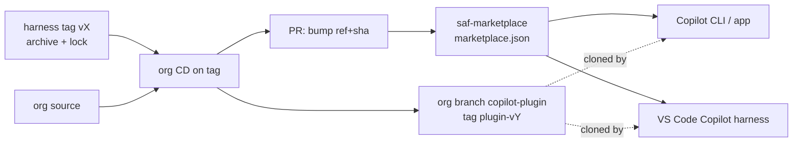

# Marketplace delivery for the SAFe agentic organization: research and design

**Status:** research and design for approval. No code, `def/`, or PR changes were made.
**Date:** 2026-11-07.
**Scope:** `poesis-cloud/saf-agentic-harness` (v1.0.0-alpha.1) and `poesis-cloud/saf-agentic-organization` (`main`).
**Question (user, verbatim):** "what about delivery channels (availability in github copilot marketplaces (including VScode gh copilot))?"

---

## 0. Summary

### Recommendation

1. Ship **one Copilot-format plugin**, `poesis-saf-agentic-organization`, built by the org's CD. It contains the agents, skills, framework layout, and a **vendored, pinned harness release**. The same package targets the Copilot CLI, the GitHub Copilot app, and VS Code's **Copilot harness**, because all three share one runtime and one hook format.
2. **No absolute paths.** Hooks reach their own files through `$PLUGIN_ROOT`. Python dependencies go in a hash-locked venv under `$PLUGIN_DATA`, created by a stdlib-only launcher. Fail-closed behavior applies only to sessions that are governed or that select an orchestrator.
3. **The workspace is chosen at runtime, not at install.** A governed portfolio repository is the session folder that holds a committed marker file. The orchestrator's `init` flow creates that marker, plus the repository's plugin recommendation in `.github/copilot/settings.json`.
4. **Versioning:** the org pins a harness release, by tag and archive SHA-256, in a lock file. The harness refuses a framework whose declared harness range it does not satisfy. Users get versions through marketplace entries pinned by `ref` and `sha`.
5. **Distribution:** create our own marketplace repo first (`poesis-cloud/saf-marketplace`), fed by tag-driven CD from the org repo. List in `github/awesome-copilot` through its external-plugin intake once the bootstrap is proven (beta). Do not target `github/copilot-plugins`: it is GitHub-curated.

### Open decisions (details in §5)

| ID | Decision | Touches |
| --- | --- | --- |
| D1 | Support VS Code only through its **Copilot harness**, and treat the Local harness as unsupported for marketplace installs | harness `def/adapter/*` |
| D2 | **Vendor the harness into the framework plugin** at build time, which reverses the rejected "option B". Keep the two-plugin split rejected. | harness `def/adapter/vscode…/spec.md` §Rendering guarantees, plus a new plugin-mode section in `def/adapter/github-copilot-cli/spec.md` |
| D3 | A **portable plugin-mode registration** (`$PLUGIN_ROOT`, a shell shim, no `exec`) next to `install.py` (kept for development) | harness `def/adapter/github-copilot-cli/spec.md` |
| D4 | **Narrow fail-closed behavior** in plugin mode to governed or orchestrator sessions (today a broken bootstrap denies every tool call in every folder) | harness `def/adapter/github-copilot-cli/spec.md` §Fail-closed entry |
| D5 | **Python provisioning:** an automatic, hash-locked venv bootstrap at `sessionStart`, or an explicit one-time command | harness spec, plus security posture |
| D6 | **Runtime workspace resolution** from the session folder and a marker file, replacing install-time `--workspace-dir` | harness `def/adapter/*`, a possible `def/core` note, and the org marker and `init` |
| D7 | **Framework/harness compatibility contract** (the framework declares a harness range, and the harness refuses a mismatch), plus mid-session update detection | harness `def/core/spec.md` (configuration and internal validation) |
| D8 | **The org's plugin package format:** the Copilot (legacy) format now, or Agent Plugins 1.0 (which awesome-copilot requires) | org only |
| D9 | **Merge the org's two renderers** into one plugin for both hosts (union `tools:`, one host-binding text) | org only |
| D10 | **Marketplace repo name and ownership**, and the CD publishing credential | org and infra |
| D11 | **Whether and when to submit to awesome-copilot** | product |

---

## 1. Today's state, and why it cannot be listed

| Item | Today | Marketplace blocker |
| --- | --- | --- |
| Harness delivery | `git archive` source tarball plus `.sha256` on tag `v*` (`.github/workflows/cd.yaml`) | Not a plugin |
| Org delivery | CD renders `builds/github-copilot` (VS Code) and `builds/github-copilot-cli` (CLI) bundles and attaches zips to the GitHub Release. The CLI bundle carries a one-plugin local `.github/plugin/marketplace.json` (`…-local`). | Nothing is in a marketplace repo, and the zips have no hooks |
| Hooks | `adapters/github-copilot-cli/install.py` writes `<bundle>/hooks.json` with `exec: <abs venv python>`, `args: [<abs adapter.py>…, --framework-dir <abs org checkout>]`, `cwd: <fw>`, and the `env` FRAMEWORK_* values. It also injects a managed `hooks:` block with absolute paths into each orchestrator's frontmatter. | Machine-specific, so it cannot be published |
| Framework dir | The org **checkout** (`--framework-dir`), and expressly not the bundle | An installed plugin is a host-managed cache, not a checkout |
| Workspace | Install-time `--workspace-dir`, or `FRAMEWORK_WORKSPACE_DIR=workspace` inside the checkout | A plugin cache is read-only and replaced on update |
| Python | A user-made venv with `requirements.txt`, validated by `install.py` | No host installs Python dependencies (§2.5) |
| Fail-closed | A bootstrap failure exits 2 in **every** folder where the hooks fire (`def/adapter/github-copilot-cli/spec.md` §Fail-closed entry) | Acceptable for a deliberate developer install. Not acceptable for a marketplace plugin, where installing without Python would block tool use everywhere. |

Self-location already works. `adapter.py` finds `harness.py` as `ADAPTER_DIR.parents[1] / "harness.py"`. The runner uses `sys.executable`. The state dir is outside every repository (`SAF_HARNESS_STATE_DIR`, then XDG or `%LOCALAPPDATA%`). Vendoring the harness under a plugin root therefore needs no code relocation.

---

## 2. Research findings

Legend: **[doc]** means documented, **[src]** means read from source, **[obs]** means observed in this repo's captured fixtures, and **[inf]** means inferred. Every claim of these kinds still needs the spike in §7.

### 2.1 One runtime across three surfaces

- The CLI, the GitHub Copilot app, and VS Code's **Copilot** session target share **one harness and one hook format**. In the VS Code docs: "VS Code, the GitHub Copilot app, and Copilot CLI share this harness and its hook format". The older **Local** harness in VS Code is for migration only. **[doc]** [VS Code hooks](https://github.com/microsoft/vscode-docs/blob/main/docs/agent-customization/hooks.md)
- `chat.useHooks` and `chat.hookFilesLocations` configure **only the Local harness**: "These settings do not configure the shared Copilot runtime." **[doc]** (same page). Our `vscode-github-copilot-chat` adapter and its required settings target that Local harness.
- The Local harness still loads plugin hooks, accepts the Copilot event aliases, and "still sends Local payloads" **[doc]** (same page). So a CLI-format hook can receive a Local-format payload in VS Code. The entry must detect this.
- In VS Code the event name **selects the payload format**: `preToolUse` gets `toolName`/`toolArgs`, while `PreToolUse` gets snake_case with Claude-style tool names. **[doc]** (same page). We must keep the lowerCamel names.
- VS Code auto-discovers plugins **installed by the Copilot CLI** (`~/.copilot/installed-plugins/…`). **[doc]** [VS Code agent plugins](https://github.com/microsoft/vscode-docs/blob/main/docs/agent-customization/agent-plugins.md), **[src]** `CopilotCliAgentPluginDiscovery`.

### 2.2 Plugin format

| | Copilot CLI and app | VS Code (Copilot harness) |
| --- | --- | --- |
| Formats | Agent Plugins 1.0 (root `plugin.json` with `$schema` set to the agent-plugins.org 1.0.0 or 1.1.0 URL) or legacy Copilot. Legacy manifest search order: `.plugin/plugin.json`, `plugin.json`, `.github/plugin/plugin.json`, `.claude-plugin/plugin.json` **[doc]** [CLI plugin reference](https://docs.github.com/en/copilot/reference/copilot-cli-reference/cli-plugin-reference) | Agent Plugins 1.0, Copilot, Claude, and legacy OpenPlugin, auto-detected **[doc]** [VS Code plugin reference](https://github.com/microsoft/vscode-docs/blob/main/docs/agents/reference/agent-plugin-reference.md), **[src]** `pluginParsers.ts` |
| Legacy manifest fields | `name` (kebab-case), `description`, `version`, `author`, `homepage`, `repository`, `license`, `keywords`, `category`, `tags`, plus component paths `agents` (default `agents/`), `skills` (default `skills/`), `commands`, `hooks`, `extensions`, `mcpServers`, `lspServers` **[doc]** | The same component path fields **[src]** |
| AP 1.0 layout | `plugin.json`, `skills/<n>/SKILL.md`, `mcp.json`, and `com.github.copilot/{agents,commands,rules,hooks/hooks.json}`. Component path fields are **not** allowed in the manifest. **[doc]** | The same; VS Code reads agents and hooks only from `com.github.copilot` **[doc]** |
| Hook file | Legacy: root `hooks.json` (or `hooks/hooks.json`). AP 1.0: `com.github.copilot/hooks/hooks.json`. | The same table **[doc]** |
| Components | agents, skills, commands, hooks, MCP servers, LSP servers, extensions | skills, MCP, agents, commands, rules, hooks, automations (the last are VS Code-only) |
| Same plugin on both? | **Yes.** Both read the Copilot and AP 1.0 formats, and VS Code even loads CLI-installed plugins. | |

Our current CLI bundle (legacy `plugin.json` with `agents/` and `skills/`) is already valid for both hosts. In agent frontmatter, "All unrecognized tool names are ignored" **[doc]** [custom agents configuration](https://docs.github.com/en/copilot/reference/custom-agents-configuration). A union `tools:` list is therefore safe.

**`marketplace.json`.** The canonical location is `.github/plugin/marketplace.json`; `.plugin/` and `.claude-plugin/` are also read. It requires `name`, `owner{name,email?}`, and `plugins[]`, with optional `metadata{description,version,pluginRoot}`. Each entry has `name`, `source`, and metadata. `source` is either a relative path or `{source:"github", repo, ref?, path?, sha?}`, or the `url` form. `sha` must be a full 40-character commit and is "immune to force-pushes". **[doc]** [CLI plugin reference](https://docs.github.com/en/copilot/reference/copilot-cli-reference/cli-plugin-reference). VS Code defers to the Claude marketplace schema and supports `owner/repo#ref-or-sha`, git URLs, relative paths, and npm or pip sources. **[doc]** [src] `pluginSources.ts`. A plugin's id is `PLUGIN@MARKETPLACE`, where the marketplace part is the marketplace's `name`, not its repo name.

### 2.3 Hooks in plugins

- **Plugin root.** Hook commands use `"${PLUGIN_ROOT}/…"`. VS Code substitutes the token **and** exports `PLUGIN_ROOT` (or `CLAUDE_PLUGIN_ROOT` for the Claude format) to the hook process **[doc]** [VS Code plugin reference §Reference plugin paths in hook commands](https://github.com/microsoft/vscode-docs/blob/main/docs/agents/reference/agent-plugin-reference.md), **[src]** `interpolateHookCommandRoot`. The CLI changelog says "Plugin hooks receive PLUGIN_ROOT, COPILOT_PLUGIN_ROOT, and CLAUDE_PLUGIN_ROOT env vars", and later adds `CLAUDE_PROJECT_DIR`, `CLAUDE_PLUGIN_DATA`, `{{project_dir}}`, and `{{plugin_data_dir}}` **[doc]** [copilot-cli changelog](https://github.com/github/copilot-cli/blob/main/changelog.md). GitHub's starter template uses `node "${PLUGIN_ROOT}/…"` **[doc]** [plugin-marketplace-starter hooks.md](https://github.com/github/plugin-marketplace-starter/blob/main/docs/hooks.md).
- **Writable data.** `PLUGIN_DATA` (with the `COPILOT_PLUGIN_DATA` and `CLAUDE_PLUGIN_DATA` aliases) is "a persistent, writable directory unique to each installed plugin". The Agent Plugins spec says it MUST persist across updates and is meant for "virtual environments" **[doc]** [Agent Plugins spec §9.1](https://github.com/agentplugins/agent-plugins-spec/blob/main/spec/1.0.0.md). In a sandboxed CLI session, a plugin hook "can read the directory it was loaded from" and "write to its data directory (`$COPILOT_PLUGIN_DATA`)" **[doc]** [hooks reference §Sandboxed sessions](https://docs.github.com/en/copilot/reference/hooks-reference).
- **Working directory.** It is **not** the plugin dir. The default is the repository or workspace root, and a relative `cwd` resolves from there **[doc]** (hooks reference), **[src]** VS Code `resolveHookCommand`. Plugin files must therefore always be reached through `PLUGIN_ROOT`.
- **Entry forms.** `bash`, `powershell`, `command`, and `exec`+`args` (the last is CLI-only), each with `cwd`, `env`, and `timeoutSec`. VS Code's parser normalizes `command`, `windows`, `linux`, `osx`, `bash`, and `powershell`, and has **no `exec`** **[src]** `normalizeHookCommand`. The VS Code docs mention `exec` for the Copilot harness **[doc]**. Because the parsers differ, plugin mode should use `bash`/`powershell` strings.
- **Events (shared runtime).** `sessionStart`, `sessionEnd`, `userPromptSubmitted`, `userPromptTransformed`, `preToolUse`, `postToolUse`, `postToolUseFailure`, `subagentStart`, `subagentStop`, `agentStop`, `preCompact`, `permissionRequest`, `notification`, `errorOccurred` **[doc]** (hooks reference). This covers every event in `adapters/github-copilot-cli/hooks.yaml` and `agent-hooks.yaml`.
- **Failure semantics.** For `preToolUse`, any non-zero exit **denies** and a **timeout fails open**. Other events log and continue **[doc]** (hooks reference §Exit codes). This matches the adapter spec's host facts.
- **Agent-scoped hooks.** A `hooks:` map in agent frontmatter runs "only while that agent is selected". `command` takes `windows`/`linux`/`osx` overrides. "Paths resolve from the repository root." "Repository and inherited-agent hooks require workspace admission." Remote or org-hosted agents do not run scoped hooks **[doc]** (hooks reference §Agent-scoped hooks). VS Code "forwards those hooks when passing the agent to Copilot", including for plugin agents **[doc]**. The adapter spec **observed** plugin-agent scoped hooks running in an untrusted folder (CLI 1.0.105). **Not documented: whether `${PLUGIN_ROOT}` is expanded, or `PLUGIN_ROOT` exported, for frontmatter hooks.** The CLI documents frontmatter `${PLUGIN_ROOT}` substitution **only** for a plugin agent's `mcp-servers` block, and says it "doesn't extend" further **[doc]**. This is spike S1.

### 2.4 Trust and policy

- **CLI.** Repository hooks need folder trust, and plugin hooks were observed running regardless **[obs]**. The scoped-hook row reads "inherited-agent hooks require workspace admission" **[doc]**, which partly conflicts with the observation, so it is re-checked in S1.
- **VS Code.** There is a trust prompt the first time a user installs from a new marketplace. Plugin MCP servers are implicitly trusted. Under the enterprise setting `allowManagedHooksOnly`, plugin hooks run only if `enabledPlugins` force-enables the plugin **[doc]**.
- **Enterprise controls.** Managed settings offer `extraKnownMarketplaces`, `strictKnownMarketplaces`, and `enabledPlugins`. A repository can recommend plugins in `.github/copilot/settings.json`, through `extraKnownMarketplaces` and `enabledPlugins` **[doc]** [manage plugin marketplaces](https://docs.github.com/en/copilot/how-tos/administer-copilot/manage-for-enterprise/use-managed-settings/manage-plugin-marketplaces-and-plugins), [VS Code agent plugins](https://github.com/microsoft/vscode-docs/blob/main/docs/agent-customization/agent-plugins.md).

### 2.5 Install mechanics

- **CLI commands.** `copilot plugin marketplace add OWNER/REPO|URL|PATH`, `plugin install NAME@MARKETPLACE`, `update [--all]`, `enable`, `disable`, `uninstall`, `list`, and `marketplace update|browse|remove`.
- **Install locations.** Plugins go in `~/.copilot/installed-plugins/<MARKETPLACE>/<PLUGIN>` (or `_direct/<id>`, under `COPILOT_HOME`). The marketplace cache is in the platform cache dir **[doc]** (CLI plugin reference).
- **The app.** The Customize tab offers Browse, Installed, and "add marketplace by repo or Git URL" **[doc]** [customize the GitHub Copilot app](https://docs.github.com/en/copilot/how-tos/github-copilot-app/customize-github-copilot-app).
- **VS Code surfaces.** The Agent Customizations editor (Plugins and Browse), `@agentPlugins` in Extensions, "Chat: Install Plugin from Source", `/plugin` (which keeps a separate inventory), `vscode://chat-plugin/install` deep links, and `chat.plugins.marketplaces`. That setting is experimental and defaults to `github/copilot-plugins` and `github/awesome-copilot`. `chat.plugins.enabled` defaults to `false` **[doc]**.
- **VS Code storage.** A VS Code-managed git cache, plus `agent-plugins/installed.json` **[src]**.
- **Defaults.** `awesome-copilot` is the **only built-in** marketplace in the CLI, the app, and VS Code. `copilot-plugins` has become an ordinary marketplace that users add themselves on the CLI **[doc]** [About plugins](https://docs.github.com/en/copilot/concepts/customizations/plugins), CLI plugin reference.
- **Updates.** Built-in awesome-copilot plugins **auto-update at session start**. A user-added marketplace opts in with `autoUpdate: true` in user or managed settings; repository settings cannot enable it. Otherwise updates run through `copilot plugin update`. VS Code checks about every 24 hours and follows `extensions.autoUpdate`. **[doc]**
- **Pinning.** Pins are set by the marketplace entry's `source.ref`/`sha`. `version` is informational **[doc]**.
- **No install step.** Nothing in the CLI docs runs `pip` or `npm` on install. Plugins are cloned or copied into the cache **[doc]** [creating plugins](https://docs.github.com/en/copilot/how-tos/copilot-cli/customize-copilot/plugins-creating). VS Code is the one exception: plugins with an `npm` or `pip` **source** run `pip install --target <cache> <pkg>` in a terminal after a confirmation dialog **[src]** `PipPluginSource`. That path is VS Code-only, installs into whatever `pip` is on PATH, and does not apply to git sources. **Conclusion: no host provisions Python or our dependencies for a git-sourced plugin.**
- **Cloud agent.** The cloud agent ships no installed plugins **[doc]** (hooks reference). This channel does not reach Copilot coding agent jobs.

### 2.6 Runtime prerequisites (measured)

`pip download -r requirements.txt` (Python 3.12, Linux) resolves these **platform-specific binary** wheels:

| Package | Pulled in by | Pure-Python fallback? |
| --- | --- | --- |
| `google-re2` (C++) | `cel-python 0.5.0` (a hard `Requires-Dist`) | **No** |
| `rpds-py` (Rust) | `jsonschema ≥ 4.18` through `referencing` | **No** |
| `pendulum` (Rust) | `cel-python` | Yes (a `py3-none-any` wheel exists) |
| `PyYAML` (C) | direct dependency | Yes (pure modules) |

A **single portable, OS-independent vendored bundle is therefore impossible** with today's dependencies. Options compared:

| Option | Portability | Size | Prerequisites | Verdict |
| --- | --- | --- | --- | --- |
| Bundled venv | Per OS, arch, and Python ABI | Large | none | ✗ The plugin is one git tree for all platforms |
| shiv/zipapp with binary wheels | Per OS×arch×cp3.10–3.14 (about 30 builds) | About 10 MB × N | Python | ✗ Build-matrix explosion; one tree cannot select a platform |
| Bundled standalone CPython | Per platform | About 30 MB × 5 | none | ✗ The same tree problem |
| **First-run launcher → venv in `$PLUGIN_DATA`**, hash-locked `pip` install, uses `uv` if present | Universal | Small | Python ≥ 3.10, network once (or a mirror) | **✓ Recommended.** This matches the AP spec's stated use of `PLUGIN_DATA` |
| `uvx`/`uv run` on every hook | Universal; uv can even fetch Python | Small | `uv` on PATH | ◐ Supported as an accelerator. A cold cache inside `preToolUse` risks a timeout, and **timeouts fail open**. |
| Harness as an MCP server | — | — | — | ✗ Governance needs hooks, which MCP cannot replace. A possible future option for H4 only. |
| VS Code `pip` plugin source | VS Code only | — | `pip` on PATH | ✗ Not cross-host |

Git ≥ 2.38 and a Git identity can only be **checked**, never provided.

### 2.7 Listing

- **`github/awesome-copilot`** is open to community contribution. Plugins hosted in **other repositories** go in `plugins/external.json` through an **issue-form intake, not a PR**. Intake requires a GitHub source with `ref`/`sha`, Agent Plugins spec compliance, `vally lint` for skills, and an install smoke test with the Copilot CLI. Maintainers respond with `/approve` or `/reject`, and there is a 6-month re-review. Plugins hosted in the repo itself must be AP 1.0 with `$schema`, `name`, `description`, and `version`. Hooks are an accepted category. Content that "compromises security" or circumvents the ToS is rejected. **[doc]** [CONTRIBUTING.md](https://github.com/github/awesome-copilot/blob/main/CONTRIBUTING.md), [AGENTS.md](https://github.com/github/awesome-copilot/blob/main/AGENTS.md). Because it is the built-in marketplace in all three surfaces, this listing means **zero-setup discovery**.
- **`github/copilot-plugins`** is "The official GitHub Copilot plugins collection". Its CONTRIBUTING file is generic, and its entries are first-party (GitHub and Microsoft) external sources **[doc]** [README](https://github.com/github/copilot-plugins). There is no documented third-party intake, and it is no longer a CLI default. **[inf] Not a realistic target.**
- **Our own marketplace.** GitHub provides `github/plugin-marketplace-starter`, which has `npm run verify`, a CI validator, CODEOWNERS, and sharing guidance **[doc]** [create and share plugin marketplaces](https://docs.github.com/en/copilot/how-tos/copilot-on-github/customize-copilot/create-and-share-plugin-marketplaces).

---

## 3. Design



### 3.1 Package shape — **one plugin** (D2)

| Option | Pros | Cons |
| --- | --- | --- |
| **A. One plugin (org plus vendored harness)** ✓ | Atomic version pin. A single `PLUGIN_ROOT` reaches the harness and the framework. One install. Scoped H0 hooks and global hooks ship together, matching today's bundle. | The harness is copied per framework at build time. This reverses the "B — vendor `adapters/` into the framework" rejection in `def/adapter/vscode-github-copilot-chat/spec.md` §Rendering guarantees. That rejection was about **source forks**, whereas this is a CI copy of a release tag, verified by checksum. |
| B. Two plugins (harness plus org) | The harness stays framework-agnostic | No host has cross-plugin discovery or dependencies. The org's scoped hooks cannot find the harness root. The global harness hooks cannot find the framework. Versions drift independently. Every session in every folder pays harness latency. |
| C. Org plugin plus harness from PyPI through `uvx` | uv provisions Python too | Requires PyPI packaging. `src/` uses top-level module names (`commands`, `stores`, `utils`) that would collide in site-packages, forcing a restructure. A cold `uvx` start risks a fail-open timeout. |

**Spec impact:** a harness `def/` change, D2. The org renderer change is org-only.

### 3.2 Plugin layout

This is the Copilot (legacy) format, D8. AP 1.0 would move `agents/` and `hooks.json` under `com.github.copilot/` and drop the manifest path keys.

```text
poesis-saf-agentic-organization/        # = PLUGIN_ROOT (read-only, replaced on update)
  plugin.json                           # name, version, agents: agents/, skills: skills/, hooks: hooks.json
  hooks.json                            # global hooks, no absolute paths (rendered by the harness)
  agents/<slug>.agent.md                # union tools:, one host-binding section, H0 scoped block
  skills/<stem>/SKILL.md                # host skills
  framework/                            # FRAMEWORK_DIR (was: the checkout)
    .env  workflows/ conf/ instructions/ templates/ artifacts/ skills/*.skill.md
    harness.require                     # e.g. ">=1.0.0-alpha.1,<1.1"   (D7)
  harness/                              # vendored harness release (runtime subset only)
    VERSION  requirements.lock          # hash-pinned, multi-platform
    harness.py src/ adapters/ contracts/ LICENSE NOTICE
    bin/saf-hook.sh  bin/saf-hook.ps1   # shell shims (no Python needed to fail closed)
    launcher.py                         # stdlib-only bootstrap and router
  LICENSE NOTICE README.md
```

Moving the framework layout into `framework/` keeps the AP 1.0 `skills/` folder clean (§2.2). It also makes `FRAMEWORK_DIR=$PLUGIN_ROOT/framework` a valid layout root. **Org change.** The harness's `install.py` keeps working for checkouts.

### 3.3 Hooks without absolute paths (D3, D1)

**Global `hooks.json`.** The harness renders it once at **build** time. Its source of truth is the same `hooks.yaml`.

```json
{ "version": 1, "hooks": { "preToolUse": [ {
  "type": "command",
  "bash": "sh \"$PLUGIN_ROOT/harness/bin/saf-hook.sh\" preToolUse",
  "powershell": "& \"$env:PLUGIN_ROOT\\harness\\bin\\saf-hook.ps1\" preToolUse",
  "timeoutSec": 120 } ] } }
```

- Use the **environment variable** (`$PLUGIN_ROOT`, `$env:PLUGIN_ROOT`) rather than the `${PLUGIN_ROOT}` text token. This avoids each host's different quoting during substitution. Both hosts export it (§2.3); spike S2 confirms this.
- **Shell strings, not `exec`.** VS Code's parser has no `exec`. Only a shell can also turn "no Python found" into exit 2 rather than a spawn error. A spawn error fails open on non-`preToolUse` events, and its handling is undocumented on `preToolUse`.
- **The shim** finds an interpreter: `SAF_HARNESS_PYTHON`, then `py -3` or `python3` or `python`, with Python ≥ 3.10. It runs `launcher.py <event> [--agent <slug>]`. It maps any failure to **exit 2 only if fail-closed applies** (§3.4).
- **`launcher.py`** (stdlib only, parses on old Pythons):
  1. It resolves `FRAMEWORK_DIR=$PLUGIN_ROOT/framework` and the state dir (`$PLUGIN_DATA/state`, else today's XDG path).
  2. It resolves the workspace (§3.5) and **detects the payload family**. `toolName`/`toolArgs` and the batched `toolCalls` mean the Copilot runtime. snake_case `tool_input` or `hookEventName` means VS Code's Local harness, which refuses governed sessions with "select Session Target: Copilot" (D1).
  3. It then `exec`s the venv Python on `adapters/github-copilot-cli/adapter.py hook --event … --framework-dir … --workspace-dir …`.
- **Every `FRAMEWORK_*` value is derived at runtime** from `framework/.env`, never written into `env`. `--layout` is no longer needed.

**Scoped H0 block (orchestrator frontmatter).** This is the open issue S1. The design has two branches:

- **(a)** If `PLUGIN_ROOT` is exported to frontmatter hooks, use the same `sh "$PLUGIN_ROOT/…"` form with `--agent <slug>`.
- **(b)** Otherwise, the global `sessionStart` hook writes a **versioned shim** to a fixed per-user path: `$HOME/.local/state/saf-agentic-harness/plugins/<plugin>@<version>/saf-hook.sh`, and `%LOCALAPPDATA%\…` on Windows. That shim records `PLUGIN_ROOT`. The scoped hook calls the shim through `$HOME` or `$env:LOCALAPPDATA`. CI bakes the version in, so parallel versions never collide.
- On the CLI, a third option is the documented install path `~/.copilot/installed-plugins/<marketplace>/<plugin>/…`. It does not hold for VS Code-installed plugins, so (b) is preferred.

**Spec impact:** harness `def/adapter/github-copilot-cli/spec.md` gains a "Plugin-mode registration" section. Two items change: host fact 1 (`exec` as default) and `cwd: <fw>` (in plugin mode `cwd` is the workspace root). The adapter README's dispatch exception changes too. D1 also states that the CLI adapter is **the** VS Code adapter for the Copilot harness, and the `vscode-github-copilot-chat` adapter becomes Local-harness legacy. **These are decisions for the user.**

### 3.4 Python bootstrap, fail-closed (D4, D5)

**Venv key.** `$PLUGIN_DATA/venv/<harness-version>-<sha256(requirements.lock)[:12]>-py3X-<platform>`. A `.ready` stamp is written last, so a half-built venv is never used.

**Provisioning** (D5, recommended: automatic at `sessionStart`):

- Use `uv venv` plus `uv pip install --require-hashes -r requirements.lock` when `uv` is on PATH. Otherwise use `python -m venv` plus `pip install --require-hashes --only-binary=:all: -r requirements.lock`.
- Concurrent sessions take a file lock. `sessionStart` gets a 300 s `timeoutSec`; it cannot veto, and it blocks only the first session.
- `PIP_INDEX_URL` and `UV_INDEX_URL` are honored for mirrors. `SAF_HARNESS_PYTHON` lets an enterprise point at a pre-provisioned interpreter and skip provisioning.
- The alternative is an explicit one-time command, which the denial message names verbatim: `python3 "<PLUGIN_ROOT>/harness/launcher.py" bootstrap`.

**Lock file.** The harness CI generates `requirements.lock` with hashes **for all target platforms**, using `uv pip compile --universal --generate-hashes`. This is a harness CI change.

**Fail-closed scope** (D4). A marketplace plugin must not block every tool call in every folder of a user who has not set up Python. The stdlib launcher (or, without Python, the shim) decides:

| Situation | Missing or broken runtime → |
| --- | --- |
| Session folder is not a marked workspace, and no orchestrator is selected | **pass** (exit 0, empty), with a one-time `sessionStart` warning on stderr |
| Orchestrator selected (scoped H0 fired) | H0 first writes a stdlib **intent record** to the state dir. Every later `preToolUse` in that session **denies** (exit 2) with the exact remedy. |
| Marked workspace (§3.5) | Every `preToolUse` **denies** with the remedy, and so does I9 (shell writes into the workspace) |
| Git missing, or older than 2.38 | The same rules, with message "Git ≥ 2.38 required (found …)" |
| Plugin updated mid-session (the recorded harness version differs from `harness/VERSION`) | Deny, with "the plugin was updated; start a new session" (D7) |

Three things never change: payload handling once bootstrapped, the H0–H7 semantics, and the denial of timed-out or failed gating calls. **Spec impact:** harness `def/adapter/github-copilot-cli/spec.md` §Fail-closed entry today mandates exit 2 "even for a session without a record". D4 changes that rule for plugin mode. **Decision for the user.**

**Agent-side backstop** (org). If hooks are disabled (policy, `disableAllHooks`, or the Local harness), nothing fires. The orchestrator prose must therefore check for the `sessionStart` harness context. If it is missing, the orchestrator refuses to dispatch and tells the user why. This is org-only. It is not enforcement, just a visible failure.

### 3.5 Workspace selection (D6)

- **Rule.** The governed workspace is the **git top-level** of the session `cwd`, from the payload or `CLAUDE_PROJECT_DIR`. It must contain a committed marker, `.saf/workspace.yaml`, naming `framework: poesis-saf-agentic-organization` and the workspace root slug (`portfolio`). A session in an unmarked folder is ungoverned and passes through. An orchestrator selected there gets an H0 answer: "this folder is not a SAFe workspace; ask me to initialise it".
- **`init` flow** (org skill, harness-checked):
  1. Check that the folder is a git repository with a Git identity.
  2. Write the marker.
  3. Write `.github/copilot/settings.json` with `extraKnownMarketplaces` and `enabledPlugins`, so teammates are prompted to install the same plugin (§2.4).
  4. Commit.
- **Multiple frameworks.** A plugin governs only workspaces whose marker names **its** framework. A future second framework plugin therefore never double-governs.
- **Why not environment variables or a user config file.** The app and the VS Code runtime do not inherit the user's shell environment, and a user-level mapping is invisible to teammates.
- **Spec impact.** Harness `def/adapter/*`: workspace resolution moves from registration to per firing, and is fixed per session at H0/H1 and recorded. The layout precedence in `layout.py` (`--workspace-dir`) stays. `def/core` is unaffected only if `FrameworkLayout`'s "every path existing" rule is satisfied by the resolved workspace. The org's `.env` default `FRAMEWORK_WORKSPACE_DIR=workspace` becomes checkout-only. **Decision for the user.**

### 3.6 Versioning (D7)

- **The org pins the harness** in `builds/harness.lock`, which holds the harness tag, the archive SHA-256, and the commit SHA. Org CD vendors exactly that version. Org CI today pins harness **`main` ≥ de1b5f0**; it moves to the lock for releases, and `main` remains a nightly job.
- **Compatibility.**
  - The framework declares `framework/harness.require` (a PEP 440 range).
  - The harness checks it at bootstrap and refuses a mismatch with exit 2 (fail-closed, plugin-mode scope).
  - The harness also stamps its version into each session record, and refuses a session that a different version opened.
  - This is a harness **`def/core/spec.md`** change (§Configuration / Internal validation), so it is a decision for the user. Without it, a vendored pair can still never drift, so D7 is about defense in depth and future multi-framework use.
- **Plugin version.** `plugin.json` `version` is the org's semver. The tag is `vY` (the existing coherence check stays). The vendored harness version goes in a `harness` key under `extensions["cloud.poesis.saf"]` (AP 1.0) or in `harness/VERSION`.
- **Users** install whatever `ref`/`sha` the marketplace entry carries. Channels are distinct marketplaces, not distinct plugin names, because a different name changes every namespaced agent id and could install twice. Examples: `saf-marketplace` (stable) and `saf-marketplace-preview`, or a `preview` branch of the same repo added as `owner/repo#preview` in VS Code (the CLI branch syntax goes to spike S6).

### 3.7 CI

**Harness, on tag `v*`** (CI only; no `def/` change unless the release contract is specified there):

- Keep the source archive.
- Add `saf-agentic-harness-runtime-<v>.tar.gz`: `harness.py`, `src/`, `adapters/`, `contracts/`, `requirements.lock`, `VERSION`, `bin/`, `launcher.py`, and the licenses. Ship it with `.sha256`, plus a build-provenance attestation (`actions/attest-build-provenance`).
- Add a plugin-mode render command, `adapters/github-copilot-cli/render_plugin_hooks.py`. It emits `hooks.json` and the scoped blocks with no machine paths, and is tested.
- Add a matrix smoke job (ubuntu, macOS, Windows × py3.10 and 3.13) that bootstraps from the lock.

**Org, on tag `v*`:**

1. **Gate.** Validate `harness.lock`. Download the runtime archive and verify its SHA-256 and attestation.
2. **Render** one plugin. `render_bundle.py` (merged, D9) plus the harness `render_plugin_hooks.py`, with the harness extracted to `harness/`.
3. **Validate.**
   - The manifest against the format schema (D8; for AP 1.0, the agent-plugins.org schema).
   - Skill names in kebab-case (VS Code skips invalid ones silently).
   - The functional "constitution gate" run **in place** on the rendered plugin, with a temp workspace and `PLUGIN_ROOT`/`PLUGIN_DATA` set.
   - `copilot plugin install <dir>` as a smoke test, if the CLI is usable in CI without auth.
4. **Publish.**
   - Force-push the rendered tree as one commit to the orphan branch `copilot-plugin` (the plugin at the **branch root**, so marketplace entries need no `path`; VS Code's `path` support is unverified, S6). Tag it `plugin-vY`.
   - Attach the zip to the GitHub Release, as today.
   - Open a PR on the marketplace repo that bumps `version`, `ref` (`plugin-vY`), and `sha` (the commit). This needs a GitHub App or fine-grained token with `contents:write` and `pull-requests:write` on that repo only (D10).

**Marketplace repo:** a `validate.yml` workflow on every PR (taken from the starter) checks the schema, that each `ref`/`sha` exists and matches, and that the plugin manifest at that sha has the same `name` and `version`.

### 3.8 Marketplace repo layout (D10)

```text
poesis-cloud/saf-marketplace
  .github/plugin/marketplace.json     # { name: "poesis-saf", owner: {name: "Poesis Cloud"},
                                      #   plugins: [ { name: "poesis-saf-agentic-organization",
                                      #     source: { source: "github", repo: "poesis-cloud/saf-agentic-organization",
                                      #               ref: "plugin-v0.2.0", sha: "<40-hex>" },
                                      #     version: "0.2.0", description, license, keywords } ] }
  .github/workflows/validate.yml
  CODEOWNERS  README.md  LICENSE
```

**Install, per surface:**

- **Copilot CLI:**

  ```bash
  copilot plugin marketplace add poesis-cloud/saf-marketplace
  copilot plugin install poesis-saf-agentic-organization@poesis-saf
  ```

- **Copilot app:** Customize → marketplace settings → add `poesis-cloud/saf-marketplace` → install.
- **VS Code:**
  1. Enable `chat.plugins.enabled`.
  2. Add `poesis-cloud/saf-marketplace` to `chat.plugins.marketplaces`, or accept the repository recommendation written by `init`.
  3. Install from the Agent Customizations editor.
  4. Use Session Target **Copilot**.
- **Enterprises:** managed `extraKnownMarketplaces` plus `enabledPlugins`. `enabledPlugins` is also what makes plugin hooks run under `allowManagedHooksOnly`.
- **Auto-update:** off by default for our marketplace. Users opt in with `autoUpdate: true` in user settings. This is the right default for a governance tool, since an update mid-flight is handled by D7.

An alternative is to host `marketplace.json` on the org repo's `main`. That is simpler, but it mixes the source and distribution lifecycles, and it puts a second marketplace manifest next to the org's development bundle. A separate repo is recommended.

### 3.9 Listing plan (D11)

| Phase | Channel | Gate |
| --- | --- | --- |
| alpha | Own marketplace only | S1–S6 pass on CLI, app (Windows), and VS Code (Copilot harness) |
| beta | Submit to **awesome-copilot** through its external-plugin issue form, with `ref` and `sha` | AP 1.0 package (D8), skills that pass `vally lint`, a README stating the prerequisites (Python 3.10+, Git ≥ 2.38, network on first run), and fail-closed scoping (D4) so an unconfigured user is not blocked. Expect a 6-month re-review. |
| — | `github/copilot-plugins` | Not pursued. Curated and first-party; ask GitHub only if they ask us. |

---

## 4. Change inventory

| # | Change | Harness `def/` | Harness code/CI | Org | Decision |
| --- | --- | --- | --- | --- | --- |
| 1 | Target VS Code through the Copilot harness, with the CLI adapter; Local harness is legacy for plugins | **Yes**: `def/adapter/vscode-github-copilot-chat/spec.md` scope note, and the CLI spec's title and host list | doc | README install | D1 |
| 2 | One plugin with a vendored harness | **Yes**: reverses "option B" in the VS Code spec; new plugin-mode section in the CLI spec | — | renderer | D2 |
| 3 | Portable hooks (`$PLUGIN_ROOT`, shim, shell strings, runtime layout) | **Yes**: CLI spec §Rendered registration, host fact 1, `cwd` rule; `adapters/README.md` | `render_plugin_hooks.py`, `bin/`, `launcher.py` | — | D3 |
| 4 | Scoped H0 without absolute paths (env var, or versioned shim) | **Yes**: CLI spec H0 registration | launcher and shim writer | renderer | D3 (after S1) |
| 5 | Payload-family detection; refuse the Local harness | **Yes**: CLI spec §Fail-closed entry | launcher | — | D1 |
| 6 | Fail-closed scoped to governed or orchestrator sessions | **Yes**: CLI spec §Fail-closed entry | launcher | — | D4 |
| 7 | Venv in `$PLUGIN_DATA`, hash lock, auto or explicit bootstrap | **Yes**: CLI spec prerequisites and bootstrap | lock generation, launcher | README | D5 |
| 8 | State dir under `$PLUGIN_DATA` (sandbox-safe) | Minor: CLI spec §Session identity "Records live…" | launcher sets `SAF_HARNESS_STATE_DIR` | — | with D3 |
| 9 | Runtime workspace (git top-level plus marker), recorded per session | **Yes**: CLI spec (layout, H0/H1, I9 wording); possibly a `def/core` note | adapter layout | marker schema, `init` skill, `.env` note | D6 |
| 10 | `harness.require` check and per-session version stamp | **Yes**: `def/core/spec.md` (configuration and internal validation) | core loader | `framework/harness.require`, `builds/harness.lock` | D7 |
| 11 | Harness runtime release asset, attestation, OS matrix smoke | No (unless release artifacts are specified) | `cd.yaml` | — | — |
| 12 | `framework/` subfolder layout | No | — | renderer | D8 |
| 13 | Merge the two renderers (union `tools:`, one host-binding text) | No | — | `builds/` | D9 |
| 14 | "No harness context → refuse" backstop in orchestrator prose | No | — | agents and host binding | — |
| 15 | Org CD: lock-pinned vendor, orphan branch, tag, marketplace PR | No | — | `cd.yml` | D10 |
| 16 | Marketplace repo with validation | No | — | new repo | D10 |
| 17 | AP 1.0 conversion and awesome-copilot submission | No | — | renderer | D8, D11 |

---

## 5. Open decisions

- **D1 — VS Code via the Copilot harness only.** *Why:* VS Code documents the Copilot harness as the shared runtime and calls Local the "older" harness. Our plugin hooks would receive Local payloads there. *Recommend:* yes. In plugin mode, refuse governed sessions under Local. Keep `make install-hooks` for existing Local users. *Spec:* `def/adapter/*` scope statements.
- **D2 — Vendor the harness into the framework plugin.** *Why:* this is the only shape where hooks can find both roots without absolute paths or cross-plugin discovery. It reverses a recorded rejection, although that rejection was about a source fork, not a CI copy. *Recommend:* yes. *Spec:* `def/adapter/vscode-github-copilot-chat/spec.md` §Rendering guarantees, and the CLI spec.
- **D3 — Plugin-mode registration.** It uses shell strings with `$PLUGIN_ROOT`, a shim plus launcher, and a layout derived at runtime. It sits beside `install.py`, not in place of it. *Recommend:* yes. *Spec:* CLI spec §Rendered registration and host fact 1.
- **D4 — Fail-closed scope.** *Why:* the current rule blocks every tool call in every folder when the runtime is missing, which is unacceptable for a marketplace audience and would likely fail awesome-copilot review. *Recommend:* scope fail-closed behavior to marked workspaces and orchestrator sessions, as in the §3.4 table. *Spec:* CLI spec §Fail-closed entry. **This weakens a written invariant, so it is the user's decision.**
- **D5 — Automatic or explicit bootstrap.** *Why:* automatic downloads code from PyPI on a hook firing, though only hash-pinned packages. Explicit adds one manual step. *Recommend:* automatic at `sessionStart`, hash-locked, mirror-aware, opt-out with `SAF_HARNESS_PYTHON`. *Spec:* CLI spec prerequisites.
- **D6 — Runtime workspace resolution with a marker file.** *Why:* no install step exists to pass `--workspace-dir`. *Recommend:* git top-level plus `.saf/workspace.yaml`, created by an `init` skill. *Spec:* CLI spec; check `def/core` FrameworkLayout. *Sub-decision:* the marker's name and location.
- **D7 — Compatibility contract and mid-session update detection.** *Why:* defense in depth, and needed if more than one framework plugin ships. *Recommend:* yes, as a small check. *Spec:* `def/core/spec.md`.
- **D8 — Package format.** The Copilot legacy format works today on both hosts. AP 1.0 is required for awesome-copilot and is the cross-tool standard. *Recommend:* legacy for alpha, AP 1.0 before the beta listing. Org only.
- **D9 — One renderer and one plugin for all three surfaces.** *Why:* VS Code's Copilot harness uses the CLI tool vocabulary, and unknown tool names are ignored. *Recommend:* yes. Retire `builds/github-copilot` once D1 is accepted. Org only.
- **D10 — Marketplace repo.** Name (`poesis-cloud/saf-marketplace`, marketplace `name: poesis-saf`), owners, and the CD credential (GitHub App preferred). Org and infra.
- **D11 — awesome-copilot submission timing.** *Recommend:* after beta, once D4, D5, and D8 are done.

## 6. Risks

- **A `preToolUse` timeout fails open.** A cold bootstrap must never run inside `preToolUse`. Provisioning happens only at `sessionStart` or through the explicit command, and gating events deny until the stamp exists.
- **Duplicate governance.** This happens if the same plugin is installed through both the CLI and VS Code inventories, or alongside a `--plugin-dir` development bundle or a user `hooks/` file from `install.py`. Every hook would fire twice. *Mitigation:* the launcher takes a per-firing idempotency key (session id + event + tool call id) in the state dir, and the second firing passes. Spike S5 confirms whether VS Code deduplicates.
- **Python start on every tool call in every folder.** The shim short-circuits in shell before starting Python when the folder is unmarked and no intent record exists (a cheap file test).
- **Preview features.** `chat.plugins.*` is experimental, VS Code hooks are in Preview, and the AP spec is at 1.0/1.1. Keep the binding contract's fail-fast drift detection.
- **Supply chain.** Use hash-locked dependencies, release attestations, and SHA-pinned marketplace entries. Auto-update is off by default.
- **Sandboxed CLI sessions.** Writes outside `$PLUGIN_DATA` and the session grants (the git commits in the workspace are inside them) need checking. `pip` network access may be restricted, so bootstrap outside the sandbox or use a mirror.
- **Remote and containers.** The runtime and prerequisites must exist on the remote host [doc].

## 7. Verification spikes, required before implementation

| ID | Question | How |
| --- | --- | --- |
| S1 | Does a **plugin agent's frontmatter hook** get `PLUGIN_ROOT` (as env or token), in the CLI, the app, and VS Code (Copilot)? Does it run in an untrusted folder? | A throwaway plugin whose agent's scoped `userPromptSubmitted` dumps its env and cwd |
| S2 | Is `PLUGIN_ROOT`/`PLUGIN_DATA` exported to **global** plugin hooks on all three surfaces? What is the default cwd? | The same plugin, with a `sessionStart` dump |
| S3 | Do `bash`/`powershell` strings with `$PLUGIN_ROOT` work in the app on Windows (paths with spaces)? What is the PowerShell execution policy for `& file.ps1`? | Windows app test, with an inline-PowerShell fallback |
| S4 | Plugin agent ids in VS Code (Copilot harness): is the `plugin:agent` namespace the same as the CLI's? Does `task` dispatch of plugin agents behave the same? | VS Code session |
| S5 | Does VS Code double-load a plugin installed in both inventories? | Install in both, and count `sessionStart` firings |
| S6 | Do marketplace `github` sources with `ref`+`sha` (and optional `path`) resolve in VS Code? What branch/ref syntax does `copilot plugin marketplace add` accept? | Test marketplace |

## 8. Sources

- GitHub Docs: [hooks reference](https://docs.github.com/en/copilot/reference/hooks-reference), [CLI plugin reference](https://docs.github.com/en/copilot/reference/copilot-cli-reference/cli-plugin-reference), [plugin and marketplace reference](https://docs.github.com/en/copilot/reference/plugin-and-marketplace-reference), [About plugins](https://docs.github.com/en/copilot/concepts/customizations/plugins), [creating plugins](https://docs.github.com/en/copilot/how-tos/copilot-cli/customize-copilot/plugins-creating), [plugin marketplaces (CLI)](https://docs.github.com/en/copilot/how-tos/copilot-cli/customize-copilot/plugins-marketplace), [create and share marketplaces](https://docs.github.com/en/copilot/how-tos/copilot-on-github/customize-copilot/create-and-share-plugin-marketplaces), [managed marketplaces and plugins](https://docs.github.com/en/copilot/how-tos/administer-copilot/manage-for-enterprise/use-managed-settings/manage-plugin-marketplaces-and-plugins), [custom agents configuration](https://docs.github.com/en/copilot/reference/custom-agents-configuration), [customize the GitHub Copilot app](https://docs.github.com/en/copilot/how-tos/github-copilot-app/customize-github-copilot-app).
- VS Code docs (`microsoft/vscode-docs`, DateApproved 11/4/2026): [agent plugins](https://github.com/microsoft/vscode-docs/blob/main/docs/agent-customization/agent-plugins.md), [agent plugin reference](https://github.com/microsoft/vscode-docs/blob/main/docs/agents/reference/agent-plugin-reference.md), [hooks](https://github.com/microsoft/vscode-docs/blob/main/docs/agent-customization/hooks.md), [migrate customizations](https://github.com/microsoft/vscode-docs/blob/main/docs/agent-customization/migrate-customizations.md), [release notes 1.110](https://github.com/microsoft/vscode-docs/blob/main/release-notes/v1_110.md).
- `microsoft/vscode` (tag 1.142.0): `src/vs/platform/agentPlugins/common/pluginParsers.ts`, `src/vs/workbench/contrib/chat/browser/pluginSources.ts`, `src/vs/workbench/contrib/chat/common/plugins/AGENTS_PLUGINS.md`, `src/vs/workbench/contrib/chat/common/promptSyntax/hookTypes.ts`.
- [Agent Plugins spec 1.0.0](https://github.com/agentplugins/agent-plugins-spec/blob/main/spec/1.0.0.md), §5, §9.
- [`github/copilot-cli` changelog](https://github.com/github/copilot-cli/blob/main/changelog.md); [`github/awesome-copilot`](https://github.com/github/awesome-copilot) (CONTRIBUTING.md, AGENTS.md, `.github/plugin/marketplace.json`); [`github/copilot-plugins`](https://github.com/github/copilot-plugins); [`github/plugin-marketplace-starter`](https://github.com/github/plugin-marketplace-starter).
- This repository: `adapters/README.md`, `adapters/dispatch.sh`, `adapters/github-copilot-cli/{README.md,hooks.yaml,agent-hooks.yaml,adapter.py,copilot_cli_adapter/layout.py}`, `def/adapter/github-copilot-cli/spec.md`, `def/adapter/vscode-github-copilot-chat/spec.md` (§Installation destination, §Rendering guarantees), `def/core/spec.md` (§Configuration), `.github/workflows/cd.yaml`. The org: `builds/github-copilot{,-cli}/`, `README.md` §Installing, `.github/workflows/{cd,ci}.yml`, `.env`.
- Measured: `pip download -r requirements.txt` on CPython 3.12 for Linux x86_64 (binary wheels: `google-re2`, `rpds-py`, `pendulum`, `pyyaml`); `cel_python-0.5.0` METADATA `Requires-Dist: google-re2`.
